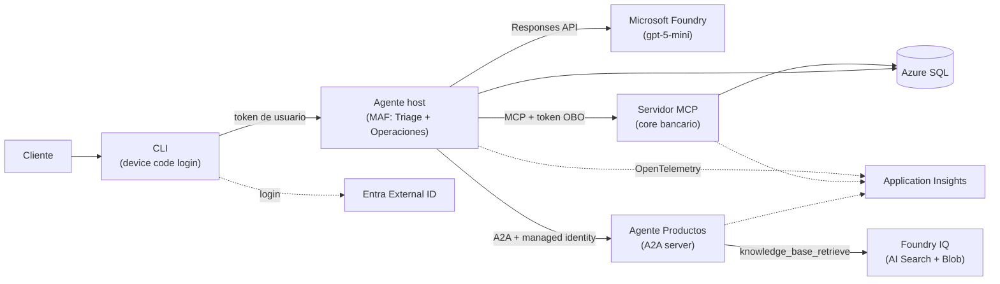

# Agente bancario con Microsoft Agent Framework y Microsoft Foundry

Agente conversacional para un banco ficticio, **Banco Andino Demo**, construido con criterios de producción: identidad real, aprobación humana para operaciones, idempotencia, resiliencia, trazas distribuidas y evaluaciones automatizadas. Usa Microsoft Agent Framework (MAF), Microsoft Foundry, MCP y A2A sobre Azure.

> Proyecto de portafolio. Todos los datos son 100 % sintéticos. No está afiliado a ningún banco real.

## Resumen en 30 segundos

| Pregunta | Respuesta |
|----------|-----------|
| Qué es | Un agente que atiende consultas de clientes bancarios y ejecuta operaciones de bajo riesgo con aprobación explícita. |
| Qué demuestra | Diseño de agentes de IA seguros y operables: mínimo privilegio, identidad delegada, pruebas en 6 capas, observabilidad de punta a punta. |
| Stack | Python, Microsoft Agent Framework 1.24, Microsoft Foundry (gpt-5-mini, Foundry IQ), MCP, A2A, Azure Container Apps, Azure SQL, Entra External ID, Terraform. |
| Estado | **v1 completa**: agente Operaciones con aprobación humana, servidor MCP y Azure SQL desplegados en Azure con Terraform. **Fases 3 a 7 desplegadas**: Productos responde con citas desde Foundry IQ, Triage deriva con `HandoffBuilder` y escala los temas sensibles, los clientes inician sesión con Entra External ID (OBO hacia el MCP), el host corre en Container Apps con sesiones durables y resiliencia, Productos es un servidor A2A con managed identity y trazas distribuidas, y la **fase 8** mide el agente con evaluaciones registradas en Foundry y un workflow con OIDC. **Todas las fases están hechas**; quedan pendientes las verificaciones que requieren inicio de sesión interactivo, la vista Compare del portal y el escaneo del red team en una región soportada. Ver [Hoja de ruta](#hoja-de-ruta). |

## Qué hace

| Capacidad | Ejemplo | Cómo lo resuelve |
|-----------|---------|------------------|
| Responde sobre productos con citas *(v1)* | "¿Cuál es la comisión de mantenimiento de la cuenta corriente?" | Base de conocimiento en Foundry IQ; cada respuesta cita su fuente. |
| Consulta datos del cliente *(v1)* | "¿Cuál es mi saldo?", "¿En qué va mi reclamo?" | Herramientas MCP sobre el core bancario simulado. |
| Ejecuta operaciones de bajo riesgo *(v1)* | "Bloquea mi tarjeta" | `block_card` y `open_claim`, solo con aprobación humana explícita. |
| Escala a una persona *(v1)* | Fraude, fallecimiento del titular, reclamos legales, o falta de fuente confiable | Herramienta `escalate_to_human` que crea un ticket. |

## Arquitectura en un vistazo



El diagrama muestra la arquitectura desplegada: agente host, servidor MCP y agente Productos (A2A) en Azure Container Apps, con Azure SQL, Foundry IQ y Entra External ID. Detalle completo en [docs/ARCHITECTURE.md](docs/ARCHITECTURE.md).

## MAF y Foundry: quién hace qué

| Responsabilidad | Microsoft Agent Framework (en nuestro código) | Microsoft Foundry (servicio gestionado) |
|-----------------|-----------------------------------------------|------------------------------------------|
| Bucle del agente | Sí, con `FoundryChatClient` (Responses API) | No: no usamos agentes server-side de Foundry Agent Service |
| Herramientas y cliente MCP | Sí | No |
| Aprobaciones humanas | Sí (`approval_mode`) | No |
| Orquestación (handoff) | Sí (`HandoffBuilder`) | No |
| A2A | Sí (`A2AExecutor`, experimental) | No |
| Sesiones | Sí (`session.to_dict()` persistido en Azure SQL) | No |
| Modelo | No | Sí: gpt-5-mini, Global Standard |
| Conocimiento | No | Sí: Foundry IQ (recuperación extractiva) |
| Trazas y evaluaciones | Emite OpenTelemetry | Sí: tracing, evaluaciones, AI Red Teaming Agent |

Regla de oro: **los saldos y movimientos nunca salen del RAG; las comisiones y reglas de producto nunca salen de SQL.**

## Cómo funciona una conversación

1. El cliente inicia sesión en la CLI con device code (Entra External ID) y obtiene un token para la API del agente.
2. El agente **Triage** clasifica la intención y transfiere la conversación (handoff).
3. Si es una pregunta de producto, responde **Productos** (remoto vía A2A) con citas de la base de conocimiento.
4. Si es una consulta u operación personal, responde **Operaciones** usando herramientas MCP con un token OBO.
5. Si la operación escribe datos (`block_card`, `open_claim`), el agente pide aprobación y la ejecuta una sola vez gracias a la `idempotency_key`.
6. Si no hay fuente confiable o el tema es sensible, se llama a `escalate_to_human`.
7. La sesión, incluidas las aprobaciones pendientes, se guarda en Azure SQL: cualquier réplica puede retomarla.

## Seguridad

| Amenaza | Control |
|---------|---------|
| Prompt injection del usuario | Instrucciones del agente, filtros DefaultV2 y detección de jailbreak de Foundry, red teaming automatizado. |
| Acceso a datos de otro cliente | Las herramientas MCP nunca reciben `customer_id` del LLM: la identidad sale del token Entra validado (`oid` -> `customer_id`). Cada id recibido valida pertenencia. Probado con tests adversariales. |
| Operaciones duplicadas | `idempotency_key` con restricción `UNIQUE` en SQL; un reintento devuelve el resultado original. |
| Operaciones no deseadas | `approval_mode` con `always_require` por defecto para herramientas de escritura. |
| Secretos filtrados | Cero secretos en el repositorio. Managed identity entre servicios, certificado OBO en Key Vault, CI con OIDC. |
| Inyección indirecta en documentos | Indirect Attack detection habilitada explícitamente (viene desactivada) vía `azurerm_cognitive_account_rai_policy`; fuentes de conocimiento versionadas en el repo. |
| Abuso y costos | Límite de longitud de entrada y rate limit por usuario en el agente host; alerta de presupuesto USD 20. |
| Fuga de datos vía caché | Solo se cachea la recuperación de conocimiento (no personal, con TTL); nunca respuestas con datos del cliente. |
| Exceso de privilegios entre agentes | Productos solo tiene conocimiento; Operaciones solo tiene herramientas MCP. |
| Trazabilidad | Auditoría de cada llamada a herramienta en SQL y trazas distribuidas en Application Insights. |

## Producción y resiliencia

| Aspecto | Implementación |
|---------|----------------|
| Reintentos | Backoff exponencial con jitter ante 429/5xx para modelo, MCP y A2A (MAF no los trae de serie). |
| Timeouts | Por llamada; MCP con `request_timeout` de 30 s y reconexión automática. |
| Circuit breaker | Hacia Productos (A2A): si está caído, Triage escala a una persona. |
| Sesiones durables | Estado de la conversación en Azure SQL; sobrevive al reinicio de una réplica. |
| Health checks | Probes de liveness y readiness en Container Apps. |
| Escalado | Mínimo 0 réplicas en desarrollo (costo); 1 el día de la demo. |
| Validación | Prueba de carga con locust y prueba de caos documentada (matar una réplica a mitad de conversación). |

## Cómo se prueba

| Capa | Qué valida | Herramienta |
|------|------------|-------------|
| 1. Unitarias de herramientas | Lógica y autorización sin LLM (ej. no puedes bloquear la tarjeta de otro cliente) | pytest |
| 2. Contrato MCP | Esquemas y comportamiento del servidor MCP | MCP Inspector + cliente MCP en pytest |
| 3. Escenarios | Trayectoria de herramientas con modelo real, N ejecuciones con umbral (ej. 4/5) | pytest + function middleware de MAF |
| 4. Evaluaciones | Exactitud de herramientas, groundedness, recuperación, consistencia | azure-ai-evaluation + Foundry |
| 5. Red teaming | Prompt injection y acceso cruzado entre clientes | pytest adversarial + AI Red Teaming Agent |
| 6. Trazas | Una sola traza distribuida de punta a punta | OpenTelemetry + Application Insights |

Dónde ver los resultados:

- **Foundry portal > Evaluations**: detalle por fila y comparación de ejecuciones.
- **GitHub Actions > Job Summary**: tabla con resultados de pytest y evaluaciones.
- **Application Insights > Agents (Preview)** y tracing de Foundry.

Prueba de A2A: `curl` a la agent card, `SendMessage` directo sin router, test de interoperabilidad con JSON-RPC crudo en `httpx`, A2A Inspector manual, traza única y prueba de resiliencia.

## Decisiones clave

| Decisión | ADR |
|----------|-----|
| MAF ejecuta el bucle del agente; Foundry aporta modelo, conocimiento y evaluación | [ADR-001](docs/DECISIONS.md#adr-001-maf-como-runtime-del-agente-y-foundry-como-plataforma) |
| Separación estricta de fuentes de verdad (RAG vs SQL) | [ADR-003](docs/DECISIONS.md#adr-003-separación-estricta-de-fuentes-de-verdad) |
| Handoff con mínimo privilegio por agente | [ADR-004](docs/DECISIONS.md#adr-004-orquestación-con-handoffbuilder-y-mínimo-privilegio) |
| Identidad del cliente desde el token, nunca desde el LLM | [ADR-005](docs/DECISIONS.md#adr-005-servidor-mcp-propio-con-identidad-derivada-del-token) |
| Aprobación humana e idempotencia en escrituras | [ADR-006](docs/DECISIONS.md#adr-006-aprobación-humana-obligatoria-para-escrituras), [ADR-007](docs/DECISIONS.md#adr-007-idempotencia-con-idempotency_key) |
| Entra External ID + OBO con certificado en Key Vault | [ADR-008](docs/DECISIONS.md#adr-008-managed-identity-entre-servicios-y-entra-external-id-para-clientes), [ADR-009](docs/DECISIONS.md#adr-009-obo-con-certificado-en-key-vault) |
| Azure SQL free offer para datos y sesiones | [ADR-011](docs/DECISIONS.md#adr-011-azure-sql-database-free-offer), [ADR-013](docs/DECISIONS.md#adr-013-sesiones-durables-en-azure-sql) |
| Productos remoto vía A2A, marcado experimental | [ADR-015](docs/DECISIONS.md#adr-015-agente-productos-remoto-vía-a2a) |
| Pirámide de pruebas de 6 capas y CI sin secretos | [ADR-019](docs/DECISIONS.md#adr-019-pirámide-de-pruebas-de-6-capas), [ADR-020](docs/DECISIONS.md#adr-020-ci-con-oidc-y-evaluaciones-bajo-demanda) |

Todas las decisiones: [docs/DECISIONS.md](docs/DECISIONS.md).

## Estado de las piezas

Verificado el 2026-11-06.

| Pieza | Estado | Uso en el proyecto |
|-------|--------|--------------------|
| Microsoft Agent Framework (`agent-framework` 1.24) | GA (desde 1.0, 2026-04-03) | Núcleo |
| `agent_framework.orchestrations` (HandoffBuilder) | Estable | Núcleo |
| `agent-framework-a2a` | Beta | Experimental (fase 7) |
| Hosting de agentes en Foundry | Beta | Solo fase bonus |
| Foundry IQ knowledge base (recuperación extractiva) | GA (abril 2026) | Núcleo |
| Foundry IQ answer synthesis | Preview | No se usa: la síntesis la hace el agente |
| Agentic retrieval en AI Search Free | Disponible en regiones seleccionadas | Núcleo; funciona en southcentralus (fallback híbrido no fue necesario) |
| Endpoint MCP de la knowledge base | Preview (`2026-08-01-preview`) | Núcleo: herramienta `knowledge_base_retrieve` del agente Productos |
| `azure-ai-evaluation` 1.18 | Estable | Evaluaciones |
| Evaluadores `tool_call_accuracy`, `groundedness` | GA | Evaluaciones |
| Evaluadores `intent_resolution`, `task_adherence` | Preview | Evaluaciones |
| AI Red Teaming Agent | Preview | Red teaming |
| Application Insights "Agents" view | Preview | Observabilidad |
| A2A spec | 1.0 | Protocolo |
| API ARM `ciamDirectories` (External ID) | Preview | No se usa: el tenant se crea manualmente |

## Estructura del repo

Planificada; se crea a medida que avanzan las fases.

```text
banking-agent-maf-foundry/
  README.md
  docs/                 ARCHITECTURE.md, DECISIONS.md, PLAN.md, guías por fase
  agent_host/           agentes MAF: triage, operaciones, handoff, sesiones, resiliencia, CLI
  productos_a2a/        agente Productos + servidor A2A
  mcp_server/           servidor MCP, herramientas, autorización, idempotencia, repositorio del core
  knowledge/            fuentes markdown, render a PDF, script de ingesta a Foundry IQ
  evals/                datasets, evaluadores, red team
  infra/                Terraform
  tests/                unit, contract, scenarios, a2a interop
  .github/workflows/    ci.yml, evals.yml (workflow_dispatch)
```

## Hoja de ruta

Las fases 0 a 8 están completas y desplegadas, con algunas verificaciones pendientes (listadas abajo). La fase bonus tiene diseño, decisiones y criterios de aceptación definidos en [docs/PLAN.md](docs/PLAN.md).

| Fase | Objetivo | Estado |
|------|----------|--------|
| 0 | Documentación y estructura | Hecha |
| 1 | Core bancario simulado + servidor MCP | Hecha |
| 1.5 | Infra base en Azure (Terraform) y MCP desplegado en Container Apps | Hecha |
| 2 | Agente MAF con aprobación humana | Hecha (v1) |
| 3 | Base de conocimiento | Hecha |
| 4 | Orquestación | Hecha |
| 5 | Identidad Entra | En curso: desplegada y verificada; falta la prueba interactiva con device code |
| 6 | Producción | Hecha: desplegada y verificada; falta la prueba de carga |
| 7 | A2A | Hecha: desplegada y verificada; faltan la conversación por `/chat`, la prueba con Productos detenido en Azure y A2A Inspector |
| 8 | Evaluaciones y observabilidad completas | Hecha: evaluaciones en Foundry, workflow con OIDC y tracing conectado; faltan la vista Compare en el portal y el escaneo del red team en una región soportada |
| Bonus | Hosted agents, RAG manual, UI web, doble OBO | Diseñada |

Detalle y criterios de aceptación en [docs/PLAN.md](docs/PLAN.md).

## Cómo ejecutarlo

Fase 1 (servidor MCP local, sin Azure). Requiere [uv](https://docs.astral.sh/uv/).

```bash
uv sync
cp .env.example .env
uv run --env-file .env python -m mcp_server.seed   # datos sintéticos en data/banco.db
uv run --env-file .env python -m mcp_server        # http://127.0.0.1:8000/mcp
uv run ruff check . && uv run ruff format --check . && uv run pytest
```

Para probar con MCP Inspector y ver qué hace cada archivo: [docs/guides/fase-1-mcp.md](docs/guides/fase-1-mcp.md).

Fase 2 (agente Operaciones en la CLI, con gpt-5-mini en Foundry y el MCP en Azure). Requiere `az login` con el rol Foundry User y la infraestructura de la [fase 1.5](docs/guides/fase-1-5-azure.md).

```bash
export FOUNDRY_PROJECT_ENDPOINT=$(terraform -chdir=infra output -raw foundry_project_endpoint)
export MCP_URL=$(terraform -chdir=infra output -raw mcp_url)
export DEV_CUSTOMER_ID=1
uv run python -m agent_host --agent operaciones              # chat; las escrituras piden "¿Apruebas? (s/n)"
uv run python -m agent_host --agent operaciones --ask "¿Cuál es mi saldo?"  # sin interacción
uv run pytest -m azure -v                                    # escenarios con el modelo real
```

Cómo funciona el agente, las aprobaciones y una transcripción real: [docs/guides/fase-2-agente.md](docs/guides/fase-2-agente.md).

Fase 3 (agente Productos con Foundry IQ). Requiere los recursos de conocimiento de [infra/README.md](infra/README.md) y haber corrido la ingesta.

```bash
export FOUNDRY_PROJECT_ENDPOINT=$(terraform -chdir=infra output -raw foundry_project_endpoint)
export SEARCH_ENDPOINT=$(terraform -chdir=infra output -raw search_endpoint)
uv run python -m agent_host --agent productos --ask "¿Cuánto cuesta la membresía de la Tarjeta Oro?"
uv run python evals/run_retrieval.py                         # evaluación de recuperación
```

Ingesta, qué hace Foundry IQ por dentro y una transcripción real: [docs/guides/fase-3-knowledge.md](docs/guides/fase-3-knowledge.md).

Fase 4 (Triage con handoff hacia Productos y Operaciones; es el modo por defecto de la CLI). Usa las variables de las fases 2 y 3 y el MCP con la imagen `mcp-server:v2`.

```bash
uv run python -m agent_host                                  # triage, interactivo
uv run python -m agent_host --ask "Me robaron la tarjeta y hay cargos que no reconozco"
uv run pytest -m azure tests/scenarios/test_triage_azure.py -s  # 5 ejecuciones por escenario
```

Handoff, mínimo privilegio, aprobaciones dentro del workflow y una transcripción real: [docs/guides/fase-4-orquestacion.md](docs/guides/fase-4-orquestacion.md).

Fase 5 (identidad real con Entra External ID). El MCP desplegado (`mcp-server:v3`) corre con `AUTH_MODE=entra`: valida el JWT y mapea `oid` a cliente. La CLI inicia sesión por device code y el host hace OBO con un certificado de Key Vault. Las variables `ENTRA_*` y los pasos están en la guía.

```bash
export AUTH_MODE=entra   # más ENTRA_AUTHORITY, ENTRA_*_CLIENT_ID y KEY_VAULT_URI (ver la guía)
uv run python -m agent_host --agent operaciones       # te pide iniciar sesión con un código
uv run pytest -m interactive -s -v                    # extremo a extremo con device code
```

Conceptos, secuencia, validación JWT y rechazos verificados: [docs/guides/fase-5-identidad.md](docs/guides/fase-5-identidad.md). Las pruebas `-m azure` de las fases 2 a 4 envían el header dev y ahora necesitan un MCP local en modo `dev`.

Fase 7 (Productos remoto por A2A). `productos-a2a` corre como Container App con ingress interno y expone la card en `/.well-known/agent-card.json` y JSON-RPC (`SendMessage`, `A2A-Version: 1.0`). El host lo llama con un token de su managed identity cuando `PRODUCTOS_A2A_URL` está definida; si no, usa Productos en proceso.

```bash
uv run pytest -q -m contract tests/contract/test_a2a_interop.py   # JSON-RPC crudo con httpx, sin Azure
```

Autenticación entre servicios, trazas, verificación en Azure y pendientes: [docs/guides/fase-7-a2a.md](docs/guides/fase-7-a2a.md).

Fase 8 (evaluaciones y observabilidad). El runner conduce el workflow de triage contra un MCP local con el seed (el MCP desplegado es interno), con el modelo y Foundry IQ reales, y registra cada ejecución en Foundry > Evaluations.

```bash
uv sync --group evals
uv run --group evals python -m evals.run_evals --name baseline   # 26 casos con jueces
gh workflow run evals.yml -f limit=6                              # mismo runner en GitHub, con OIDC
```

Pendientes por fase:

| Fase | Pendiente |
|------|-----------|
| 5 | Prueba interactiva con device code |
| 6 | Prueba de carga |
| 7 | Conversación por `/chat`, Productos detenido en Azure, A2A Inspector |
| 8 | Vista Compare en el portal, escaneo del AI Red Teaming Agent en una región soportada |

Dataset, jueces, resultados, red team y vista Agents: [docs/guides/fase-8-evaluaciones.md](docs/guides/fase-8-evaluaciones.md).

## Costos

Diseñado para costar casi cero en reposo.

| Recurso | Costo en reposo |
|---------|-----------------|
| Azure AI Search | Free tier (semantic ranker y agentic retrieval en plan free) |
| Storage account (PDF de productos) | Centavos al mes por < 1 MB |
| text-embedding-3-small | Por uso; la ingesta de 8 documentos cuesta menos de un centavo |
| Azure SQL Database | Free offer (100 000 vCore-s/mes, 32 GB, se pausa al llegar al límite: no factura) |
| Azure Container Apps | Scale-to-zero; grant gratuito de 180 000 vCPU-s/mes |
| gpt-5-mini | Por uso: aprox. USD 0,25 entrada / 2,00 salida por 1M tokens (fuente de terceros; verifica en la página oficial de precios) |

Controles: alerta de presupuesto de USD 20 y `terraform destroy` al final de cada sesión de trabajo.

## Aviso

Banco Andino Demo es una entidad ficticia. Los nombres, productos, comisiones y datos de clientes son inventados y no representan a ningún banco ni dato económico real.
