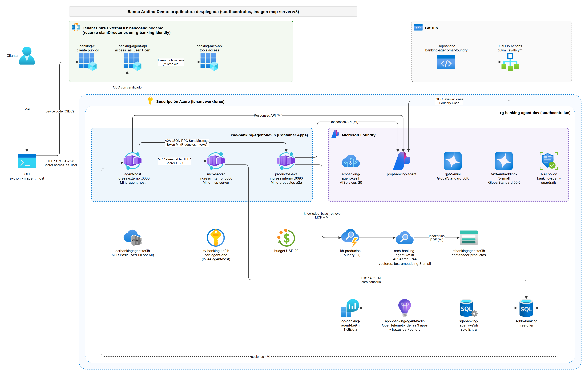
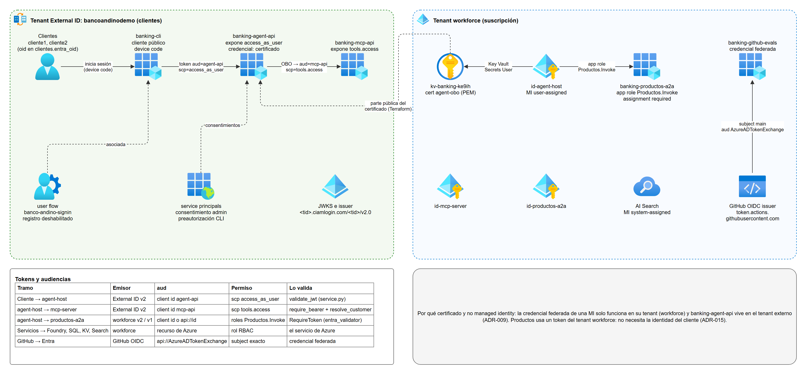
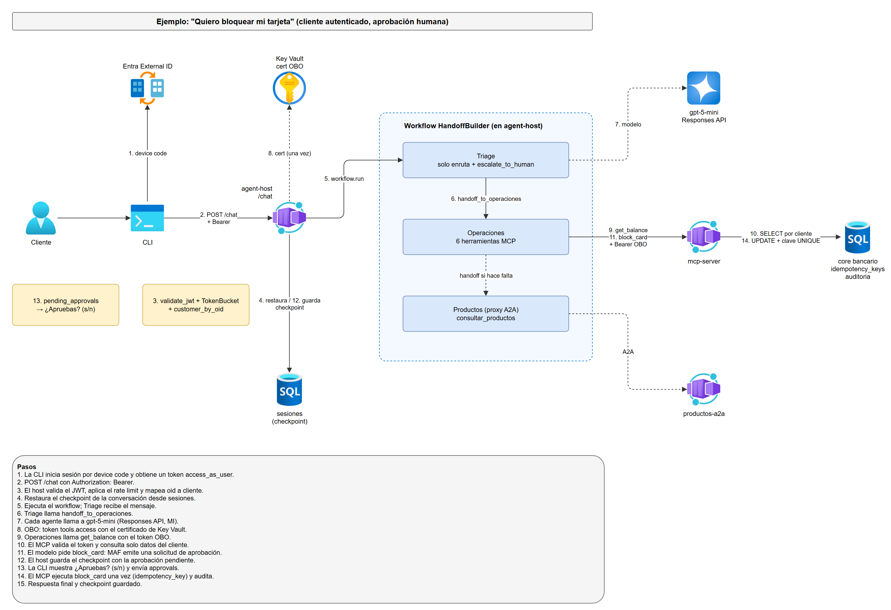
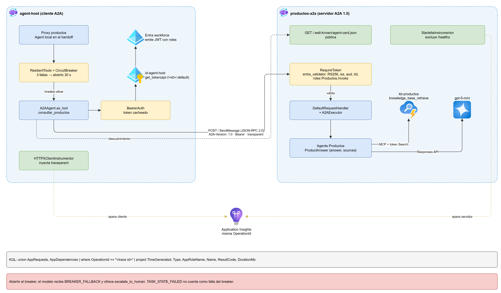
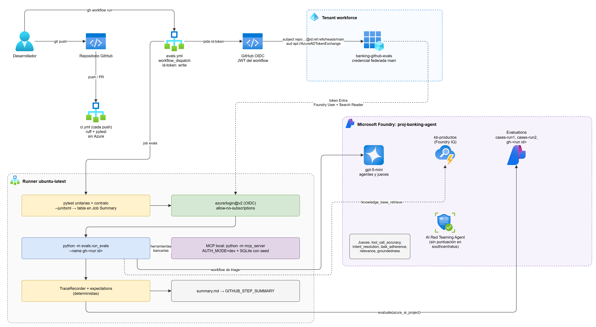

# Agente bancario con Microsoft Agent Framework y Foundry

Este repositorio es un asistente de atención al cliente para un banco que no existe, Banco Andino Demo. Lo construí para aprender a llevar un agente de IA a algo parecido a producción en Azure: clientes que inician sesión de verdad, operaciones que solo se ejecutan si la persona las aprueba, sesiones que sobreviven a la caída de un servidor y evaluaciones que dicen si el agente responde bien.

Todos los datos son sintéticos. El proyecto no tiene relación con ningún banco real.



## Estado

Las fases 0 a 8 del [plan](docs/PLAN.md) están terminadas. Todo estuvo desplegado en Azure (región southcentralus) y se verificó ahí. El 2026-11-08 destruí la infraestructura para no seguir pagando, y deshabilité los workflows `CI` y `Evals` de GitHub. El código, el Terraform y las guías permiten volver a levantarlo; los pasos están en [docs/guia/08-operacion.md](docs/guia/08-operacion.md).

Quedaron sin hacer algunas verificaciones que necesitaban iniciar sesión a mano o un paso en el portal:

| Fase | Qué falta |
|------|-----------|
| 5 | Prueba de punta a punta con device code |
| 6 | Prueba de carga contra Azure (el script está listo, ver la [guía](docs/guides/fase-6-produccion.md)) |
| 7 | Una conversación por `/chat` pasando por A2A, Productos apagado en Azure, A2A Inspector |
| 8 | Comparar dos corridas en el portal de Foundry; el red team de Azure no puntúa ataques en southcentralus |

## Qué puede hacer un cliente

| Pide | Qué pasa |
|------|----------|
| "¿Cuánto cuesta la membresía de la Tarjeta Oro?" | El agente Productos busca en los documentos del banco (Foundry IQ) y responde citando el documento. |
| "¿Cuál es mi saldo?" | El agente Operaciones llama a una herramienta del servidor MCP, que lee el saldo en Azure SQL. |
| "Bloquea mi tarjeta" | Operaciones prepara el bloqueo y pregunta "¿Apruebas?". Solo con un sí se ejecuta, y una sola vez aunque se reintente. |
| "Me robaron la tarjeta y hay cargos raros" | Triage detecta un posible fraude y lo deriva a una persona con `escalate_to_human`. |

El cliente nunca le dice al agente quién es. El servidor MCP saca la identidad del token de Entra; si el modelo intenta consultar el reclamo de otro cliente, el servidor lo rechaza. Esto pasó de verdad en las evaluaciones adversariales y el rechazo funcionó.

## Cómo funciona

Hay tres servicios en Azure Container Apps, todos con la misma imagen y distinto comando:

- `agent-host`: el único con acceso desde internet. Corre los agentes con Microsoft Agent Framework (MAF). Triage recibe la conversación y la pasa a Operaciones o a Productos.
- `mcp-server`: expone el core bancario como herramientas MCP. Solo se llega a él desde dentro del entorno.
- `productos-a2a`: el agente Productos como servicio aparte, al que el host llama por el protocolo A2A.

Foundry pone el modelo (gpt-5-mini), la base de conocimiento, los filtros de contenido y las evaluaciones. El bucle del agente, las herramientas, las aprobaciones y las sesiones viven en nuestro código.

### Identidad



El cliente inicia sesión en la CLI con device code contra un tenant de Entra External ID. El host recibe ese token y lo cambia por otro dirigido al MCP (On-Behalf-Of), firmado con un certificado guardado en Key Vault. Entre servicios no hay contraseñas: cada app tiene su managed identity, y SQL solo acepta autenticación de Entra.

### Una conversación



La sesión, incluida una aprobación pendiente, se guarda en la tabla `sesiones` de Azure SQL. Si la réplica muere a mitad de la conversación, otra la retoma. Hay un test de caos que mata el proceso con la aprobación pendiente y comprueba que la operación se ejecuta exactamente una vez.

### A2A y trazas



El host llama a Productos con un token de su managed identity que lleva el rol `Productos.Invoke`; sin él la respuesta es 401. Si Productos falla varias veces, un circuit breaker deja de llamarlo y la conversación se escala a una persona. Las trazas se propagan entre servicios, así que una llamada aparece como una sola traza en Application Insights.

### Evaluaciones y CI



El workflow `evals.yml` entra a Azure con OIDC (sin secretos guardados en GitHub), corre los tests y las evaluaciones, y deja las tablas en el Job Summary.

Los otros diagramas (red y modelo de datos) están en [docs/diagramas](docs/diagramas/README.md). El archivo fuente es `docs/diagramas/banking-agent.drawio`.

## Resultados

- 169 tests unitarios y 26 de contrato, que incluyen los de caos y una prueba de interoperabilidad A2A con JSON-RPC crudo.
- Dos corridas de evaluación en Foundry con 26 casos cada una, los 26 aprobados en ambas. Precisión de herramientas 4,52 y 4,65 sobre 5; groundedness 4,42 y 4,73.
- 7 de 7 casos adversariales respondidos de forma segura (inyección en documentos, suplantación, saltarse la aprobación).
- Las evaluaciones costaron unos US$0,90.

Detalle en [docs/guides/fase-8-evaluaciones.md](docs/guides/fase-8-evaluaciones.md).

## Stack

| Pieza | Versión o tier |
|-------|----------------|
| Python con uv | 3.12 |
| Microsoft Agent Framework | `agent-framework-core` 1.24, orchestrations 1.4, `agent-framework-a2a` 1.0 beta |
| MCP | SDK `mcp` 2.x, streamable HTTP |
| Modelo | gpt-5-mini y text-embedding-3-small en Foundry, Global Standard |
| Conocimiento | Foundry IQ sobre Azure AI Search Free y Blob Storage |
| Datos | Azure SQL Database (free offer) |
| Identidad | Entra External ID para clientes, managed identities entre servicios |
| Evaluación | `azure-ai-evaluation` 1.18 |
| Infraestructura | Terraform (`azurerm`, `azuread`, `azapi`) |

## Documentación

Si quieres entender el proyecto pieza por pieza, empieza por la [guía de aprendizaje](docs/guia/README.md). Explica los conceptos desde cero, cada servicio de Azure, la construcción fase por fase, las decisiones y los flujos.

Otras referencias:

- [docs/guides](docs/guides): una guía por fase, con comandos, verificaciones y problemas encontrados.
- [docs/DECISIONS.md](docs/DECISIONS.md): las decisiones de arquitectura (ADR) con sus alternativas.
- [docs/ARCHITECTURE.md](docs/ARCHITECTURE.md): la arquitectura de referencia.
- [docs/PLAN.md](docs/PLAN.md): fases y criterios de aceptación.

## Estructura

```text
agent_host/    agentes MAF, handoff, sesiones, resiliencia, servidor HTTP, CLI, servidor A2A de Productos
mcp_server/    servidor MCP, herramientas, validación de tokens, idempotencia, datos sintéticos
knowledge/     documentos de productos e ingesta a Foundry IQ
evals/         datasets, runner de evaluaciones y red team
infra/         Terraform
tests/         unit, contract (incluye caos e interoperabilidad A2A), scenarios, load
docs/          guía, guías por fase, ADR, diagramas
```

## Ejecutarlo en local

El servidor MCP y los tests no necesitan Azure:

```bash
uv sync
cp .env.example .env
uv run --env-file .env python -m mcp_server.seed   # datos sintéticos en data/banco.db
uv run --env-file .env python -m mcp_server        # http://127.0.0.1:8000/mcp
uv run pytest                                      # unitarios
uv run pytest -m contract                          # contrato, caos e interoperabilidad A2A
```

Para el agente con el modelo real hace falta la infraestructura de Azure; los comandos están en cada guía de fase.

## Costos

En reposo costaba casi nada: AI Search en tier Free, SQL con la free offer, Container Apps con escala a cero y una alerta de presupuesto de USD 20. El gasto real fue el uso del modelo.
