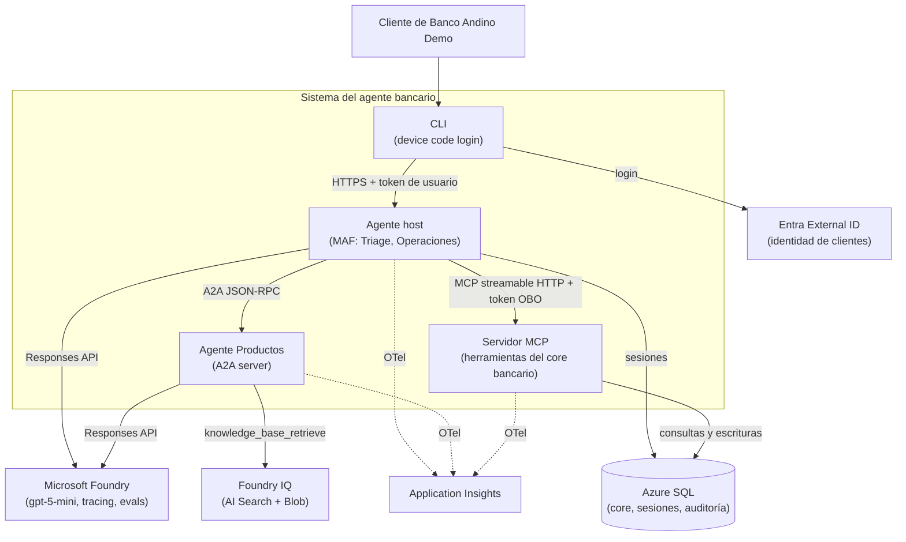
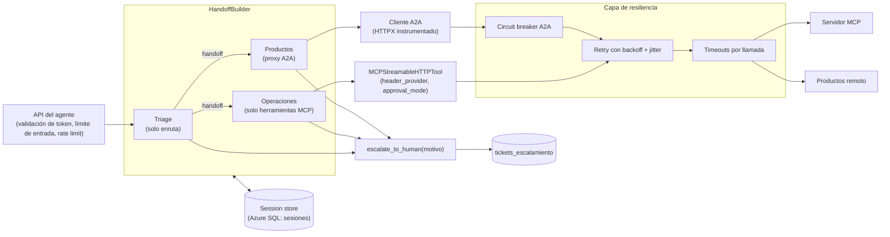
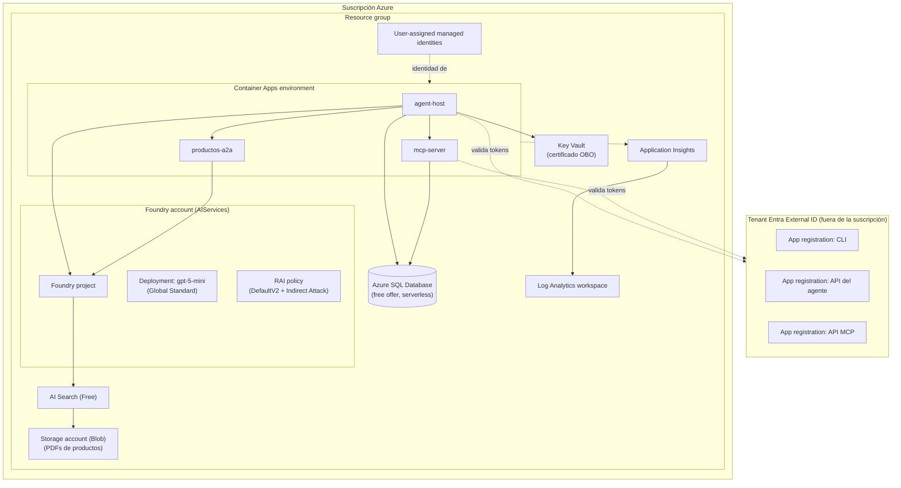
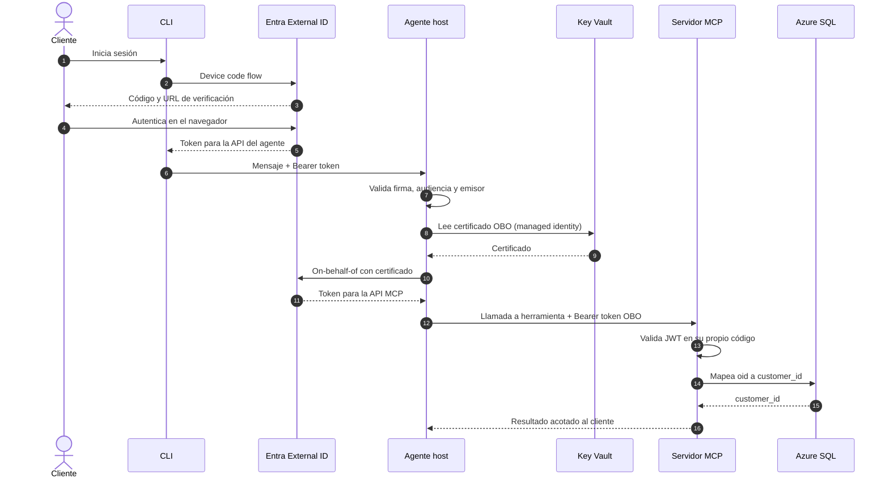
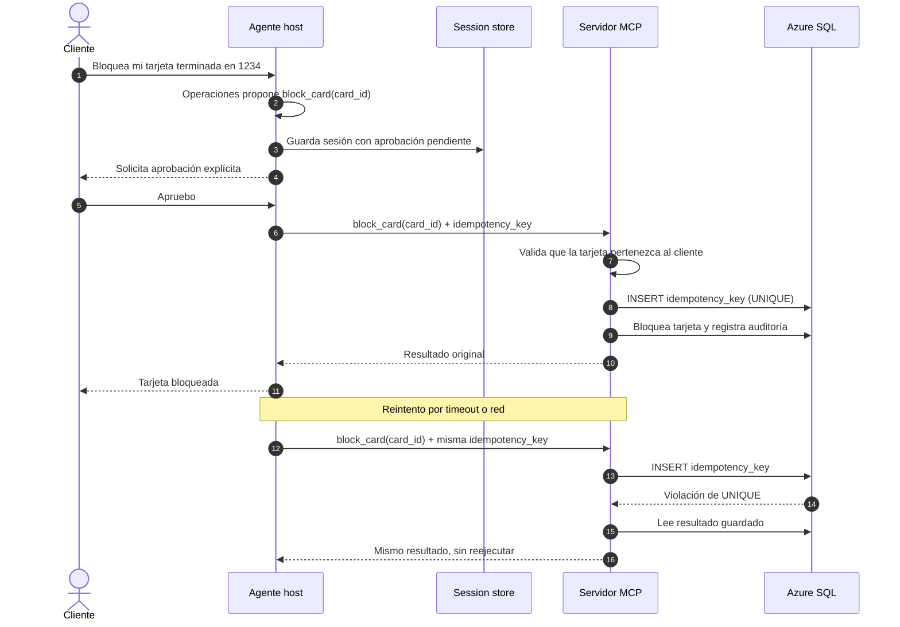
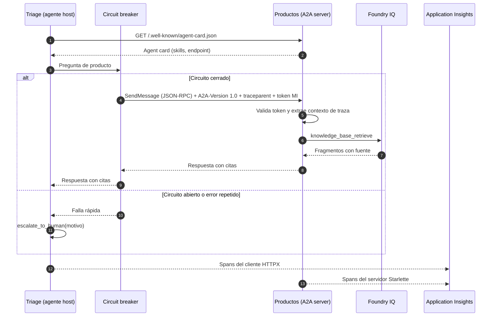
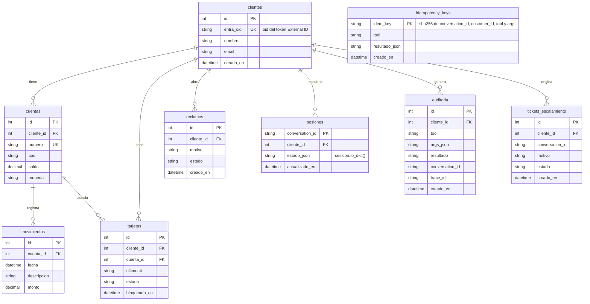
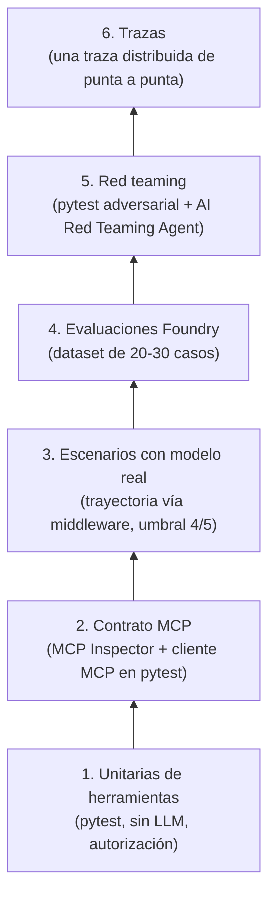

# Arquitectura

El sistema separa tres responsabilidades: **razonar** (agentes MAF en nuestro código), **saber** (Foundry IQ para productos) y **operar** (servidor MCP sobre el core bancario). Cada agente tiene solo los permisos que necesita y la identidad del cliente viaja en tokens validados, nunca en el texto del LLM.

Contenido:

1. [Contexto](#1-contexto)
2. [Componentes del agente host](#2-componentes-del-agente-host)
3. [Despliegue en Azure](#3-despliegue-en-azure)
4. [Flujo de identidad](#4-flujo-de-identidad)
5. [Aprobación humana e idempotencia](#5-aprobación-humana-e-idempotencia)
6. [Llamada A2A a Productos](#6-llamada-a2a-a-productos)
7. [Modelo de datos](#7-modelo-de-datos)
8. [Conocimiento y RAG](#8-conocimiento-y-rag)
9. [Resiliencia](#9-resiliencia)
10. [Estrategia de pruebas](#10-estrategia-de-pruebas)

Las razones de cada decisión están en [DECISIONS.md](DECISIONS.md).

---

## 1. Contexto

| Elemento | Responsabilidad | Tecnología |
|----------|-----------------|------------|
| CLI | Interfaz del cliente, login por device code | Python, MSAL |
| Agente host | Bucle del agente, orquestación, aprobaciones, sesiones | MAF 1.24 (`FoundryChatClient`) |
| Agente Productos | Responde preguntas de productos con citas | MAF + `agent-framework-a2a` (beta) |
| Servidor MCP | Herramientas sobre datos del cliente; autorización e idempotencia | Python MCP SDK, streamable HTTP |
| Microsoft Foundry | Modelo, tracing, evaluaciones | gpt-5-mini Global Standard |
| Foundry IQ | Base de conocimiento de productos | AI Search Free + Blob Storage |
| Azure SQL | Core bancario, sesiones, auditoría, idempotencia | Free offer, auth solo Entra |
| Entra External ID | Identidad de clientes | Tenant externo |
| Application Insights | Trazas distribuidas y métricas | OpenTelemetry |

---

## 2. Componentes del agente host

| Componente | Herramientas | Qué no puede hacer |
|------------|--------------|--------------------|
| Triage | Handoff, `escalate_to_human` | Leer datos del cliente ni la base de conocimiento |
| Operaciones | Herramientas MCP, `escalate_to_human` | Consultar la base de conocimiento |
| Productos | `knowledge_base_retrieve`, `escalate_to_human` | Acceder a datos del cliente |

Temas que siempre escalan: fraude, fallecimiento del titular, reclamos legales y cualquier pregunta sin fuente confiable.

### Herramientas MCP

| Herramienta | Tipo | Aprobación | Notas |
|-------------|------|------------|-------|
| `get_balance()` | Lectura | No | Cliente derivado del token |
| `list_transactions(from, to)` | Lectura | No | Rango validado con pydantic |
| `get_claim_status(claim_id)` | Lectura | No | Valida que el reclamo pertenezca al cliente |
| `block_card(card_id)` | Escritura | Sí | Valida pertenencia; idempotente por naturaleza |
| `open_claim(motivo)` | Escritura | Sí | Protegida con `idempotency_key` |

Reglas del servidor MCP:

- Ninguna herramienta recibe `customer_id`: sale del claim `oid` del token validado.
- Toda entrada se valida con tipos (pydantic).
- Cada llamada queda en la tabla `auditoria`.

---

## 3. Despliegue en Azure

| Recurso | SKU / modo | Provisión |
|---------|------------|-----------|
| Foundry account + project | AIServices | `azurerm_cognitive_account`, `azurerm_cognitive_account_project` |
| gpt-5-mini | Global Standard | `azurerm_cognitive_deployment` |
| RAI policy | DefaultV2 + Indirect Attack | `azurerm_cognitive_account_rai_policy` |
| AI Search | Free | `azurerm_search_service` |
| Storage | Blob | `azurerm_storage_account` |
| Azure SQL | Free offer, serverless, AutoPause | `azapi` (`useFreeLimit`) |
| Container Apps | 3 apps, scale-to-zero | `azurerm_container_app` |
| Key Vault | RBAC | `azurerm_key_vault` |
| Managed identities | User-assigned | `azurerm_user_assigned_identity` |
| Observabilidad | Log Analytics + App Insights | `azurerm_log_analytics_workspace`, `azurerm_application_insights` |
| App registrations | Tenant externo | `azuread` apuntando al tenant de External ID |
| Tenant External ID | — | Manual, una vez, documentado |
| Knowledge source y KB | — | Script Python (objetos de data plane) |

La región se fija en la fase de infraestructura: debe ofrecer gpt-5-mini Global Standard y agentic retrieval en AI Search Free.

---

## 4. Flujo de identidad

| Tramo | Mecanismo | Motivo |
|-------|-----------|--------|
| Cliente a agente | Device code (External ID) | Soportado en External ID; ideal para CLI |
| Agente a MCP | OBO con certificado | El MCP necesita la identidad del usuario; la federated credential de managed identity no cruza de tenant workforce a externo |
| Servicios a Foundry, SQL, Key Vault | Managed identity | Sin secretos |
| Agente a Productos | Managed identity (token Entra) | Productos no necesita identidad del usuario |

---

## 5. Aprobación humana e idempotencia

- `idempotency_key = sha256(conversation_id + customer_id + tool + args normalizados)`. `customer_id` evita que dos clientes con el mismo `conversation_id` compartan un resultado.
- Idempotencia (escrituras) no es lo mismo que consistencia (misma pregunta, misma respuesta). La consistencia se trata en la [sección 8](#8-conocimiento-y-rag).

---

## 6. Llamada A2A a Productos

| Aspecto | Decisión |
|---------|----------|
| Protocolo | A2A 1.0, JSON-RPC, método `SendMessage`, header `A2A-Version: 1.0` |
| Descubrimiento | `/.well-known/agent-card.json` |
| Autenticación | Token Entra de managed identity |
| Trazas | Instrumentación manual de HTTPX (cliente) y Starlette (servidor); MAF solo inyecta `traceparent` en MCP |
| Criterio de aceptación | Una sola traza distribuida en Application Insights |
| Fallback | Circuit breaker abierto: Triage escala a una persona |
| Estado | `agent-framework-a2a` es beta: componente experimental |

---

## 7. Modelo de datos

| Tabla | Propósito |
|-------|-----------|
| `clientes`, `cuentas`, `tarjetas`, `movimientos`, `reclamos` | Core bancario simulado (datos sintéticos con seed fija) |
| `idempotency_keys` | Garantiza ejecución única de escrituras |
| `sesiones` | Estado durable de la conversación, incluidas aprobaciones pendientes |
| `auditoria` | Registro de cada llamada a herramienta |
| `tickets_escalamiento` | Casos derivados a una persona |

---

## 8. Conocimiento y RAG

Las preguntas de productos se responden **solo** con fuentes recuperadas y citadas. Si no hay fuente, la respuesta es "no tengo esa información" o un escalamiento.

| Paso | Quién lo hace |
|------|---------------|
| Redacción de 6-8 documentos de productos ficticios | Markdown versionado en `knowledge/` |
| Render a PDF y carga a Blob | Script del repo |
| Ingesta, chunking, embeddings | Foundry IQ (gestionado) |
| Búsqueda híbrida y recuperación con fuente | Foundry IQ sobre AI Search (agentic retrieval) |
| Síntesis de la respuesta | Agente Productos (la síntesis de Foundry IQ está en preview) |
| Consumo | Endpoint MCP de la KB, herramienta `knowledge_base_retrieve` |

Consistencia de respuestas:

- gpt-5-mini es un modelo de razonamiento: no admite `temperature`; se fija `reasoning_effort`.
- Salida estructurada para las citas.
- Evaluación de consistencia: la misma pregunta 5 veces, comparando cifra y fuente.
- Caché solo de la recuperación (contenido no personal, con TTL), nunca de respuestas finales con datos del cliente.

Evaluaciones separadas: **recuperación** (se trajo el fragmento correcto) y **respuesta** (se usó bien y se citó).

---

## 9. Resiliencia

| Falla | Respuesta del sistema |
|-------|-----------------------|
| 429 o 5xx del modelo, MCP o A2A | Retry con backoff exponencial y jitter |
| Llamada lenta | Timeout por llamada (MCP: 30 s, con reconexión automática) |
| Productos caído | Circuit breaker abierto: escalamiento a una persona |
| Réplica reiniciada a mitad de conversación | Otra réplica retoma la sesión desde Azure SQL |
| Aprobación pendiente durante un reinicio | Persistida en la sesión; sigue disponible |
| Contenedor no saludable | Probes de liveness y readiness |
| Azure SQL en pausa | Primera consulta lenta; se precalienta antes de una demo |

---

## 10. Estrategia de pruebas

| Capa | Frecuencia | Requiere Azure |
|------|------------|----------------|
| 1. Unitarias | Cada push | No |
| 2. Contrato MCP | Cada push | No |
| 3. Escenarios | `workflow_dispatch` | Sí |
| 4. Evaluaciones | `workflow_dispatch` | Sí |
| 5. Red teaming | `workflow_dispatch` | Sí (la parte adversarial del MCP corre local) |
| 6. Trazas | Manual en la demo | Sí |

Pruebas específicas de A2A:

- [ ] `curl` a la agent card.
- [ ] `SendMessage` directo, sin router.
- [ ] Test de interoperabilidad con JSON-RPC crudo en `httpx` (sin MAF ni cliente a2a-sdk).
- [ ] Verificación manual con A2A Inspector (`ghcr.io/a2aproject/a2a-inspector`).
- [ ] Una sola traza de punta a punta en Application Insights.
- [ ] Productos detenido: la conversación escala a una persona.
