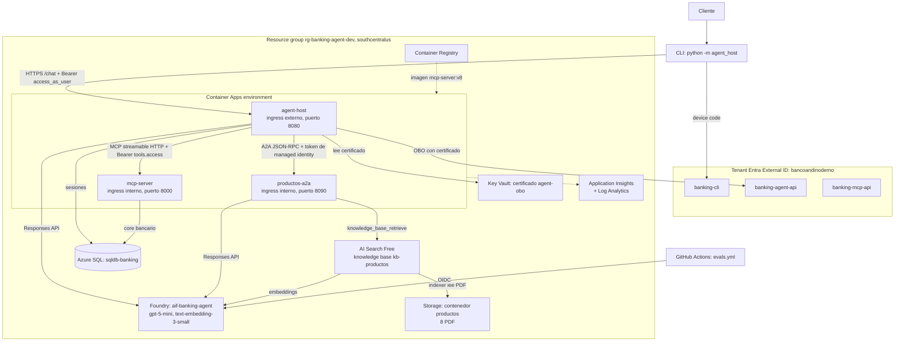
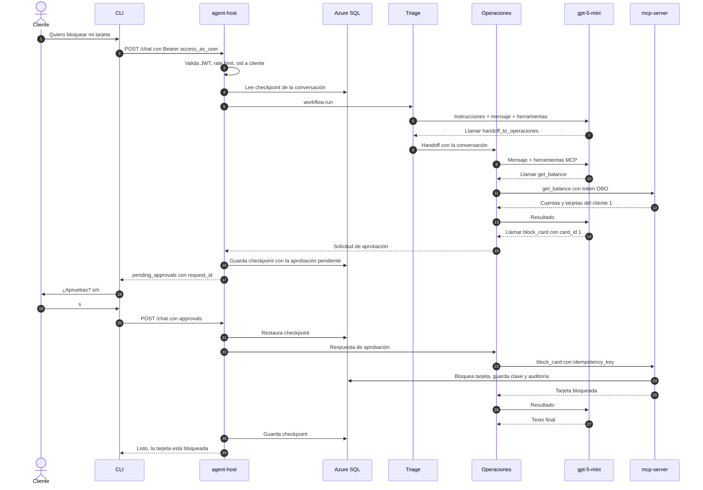

# 00. Visión general

[Índice de la guía](README.md) · Siguiente: [01. Conceptos](01-conceptos.md)

Este capítulo responde tres preguntas: qué hace el sistema, de qué piezas está hecho y qué ocurre, paso a paso, cuando un cliente escribe un mensaje.

## 1. Qué hace el sistema

Banco Andino Demo es un banco ficticio. El sistema es un **agente conversacional** que atiende a sus clientes desde una línea de comandos (CLI). Puede:

| Capacidad | Ejemplo de mensaje | Quién lo resuelve |
|-----------|-------------------|-------------------|
| Responder sobre productos, con citas | "¿Cuánto cuesta la membresía de la Tarjeta Oro?" | Agente **Productos**, con la base de conocimiento de Foundry IQ |
| Consultar datos del propio cliente | "¿Cuál es mi saldo?", "¿En qué va mi reclamo 1?" | Agente **Operaciones**, con herramientas MCP sobre el core bancario |
| Ejecutar operaciones de bajo riesgo | "Bloquea mi tarjeta" | Operaciones, **solo con aprobación explícita** del cliente |
| Derivar a una persona | "Me robaron la tarjeta", "Mi padre falleció", "Voy a demandar al banco" | Herramienta `escalate_to_human`, que crea un ticket |

Lo importante no es lo que hace, sino **cómo** lo hace: con criterios de producción.

> **Por qué importa.** Un agente de demostración que "funciona" es fácil. Lo difícil es que sea seguro (no filtra datos de otro cliente aunque lo engañen), confiable (no duplica operaciones al reintentar), operable (sobrevive a reinicios, se puede observar) y medible (se evalúa con evidencia). Todo el proyecto gira en torno a esas cuatro propiedades.

## 2. Historias de usuario

| Como... | Quiero... | Para... | Control que lo garantiza |
|---------|-----------|---------|--------------------------|
| Cliente | Iniciar sesión con mi correo y contraseña desde la CLI | Que el agente sepa quién soy sin escribir mi número de cliente | Device code con Entra External ID |
| Cliente | Preguntar por tarifas y requisitos | Recibir una respuesta con la fuente | Foundry IQ y salida estructurada `ProductAnswer` |
| Cliente | Ver mi saldo y movimientos | Atender mis dudas sin llamar al banco | Herramientas MCP; el cliente sale del token, nunca del texto |
| Cliente | Bloquear mi tarjeta | Protegerme ante una pérdida | `approval_mode`: el sistema pide "¿Apruebas? (s/n)" |
| Cliente | Que un reintento no me cree dos reclamos | Evitar duplicados | `idempotency_key` con restricción `UNIQUE` en SQL |
| Cliente | Hablar con una persona ante fraude | Recibir atención humana | `escalate_to_human` con categoría `fraude` |
| Banco | Que nadie vea datos de otro cliente | Cumplir confidencialidad | Validación JWT en el MCP y mapeo `oid` a `customer_id` |
| Banco | Medir la calidad del agente | Detectar regresiones | Evaluaciones en Foundry y workflow `evals.yml` |
| Operador | Que una réplica caída no corte la conversación | Alta disponibilidad | Sesiones durables en la tabla `sesiones` |

## 3. Arquitectura completa

La misma arquitectura, con los iconos oficiales de Azure, está en la página "Arquitectura general" de [banking-agent.drawio](../diagramas/README.md).

## 4. Componentes

### Piezas de software

| Componente | Responsabilidad | Código | Dónde corre |
|------------|-----------------|--------|-------------|
| CLI | Interfaz del cliente, inicio de sesión, aprobaciones | `agent_host/cli.py` | Máquina del cliente |
| Agente host | API HTTP `/chat`; valida el token, aplica rate limit, ejecuta el workflow, guarda la sesión | `agent_host/service.py` | Container App `agent-host` |
| Triage | Clasifica la intención y transfiere (handoff) | `agent_host/workflow.py` | Dentro del host |
| Operaciones | Consultas y operaciones del cliente vía MCP | `agent_host/agent.py` | Dentro del host |
| Productos (proxy) | Representa a Productos dentro del workflow y lo llama por A2A | `agent_host/productos.py` | Dentro del host |
| Productos (servidor A2A) | Responde con citas desde Foundry IQ | `agent_host/productos_a2a.py` | Container App `productos-a2a` |
| Servidor MCP | Herramientas bancarias, autorización, idempotencia, auditoría | `mcp_server/` | Container App `mcp-server` |
| Capa de resiliencia | Reintentos, circuit breaker, reintentos SQL | `agent_host/resilience.py` | Host y Productos |
| Sesiones durables | Checkpoint del workflow en SQL | `agent_host/sessions.py` | Host |
| Telemetría | OpenTelemetry hacia Application Insights | `agent_host/telemetry.py` | Host y Productos |
| Ingesta de conocimiento | Markdown a PDF a Blob; crea la knowledge base | `knowledge/` | Tu máquina, una vez |
| Evaluaciones | Dataset, jueces, red team | `evals/` | Tu máquina o GitHub Actions |
| Infraestructura | Todos los recursos de Azure y Entra | `infra/` | Terraform |

### Servicios gestionados

| Servicio | Para qué | Capítulo |
|----------|----------|----------|
| Microsoft Foundry (cuenta AIServices + proyecto) | Modelo gpt-5-mini, embeddings, guardrails, evaluaciones, tracing | [02](02-servicios-azure.md#foundry-cuenta-proyecto-y-despliegues) |
| Foundry IQ sobre Azure AI Search | Base de conocimiento de productos | [02](02-servicios-azure.md#azure-ai-search-y-foundry-iq) |
| Azure SQL Database (free offer) | Core bancario, sesiones, auditoría, idempotencia, tickets | [02](02-servicios-azure.md#azure-sql-server-y-base-sqldb-banking) |
| Azure Container Apps | Los tres servicios | [02](02-servicios-azure.md#container-apps-environment-y-las-tres-apps) |
| Key Vault | Certificado del OBO | [02](02-servicios-azure.md#key-vault-y-certificado-agent-obo) |
| Entra External ID | Identidad de los clientes | [02](02-servicios-azure.md#tenant-entra-external-id) |
| Application Insights + Log Analytics | Trazas, logs y métricas | [02](02-servicios-azure.md#log-analytics-y-application-insights) |

## 5. Reglas de oro del diseño

1. **El cliente sale del token, nunca del texto.** Ninguna herramienta MCP recibe `customer_id`. El servidor lo obtiene del claim `oid` de un token validado.
2. **Fuentes de verdad separadas.** Los saldos nunca salen del RAG; las tarifas nunca salen de SQL.
3. **Mínimo privilegio por agente.** Triage solo enruta; Productos solo lee conocimiento; Operaciones solo usa el MCP.
4. **Toda escritura necesita aprobación.** La aprobación es un control del framework, no una pregunta del modelo.
5. **Todo reintento es seguro.** Las escrituras son idempotentes en la base de datos.
6. **Cero secretos.** Managed identity entre servicios, certificado en Key Vault para el OBO, OIDC en CI.
7. **Ninguna réplica tiene estado propio.** La conversación vive en SQL.

## 6. Una conversación de punta a punta

Supongamos que el cliente 1 ya inició sesión y escribe: **"Quiero bloquear mi tarjeta"**.

Lo que ocurre en cada paso, en palabras:

| Paso | Qué ocurre | Dónde mirarlo |
|------|------------|---------------|
| 1-2 | La CLI envía el mensaje al host con el token del cliente (audiencia `banking-agent-api`, scope `access_as_user`). | `agent_host/cli.py`, `run_remote` |
| 3 | El host valida firma, emisor, audiencia y vigencia del token, aplica el rate limit por usuario y mapea `oid` al cliente. | `service.py`, `entra_authenticator` |
| 4 | Si la conversación existe, comprueba que sea del mismo cliente y restaura su checkpoint. | `sessions.py`, `SqlCheckpointStorage` |
| 5-8 | Triage decide a quién transferir. El handoff es una herramienta (`handoff_to_operaciones`) que el framework intercepta. | `workflow.py` |
| 9-13 | Operaciones consulta las tarjetas. El `header_provider` agrega el token OBO; el MCP valida el token y responde solo con datos del cliente 1. | `agent.py`, `mcp_server/auth.py` |
| 14-17 | El modelo pide `block_card`. MAF no la ejecuta: emite una solicitud de aprobación. El host guarda el checkpoint y devuelve `pending_approvals`. | `service.py`, `advance` |
| 18-22 | El cliente aprueba. Otra réplica podría atender este turno: restaura el checkpoint desde SQL. | `service.py` |
| 23-25 | El MCP ejecuta `block_card` una sola vez gracias a la `idempotency_key`, y registra la auditoría. | `mcp_server/banking.py` |
| 26-29 | El modelo redacta la respuesta final; el host guarda el checkpoint y responde. | `service.py` |

Si la pregunta hubiera sido de productos, Triage habría transferido al proxy de Productos, que llama al servidor `productos-a2a` por A2A. Ese flujo y los demás están en [05. Flujos](05-flujos.md).

## 7. Estado del proyecto

Las fases 0 a 8 están desplegadas en Azure (las tres Container Apps corren la imagen `mcp-server:v8`). Quedan pendientes, porque requieren acciones manuales o interactivas:

| Pendiente | Motivo |
|-----------|--------|
| Prueba interactiva de identidad (`pytest -m interactive`) | Requiere un inicio de sesión humano por device code |
| Prueba de carga con locust | Requiere un token obtenido por device code |
| Conversación completa por `/chat` con traza única, Productos detenido en Azure, A2A Inspector | Requieren device code o verificación manual |
| Vista Compare de evaluaciones en el portal | Acción manual en el portal |
| Escaneo del AI Red Teaming Agent con resultados | El servicio de puntuación no está disponible en `southcentralus` |

Detalle en [03. Paso a paso](03-paso-a-paso.md) y [08. Operación](08-operacion.md).
