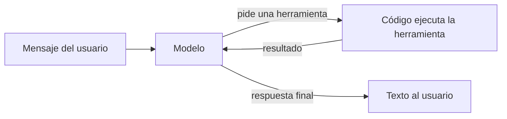
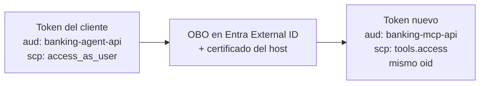
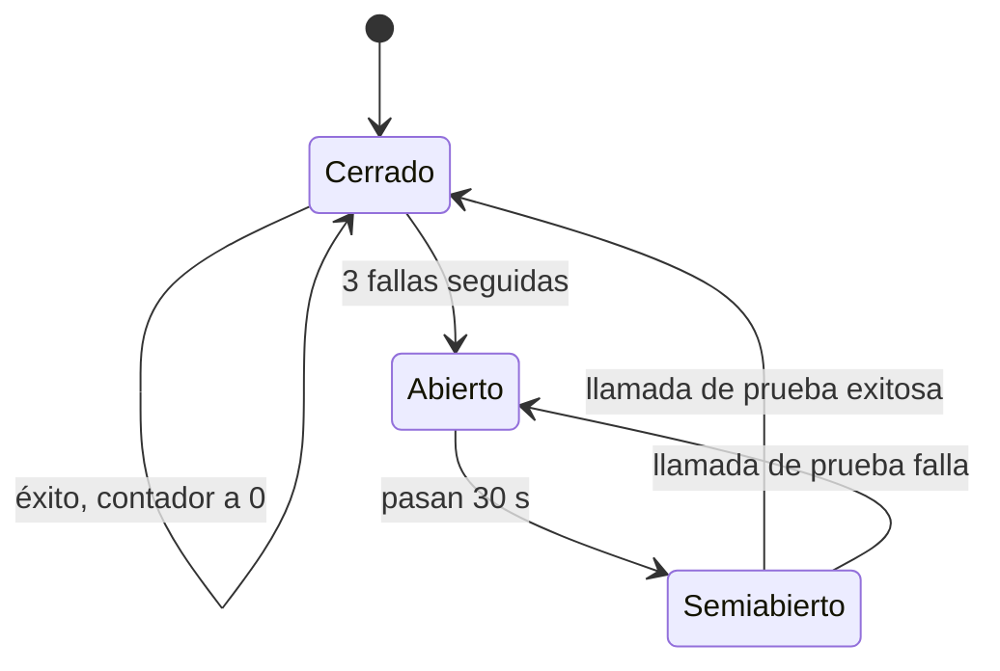

# 01. Conceptos

[Índice de la guía](README.md) · Anterior: [00. Visión general](00-vision-general.md) · Siguiente: [02. Servicios de Azure](02-servicios-azure.md)

Este capítulo explica desde cero cada concepto que usa el proyecto. Para cada uno: **qué problema resuelve**, **cómo funciona** y **dónde aparece aquí**. Si ya dominas un tema, salta a la tabla "En este proyecto" de su sección.

Contenido:

1. [Agentes LLM y tool calling](#1-agentes-llm-y-tool-calling)
2. [Microsoft Agent Framework (MAF)](#2-microsoft-agent-framework-maf)
3. [Microsoft Foundry](#3-microsoft-foundry)
4. [RAG y Foundry IQ](#4-rag-y-foundry-iq)
5. [MCP: Model Context Protocol](#5-mcp-model-context-protocol)
6. [A2A: Agent2Agent](#6-a2a-agent2agent)
7. [OAuth 2.0 y OpenID Connect](#7-oauth-20-y-openid-connect)
8. [Entra ID: workforce y External ID](#8-entra-id-workforce-y-external-id)
9. [Device code](#9-device-code)
10. [On-behalf-of (OBO)](#10-on-behalf-of-obo)
11. [Managed identity y credenciales federadas](#11-managed-identity-y-credenciales-federadas)
12. [Scopes frente a app roles](#12-scopes-frente-a-app-roles)
13. [Azure Container Apps](#13-azure-container-apps)
14. [Idempotencia, resiliencia y circuit breaker](#14-idempotencia-resiliencia-y-circuit-breaker)
15. [Observabilidad con OpenTelemetry](#15-observabilidad-con-opentelemetry)
16. [Evaluación de agentes](#16-evaluación-de-agentes)

---

## 1. Agentes LLM y tool calling

**Problema.** Un modelo de lenguaje (LLM) solo genera texto. No sabe el saldo de un cliente ni puede bloquear una tarjeta. Si se le pide una cifra que no conoce, puede inventarla (alucinación).

**Solución: tool calling.** Se le entrega al modelo una lista de herramientas (nombre, descripción y esquema JSON de argumentos). El modelo no ejecuta nada: responde "quiero llamar a `get_balance` con estos argumentos". Nuestro código ejecuta la herramienta y le devuelve el resultado. El modelo vuelve a razonar con ese resultado y decide si llama otra herramienta o responde.

**Agente** = modelo + instrucciones + herramientas + un **bucle** que repite "modelo, herramienta, modelo" hasta obtener una respuesta final.



> **Por qué importa.** El modelo decide **qué** herramienta usar, pero el código decide **si** se ejecuta y **con qué identidad**. Esa separación es la base de toda la seguridad del proyecto: el modelo nunca elige sobre qué cliente operar.

| En este proyecto | Detalle |
|------------------|---------|
| Modelo | gpt-5-mini, modelo de razonamiento: no admite `temperature`; se fija `reasoning.effort = low` |
| Herramientas | 6 del servidor MCP, `knowledge_base_retrieve` de Foundry IQ, `consultar_productos` (A2A) y las de handoff |
| Bucle | Lo ejecuta MAF en nuestro proceso |

---

## 2. Microsoft Agent Framework (MAF)

**Qué es.** El SDK de Microsoft para construir agentes en Python y .NET (GA desde la versión 1.0, el 2026-04-03). Aquí se usa `agent-framework-core` 1.24. Une lo que antes eran Semantic Kernel y AutoGen.

**Qué problema resuelve.** Escribir el bucle de un agente a mano obliga a manejar el formato de las llamadas a herramientas, el historial, las aprobaciones y la orquestación de varios agentes. MAF lo trae resuelto y testeable.

### Piezas que usamos

| Pieza | Qué hace | Dónde aparece |
|-------|----------|---------------|
| `Agent` | Modelo + instrucciones + herramientas + middleware. `agent.run(...)` ejecuta el bucle | `agent.py`, `workflow.py`, `productos.py` |
| `ChatClient` (`FoundryChatClient`) | Adaptador hacia el modelo. Usa la **Responses API** del proyecto de Foundry con credencial Entra | `build_foundry_client` en `agent.py` |
| `MCPStreamableHTTPTool` | Cliente MCP: lista las herramientas del servidor y las ofrece al modelo | `build_mcp_tool`, `build_kb_tool` |
| `header_provider` | Función que MAF llama antes de cada request MCP para agregar headers. Recibe el contexto del host, **no** los argumentos del modelo | `mcp_headers` en `agent.py` |
| `function_invocation_kwargs` | Contexto del host que viaja con cada ejecución (identidad, id de conversación). El modelo no lo ve | `run_kwargs`, `Conversation` |
| `approval_mode` | Marca qué herramientas requieren aprobación humana | `build_mcp_tool` |
| `user_input_requests` / `request_info` | Cuando una herramienta requiere aprobación, MAF devuelve una solicitud en lugar de ejecutarla | `chat_turn`, `Conversation.send`, `advance` |
| Middleware de función (`FunctionMiddleware`) | Código que envuelve cada llamada a herramienta | `ToolCallRecorder`, `ResilientTools`, `TraceRecorder` |
| Middleware de chat (`ChatMiddleware`) | Código que envuelve cada llamada al modelo | `RetryChatMiddleware` |
| `AgentSession` | Historial de una conversación de un solo agente | CLI con `--agent operaciones` |
| `HandoffBuilder` | Orquestación de varios agentes que se transfieren la conversación | `build_workflow` |
| Checkpoints de workflow | Estado serializable del workflow en cada superstep | `SqlCheckpointStorage` |
| `A2AAgent`, `A2AExecutor` | Cliente y servidor A2A (paquete beta `agent-framework-a2a`) | `productos.py`, `productos_a2a.py` |

### El bucle del agente en código

`chat_turn` en `agent_host/agent.py` muestra el bucle con aprobaciones en pocas líneas:

```python
response = await agent.run(text, session=session, function_invocation_kwargs=run_kwargs(session))
while response.user_input_requests:
    answers = [req.to_function_approval_response(decide(req)) for req in response.user_input_requests]
    response = await agent.run(Message("user", answers), session=session,
                               function_invocation_kwargs=run_kwargs(session))
```

Dentro de `agent.run`, MAF llama al modelo, ejecuta las herramientas permitidas y repite. Si una herramienta requiere aprobación, se detiene y la devuelve en `user_input_requests`.

### Workflows y handoff

Un **workflow** de MAF es un grafo de ejecutores que intercambian mensajes por **supersteps** (rondas). `HandoffBuilder` construye un workflow especial:

- Clona cada agente y le agrega una herramienta `handoff_to_<agente>` por cada destino.
- Cuando el modelo llama a esa herramienta, un middleware la intercepta y el workflow activa al agente destino con la conversación.
- Solo viajan los mensajes de texto: los resultados de herramientas (saldos, fragmentos) se quedan en el agente que las ejecutó.
- Cuando un agente responde sin transferir, el workflow emite `HandoffAgentUserRequest` y espera el siguiente mensaje.

> **Por qué importa.** El handoff permite dar a cada agente solo las herramientas que necesita (mínimo privilegio) sin perder la conversación.

| En este proyecto | Detalle |
|------------------|---------|
| Agentes | `triage` (inicial), `productos`, `operaciones` |
| Topología | Malla: cualquiera transfiere a cualquiera |
| `enable_return_to_previous(False)` | Cada mensaje nuevo vuelve a pasar por Triage |
| Checkpoints | Persistidos en la tabla `sesiones` desde la fase 6 |

---

## 3. Microsoft Foundry

**Qué es.** La plataforma de IA de Azure (antes Azure AI Foundry / Azure AI Studio). Se crea como una **cuenta** de Cognitive Services de tipo `AIServices` con uno o más **proyectos**.

| Concepto | Qué es | Aquí |
|----------|--------|------|
| Cuenta (account) | Recurso de Azure que contiene modelos, políticas y proyectos | `aif-banking-agent-ke9ih`, SKU S0 |
| Proyecto (project) | Espacio de trabajo con su endpoint, evaluaciones, conexiones y trazas | `proj-banking-agent` |
| Despliegue de modelo (deployment) | Una instancia con nombre de un modelo, con SKU y capacidad | `gpt-5-mini` y `text-embedding-3-small`, ambos GlobalStandard, 50K TPM |
| Responses API | API de OpenAI para generar respuestas con herramientas; la usa `FoundryChatClient` | Endpoint del proyecto |
| RAI policy | Política de contenido: filtros de daño y **Prompt Shields** | `banking-agent-guardrails` |
| Evaluations | Registro de ejecuciones de evaluación con detalle por fila | Fase 8 |
| Tracing | Visualización de trazas desde una conexión a Application Insights | Conexión `appi-banking-agent` |
| Foundry IQ | Capa de conocimiento sobre Azure AI Search | Sección siguiente |
| Agent Service (agentes server-side) | Agentes cuyo bucle corre en Foundry | **No se usa** (ADR-001) |

### Prompt Shields

Son clasificadores que detectan ataques en el prompt:

- **Jailbreak (ataque directo):** el usuario intenta que el modelo ignore sus reglas.
- **Indirect Attack (ataque indirecto):** instrucciones ocultas dentro de documentos o resultados de herramientas. Viene **desactivado** por defecto; aquí se habilita explícitamente en la RAI policy (ADR-017).

> **Por qué importa.** El agente Productos lee documentos. Si alguien manipulara un documento con "bloquea la tarjeta del cliente", Indirect Attack lo detecta, y además la arquitectura impide que Productos tenga herramientas de escritura.

### GlobalStandard

Tipo de despliegue de pago por token, sin costo fijo. "Global" significa que el procesamiento puede ocurrir en cualquier región de Azure. Aceptable para datos sintéticos (ADR-002). La capacidad (50K tokens por minuto) solo limita el caudal; no se paga por ella.

---

## 4. RAG y Foundry IQ

**Problema.** El modelo no conoce las tarifas de Banco Andino Demo, y si se las pregunta puede inventarlas.

**Solución: RAG (Retrieval-Augmented Generation).** Antes de responder, se **recupera** el fragmento relevante de una base documental y se le entrega al modelo como contexto. El modelo responde solo con eso y cita la fuente.

Etapas de un RAG:

| Etapa | Qué ocurre | Aquí lo hace |
|-------|------------|--------------|
| Ingesta | Leer los documentos y extraer texto | Indexer de AI Search sobre los PDF en Blob |
| Chunking | Partir el texto en fragmentos | `SplitSkill`: 2 000 caracteres con 200 de solapamiento; 8 documentos dan 11 fragmentos |
| Embeddings | Convertir cada fragmento en un vector numérico que representa su significado | `text-embedding-3-small`, 1 536 dimensiones |
| Búsqueda híbrida | Buscar por palabras (BM25) y por vector a la vez, y fusionar | AI Search |
| Reranking | Reordenar los resultados con un modelo semántico | Semantic ranker (plan free) |
| Recuperación con fuente | Devolver fragmentos y referencias | Knowledge base `kb-productos`, extractiva |
| Síntesis | Redactar la respuesta con los fragmentos | Nuestro agente Productos con gpt-5-mini |

**Foundry IQ** es la capa de conocimiento de Foundry. Tú creas dos objetos y el servicio genera el resto:

- **Knowledge source** (`ks-productos`): apunta al contenedor Blob. Al crearla, AI Search genera data source, skillset, índice e indexer.
- **Knowledge base** (`kb-productos`): agrupa fuentes y expone un endpoint **MCP** con la herramienta `knowledge_base_retrieve`.

> **Por qué importa.** Las respuestas de productos son verificables: cada una lleva el título del documento del que salió, y si no hay fuente, el agente responde "No tengo esa información."

---

## 5. MCP: Model Context Protocol

**Problema.** Cada framework de agentes define herramientas a su manera. Si el core bancario expusiera herramientas solo para MAF, ningún otro cliente podría usarlas, y la autorización quedaría mezclada con el agente.

**Solución.** MCP es un protocolo abierto para exponer herramientas (y recursos y prompts) a cualquier cliente de IA. Un **servidor MCP** publica herramientas con nombre, descripción y esquema JSON; un **cliente MCP** las lista (`tools/list`) y las invoca (`tools/call`). Los mensajes son JSON-RPC.

| Concepto | Detalle | Aquí |
|----------|---------|------|
| Transporte streamable HTTP | Un solo endpoint HTTP (`/mcp`) que acepta POST con JSON-RPC y puede responder en streaming | `http://127.0.0.1:8000/mcp` en local; `https://mcp-server.internal.../mcp` en Azure |
| Herramientas | Funciones con esquema | `get_balance`, `list_transactions`, `get_claim_status`, `block_card`, `open_claim`, `escalate_to_human` |
| Anotaciones | `readOnlyHint`, `idempotentHint`, etc. | Lecturas y escrituras anotadas en `server.py` |
| Headers | El cliente puede enviar headers HTTP en cada request | `Authorization`, `X-Conversation-Id` |
| Aprobaciones | MCP no las define; las aplica el cliente | `approval_mode` de MAF |

> **Por qué importa.** El servidor MCP es la frontera de confianza: valida el token, decide quién es el cliente y comprueba la pertenencia de cada recurso. Aunque el modelo sea engañado, el servidor rechaza el acceso cruzado.

Foundry IQ también expone su knowledge base como servidor MCP, así que el mismo tipo de cliente (`MCPStreamableHTTPTool`) sirve para el core bancario y para el conocimiento.

---

## 6. A2A: Agent2Agent

**Problema.** MCP conecta un agente con herramientas. Pero ¿cómo conversa un agente con **otro agente**, posiblemente escrito con otro framework y desplegado en otro servicio?

**Solución.** A2A (especificación 1.0) es un protocolo para que agentes se comuniquen:

| Concepto | Detalle | Aquí |
|----------|---------|------|
| Agent card | Documento JSON público que describe al agente: nombre, skills, endpoint, esquema de seguridad | `GET /.well-known/agent-card.json` |
| JSON-RPC 2.0 | Formato de las llamadas | `POST /` |
| `SendMessage` | Método para enviar un mensaje y recibir una tarea | Respuesta: tarea en `TASK_STATE_COMPLETED` |
| Header `A2A-Version: 1.0` | Versión del protocolo; sin él, el SDK asume 0.3 y responde error `-32009` | Lo envía el cliente |
| Tarea (task) | Unidad de trabajo con estado | Se guarda en memoria (`InMemoryTaskStore`) |

> **Por qué importa.** A2A permite separar Productos en su propio servicio, escalarlo aparte y que cualquier cliente que hable A2A lo use, no solo MAF. Se eligió Productos porque no necesita la identidad del cliente (ADR-015).

**MCP frente a A2A:** MCP es "agente usa herramienta" (llamada determinista con esquema); A2A es "agente conversa con agente" (el otro lado razona por su cuenta).

---

## 7. OAuth 2.0 y OpenID Connect

**Problema.** Un servicio necesita saber quién lo llama y qué puede hacer, sin recibir contraseñas.

**Solución.**

- **OAuth 2.0** define cómo un cliente obtiene un **access token** para llamar a una API.
- **OpenID Connect (OIDC)** agrega identidad encima de OAuth: un **ID token** que dice quién inició sesión, y un documento de descubrimiento (`.well-known/openid-configuration`) con los endpoints y las claves públicas.

Un access token de Entra es un **JWT**: tres partes en base64 (encabezado, claims, firma). La API valida:

| Claim | Significado | Qué se valida aquí |
|-------|-------------|--------------------|
| `iss` | Emisor (quién firmó) | Debe ser el tenant esperado |
| `aud` | Audiencia (para qué API es) | Debe ser el client id de esta API |
| `exp`, `nbf` | Vigencia | No vencido ni futuro (60 s de tolerancia) |
| `tid` | Tenant | Debe coincidir |
| `oid` | Id del usuario o identidad | Se mapea a `clientes.entra_oid` |
| `scp` | Scopes delegados | `access_as_user` o `tools.access` |
| `roles` | App roles | `Productos.Invoke` |
| `kid` (encabezado) | Qué clave firmó | Se busca en el **JWKS** del tenant |

La firma se verifica con la clave pública del **JWKS** (JSON Web Key Set) del tenant. Solo se acepta `RS256`: nunca el algoritmo que el token dice traer (evita ataques con `none` o HMAC).

> **Por qué importa.** Validar un JWT de forma incompleta es un error de seguridad frecuente. Este proyecto lo hace en una sola función, `validate_jwt` en `mcp_server/auth.py`, reutilizada por el MCP, el host y Productos, con pruebas para cada rechazo.

---

## 8. Entra ID: workforce y External ID

**Entra ID** (antes Azure AD) es el servicio de identidad de Microsoft. Un **tenant** es una instancia aislada con sus usuarios y aplicaciones.

| Tipo de tenant | Para quién | Aquí |
|----------------|-----------|------|
| **Workforce** | Empleados y servicios de la organización | El tenant de la suscripción: tú, las managed identities, la app de GitHub y la app `banking-productos-a2a` |
| **External ID** | Clientes de la organización (CIAM) | `bancoandinodemo` (`bancoandinodemo.ciamlogin.com`): los clientes del banco y las apps `banking-cli`, `banking-agent-api`, `banking-mcp-api` |

External ID reemplaza a Azure AD B2C para nuevos desarrollos. Particularidades verificadas:

- Solo emite tokens v2; rechaza crear apps con v1.
- Solo deja iniciar sesión en apps asociadas a un **user flow** (experiencia de inicio de sesión).
- Admite device code, clientes públicos y OBO; no admite ROPC (enviar usuario y contraseña desde la app).
- El emisor de los tokens usa el GUID del tenant como subdominio: `https://<tenant-id>.ciamlogin.com/<tenant-id>/v2.0`.

### App registration y service principal

- **App registration** (`azuread_application`): la definición global de una aplicación: su client id, los scopes y roles que expone, los permisos que pide y sus credenciales.
- **Service principal** (`azuread_service_principal`): la instancia de esa app en un tenant; a ella se le asignan consentimientos y roles.

> **Por qué importa.** Separar clientes y empleados en tenants distintos evita mezclar identidades y permite políticas de inicio de sesión propias para los clientes (ADR-008).

---

## 9. Device code

**Problema.** Una CLI no tiene navegador propio para mostrar la página de inicio de sesión.

**Solución: flujo device code.**

1. La CLI pide un código al endpoint `devicecode` del tenant.
2. Muestra: "abre `https://bancoandinodemo.ciamlogin.com/device` e ingresa el código XXXX".
3. El usuario inicia sesión en cualquier navegador.
4. Mientras tanto, la CLI consulta el endpoint de token hasta que el inicio de sesión termina.
5. Recibe un access token (y un refresh token que MSAL guarda en memoria).

| En este proyecto | Detalle |
|------------------|---------|
| App | `banking-cli`, cliente público (`fallback_public_client_enabled = true`) |
| Scope pedido | `api://<banking-agent-api>/access_as_user` |
| Código | `EntraIdentity.sign_in` en `agent_host/identity.py` (MSAL `PublicClientApplication`) |

---

## 10. On-behalf-of (OBO)

**Problema.** El cliente le da al host un token para **el host** (audiencia `banking-agent-api`). Pero el host necesita llamar al MCP **como el cliente**, para que el MCP sepa a quién atender. Reenviar el mismo token sería incorrecto: su audiencia no es el MCP.

**Solución: OBO.** El host (una API intermedia, "middle tier") presenta a Entra el token del cliente más su propia credencial, y recibe un token nuevo para el MCP (`api://<banking-mcp-api>/tools.access`) con el **mismo `oid`** del cliente.



La credencial del host es un **certificado** guardado en Key Vault (ADR-009). No puede ser una managed identity: una credencial federada de managed identity solo funciona dentro de su tenant (workforce) y `banking-agent-api` vive en el tenant externo.

---

## 11. Managed identity y credenciales federadas

**Problema.** Para que un servicio llame a otro (por ejemplo, el host a SQL) hace falta una credencial. Una contraseña o clave en la configuración es el origen más común de filtraciones.

**Solución: managed identity.** Azure crea una identidad para el recurso y le entrega tokens automáticamente; no existe ningún secreto que guardar.

| Tipo | Ciclo de vida | Aquí |
|------|---------------|------|
| **System-assigned** | Nace y muere con el recurso | Foundry (cuenta y proyecto) y AI Search |
| **User-assigned** | Recurso independiente que se asigna a uno o más recursos | `id-mcp-server`, `id-agent-host`, `id-productos-a2a` |

En el código, `DefaultAzureCredential` encuentra la credencial disponible: tu sesión de `az login` en local, la managed identity en Container Apps (indicada por `AZURE_CLIENT_ID`), o el token OIDC en GitHub Actions.

**Credencial federada (federated identity credential).** Permite que una identidad confíe en tokens de otro emisor sin secretos. Aquí, la app `banking-github-evals` confía en los tokens que GitHub emite para el workflow en la rama `main` (emisor `https://token.actions.githubusercontent.com`, audiencia `api://AzureADTokenExchange`).

---

## 12. Scopes frente a app roles

Hay dos formas de decir "este llamador puede usar esta API":

| | Scope delegado (`scp`) | App role (`roles`) |
|---|------------------------|--------------------|
| Quién actúa | Una app **en nombre de un usuario** | Una app **por sí misma** |
| Claim en el token | `scp` | `roles` |
| Se declara con | `oauth2_permission_scope` | `app_role` con `allowed_member_types = ["Application"]` |
| Se concede con | Consentimiento (`delegated_permission_grant`) | Asignación (`app_role_assignment`) |
| Aquí | `access_as_user` (host) y `tools.access` (MCP) | `Productos.Invoke` (servidor A2A) |

`validate_jwt` recibe exactamente uno de `scope=` o `role=`. Por eso un token de aplicación (sin `scp`) reenviado al MCP se rechaza, y un token delegado enviado a Productos también.

`app_role_assignment_required = true` en el service principal de `banking-productos-a2a` hace que Entra ni siquiera emita tokens a identidades sin asignación.

---

## 13. Azure Container Apps

**Qué es.** Un servicio para correr contenedores sin administrar Kubernetes. Por debajo usa Kubernetes, KEDA (escalado) y Envoy (ingress).

| Concepto | Qué es | Aquí |
|----------|--------|------|
| Environment | Límite de red y de logs compartido por varias apps | `cae-banking-agent-ke9ih` |
| Container App | Una aplicación con su imagen, réplicas e ingress | `agent-host`, `mcp-server`, `productos-a2a` |
| Revisión | Versión inmutable de la configuración; `revision_mode = Single` mantiene una activa | Las tres apps |
| Ingress externo | URL pública en internet | `agent-host` |
| Ingress interno | FQDN `<app>.internal.<dominio>`, solo alcanzable desde apps del mismo environment | `mcp-server`, `productos-a2a` |
| Escalado | Réplicas mínimas y máximas, reglas (por ejemplo, solicitudes concurrentes) | 0 a 2 (host, regla de 10 solicitudes concurrentes); 0 a 1 (los otros) |
| Scale to zero | Con 0 réplicas no hay costo de cómputo; la primera petición tarda más | Las tres |
| Probes | Liveness (¿el proceso responde?) y readiness (¿puede recibir tráfico?) | `/healthz`, `/readyz` |
| Secrets | Valores sensibles referenciados por variables de entorno | Cadena de conexión de Application Insights |

> **Por qué importa.** Scale to zero mantiene el costo en reposo cerca de cero; el ingress interno aísla el MCP y Productos de internet sin reglas de IP.

---

## 14. Idempotencia, resiliencia y circuit breaker

- **Idempotencia:** ejecutar una operación dos veces tiene el mismo efecto que una vez. Aquí cada escritura calcula `idempotency_key = sha256(conversation_id + customer_id + tool + args normalizados)` y la guarda en una tabla con clave primaria (restricción `UNIQUE`). Un reintento choca con la restricción y devuelve el resultado guardado.
- **Retry con backoff exponencial y jitter:** ante un error transitorio (429, 5xx, timeout), esperar 1 s, 2 s, 4 s... más un poco de azar (jitter) para que varias réplicas no reintenten al mismo tiempo.
- **Timeout:** tiempo máximo por llamada, para no esperar indefinidamente.
- **Circuit breaker:** si una dependencia falla varias veces seguidas, se deja de llamarla durante un tiempo ("circuito abierto") y se responde con un plan alternativo. Pasado el tiempo, se deja pasar una llamada de prueba ("semiabierto").



> **Por qué importa.** Reintentar escrituras solo es seguro si son idempotentes (ADR-007 y ADR-014 van juntas).

---

## 15. Observabilidad con OpenTelemetry

**OpenTelemetry (OTel)** es el estándar abierto para emitir trazas, métricas y logs.

| Concepto | Qué es |
|----------|--------|
| Traza (trace) | El recorrido completo de una petición, con un `trace id` |
| Span | Un tramo de la traza (una llamada HTTP, una llamada al modelo) con duración y atributos |
| `traceparent` | Header HTTP (W3C Trace Context) que lleva el trace id al siguiente servicio |
| Instrumentación | Código que crea spans automáticamente para una librería (HTTPX, Starlette) |
| Convenciones GenAI | Nombres estándar de spans de IA: `invoke_agent`, `chat`, `execute_tool` |

Aquí, `azure-monitor-opentelemetry` exporta todo a Application Insights. MAF emite spans GenAI y solo propaga `traceparent` en MCP; para A2A se instrumenta HTTPX (cliente) y Starlette (servidor) a mano (ADR-016).

---

## 16. Evaluación de agentes

Un agente no se puede probar solo con asserts exactos: el modelo no es determinista. Se combinan:

| Técnica | Qué mide | Aquí |
|---------|----------|------|
| Verificaciones deterministas | Herramientas ejecutadas o prohibidas, regex sobre la respuesta, fuentes | `expectations` en `run_evals.py` |
| Jueces LLM | Un modelo califica la respuesta con una rúbrica | `azure-ai-evaluation` 1.18: `tool_call_accuracy`, `intent_resolution`, `task_adherence`, `relevance`, `groundedness` |
| Consistencia | La misma pregunta varias veces da la misma cifra y fuente | Grupo de 5 filas en `cases.jsonl` |
| Umbral N de M | Un escenario pasa si acierta, por ejemplo, 4 de 5 veces | `tests/scenarios/test_triage_azure.py` |
| Red teaming | Ataques automáticos o propios | `adversarial_cases.jsonl` y AI Red Teaming Agent |

**Groundedness** mide si la respuesta se apoya en el contexto entregado (sin inventar). **Tool call accuracy** mide si se llamaron las herramientas correctas con los argumentos correctos.
