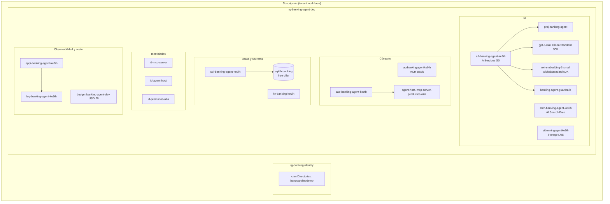

# 02. Servicios de Azure

[Índice de la guía](README.md) · Anterior: [01. Conceptos](01-conceptos.md) · Siguiente: [03. Paso a paso](03-paso-a-paso.md)

Este capítulo recorre **cada recurso desplegado**, tomado del estado de Terraform (`terraform -chdir=infra state list`) y de `az resource list`. Para cada uno: qué es, por qué se eligió, SKU, costo, configuración, quién lo usa y con qué identidad y rol.

Todo vive en una sola región, **South Central US** (`southcentralus`), y en un solo resource group, **`rg-banking-agent-dev`**, con los tags `project=banking-agent` y `env=dev`. La excepción es el tenant de External ID, que tiene su propio recurso en `rg-banking-identity`. El sufijo `ke9ih` de los nombres lo genera `random_string.suffix` (cambia si destruyes y recreas todo).

## Mapa de recursos

## Tabla resumen

| Recurso (nombre real) | Tipo Terraform | SKU / modo | Costo en reposo | Archivo |
|-----------------------|----------------|------------|-----------------|---------|
| `rg-banking-agent-dev` | `azurerm_resource_group` | — | 0 | `main.tf` |
| `aif-banking-agent-ke9ih` | `azurerm_cognitive_account` | AIServices S0 | 0 | `foundry.tf` |
| `proj-banking-agent` | `azurerm_cognitive_account_project` | — | 0 | `foundry.tf` |
| `gpt-5-mini` | `azurerm_cognitive_deployment` | GlobalStandard, 50K TPM, versión `2025-08-07` | 0 (por token) | `foundry.tf` |
| `text-embedding-3-small` | `azurerm_cognitive_deployment` | GlobalStandard, 50K TPM, versión `1` | 0 (por token) | `knowledge.tf` |
| `banking-agent-guardrails` | `azurerm_cognitive_account_rai_policy` | Base `Microsoft.DefaultV2` | 0 | `foundry.tf` |
| `appi-banking-agent` (conexión) | `azapi_resource` | Categoría `AppInsights` | 0 | `monitoring.tf` |
| `srch-banking-agent-ke9ih` | `azurerm_search_service` + `azapi_update_resource` | Free, semantic ranker free | 0 | `knowledge.tf` |
| `stbankingagentke9ih` + contenedor `productos` | `azurerm_storage_account`, `azurerm_storage_container` | Standard LRS | Centavos al mes | `knowledge.tf` |
| `sql-banking-agent-ke9ih` | `azurerm_mssql_server` | Versión 12.0, TLS 1.2 | 0 | `sql.tf` |
| `sqldb-banking` | `azapi_resource` | GP_S_Gen5, 2 vCore máx., free offer | 0 | `sql.tf` |
| Reglas de firewall SQL | `azurerm_mssql_firewall_rule` x2 | `AllowAzureServices`, `AllowClientIp` | 0 | `sql.tf` |
| `kv-banking-ke9ih` + certificado `agent-obo` | `azurerm_key_vault`, `azurerm_key_vault_certificate` | Standard, RBAC | Centavos (operaciones) | `identity.tf` |
| `acrbankingagentke9ih` | `azurerm_container_registry` | Basic, sin admin | ~USD 5 al mes | `apps.tf` |
| `cae-banking-agent-ke9ih` | `azurerm_container_app_environment` | Consumo | 0 | `apps.tf` |
| `mcp-server`, `agent-host`, `productos-a2a` | `azurerm_container_app` x3 | 0,25 a 0,5 vCPU; scale to zero | 0 con 0 réplicas | `apps.tf`, `a2a.tf` |
| `id-mcp-server`, `id-agent-host`, `id-productos-a2a` | `azurerm_user_assigned_identity` x3 | — | 0 | `main.tf`, `a2a.tf` |
| `log-banking-agent-ke9ih` | `azurerm_log_analytics_workspace` | PerGB2018, 30 días, cuota 1 GB/día | Por GB | `monitoring.tf` |
| `appi-banking-agent-ke9ih` | `azurerm_application_insights` | Basado en workspace | Por GB | `monitoring.tf` |
| `budget-banking-agent-dev` | `azurerm_consumption_budget_resource_group` | USD 20 al mes | 0 | `main.tf` |
| Tenant `bancoandinodemo` | Manual (no Terraform) | External ID | Gratis en el volumen de prueba | Manual |
| 5 app registrations | `azuread_application` | — | 0 | `identity.tf`, `a2a.tf`, `ci.tf` |

`az resource list` muestra además dos recursos que Azure crea solo: la base `master` del servidor SQL y el action group "Application Insights Smart Detection".

**Costo en reposo estimado: alrededor de USD 0,17 al día**, casi todo del Container Registry. El resto se cobra por uso.

---

## Resource group y presupuesto

**Qué es.** El resource group agrupa recursos con el mismo ciclo de vida. El presupuesto envía alertas por correo.

**Configuración.** `budget-banking-agent-dev` avisa al 50 % y al 100 % del gasto real y al 100 % del gasto pronosticado sobre USD 20 al mes (`var.budget_amount`). `ignore_changes = [time_period]` evita que el plan muestre cambios cada vez, porque la fecha de inicio se calcula con `timestamp()`.

> **Por qué.** El proyecto debe costar casi cero (ADR-021). El presupuesto es la red de seguridad si algo queda encendido.

---

## Foundry: cuenta, proyecto y despliegues

**Qué es.** La cuenta `aif-banking-agent-ke9ih` (kind `AIServices`, SKU S0) es el recurso de Microsoft Foundry. Contiene los despliegues de modelos, la RAI policy y el proyecto `proj-banking-agent`.

**Configuración clave.**

| Ajuste | Valor | Motivo |
|--------|-------|--------|
| `local_auth_enabled` | `false` | Sin API keys: solo tokens Entra |
| `custom_subdomain_name` | `aif-banking-agent-ke9ih` | Necesario para autenticación Entra y para el endpoint del proyecto |
| `project_management_enabled` | `true` | Permite crear proyectos (Foundry nuevo) |
| Identidad | System-assigned (cuenta y proyecto) | Para conexiones gestionadas |
| `purge_soft_delete_on_destroy` | `true` (en el provider) | La cuenta se borra con soft delete; se purga para poder recrearla con el mismo nombre |

**Endpoints** (salidas de Terraform):

| Salida | Valor | Uso |
|--------|-------|-----|
| `foundry_project_endpoint` | `https://aif-banking-agent-ke9ih.services.ai.azure.com/api/projects/proj-banking-agent` | `FoundryChatClient`, evaluaciones |
| `foundry_openai_endpoint` | `https://aif-banking-agent-ke9ih.openai.azure.com` | Modelo de embeddings de la knowledge source; jueces de evaluación |

**Despliegues.**

| Despliegue | Modelo | SKU | Capacidad | Para qué |
|------------|--------|-----|-----------|----------|
| `gpt-5-mini` | gpt-5-mini `2025-08-07` | GlobalStandard | 50K TPM (`var.model_capacity`) | Los tres agentes y los jueces |
| `text-embedding-3-small` | text-embedding-3-small `1` | GlobalStandard | 50K TPM (`var.embedding_capacity`) | Vectores de los fragmentos y de las consultas |

`gpt-5-mini` usa la RAI policy `banking-agent-guardrails` (`rai_policy_name`).

**RAI policy `banking-agent-guardrails`.** Base `Microsoft.DefaultV2`, y reafirma explícitamente:

| Filtro | Fuente | Modo |
|--------|--------|------|
| Hate, Sexual, Violence, Selfharm | Prompt y Completion | Bloqueo, umbral Medium |
| Jailbreak | Prompt | Bloqueo |
| Indirect Attack | Prompt | Bloqueo (viene apagado por defecto: aquí se enciende) |
| Protected Material Text, Protected Material Code | Completion | Bloqueo |

**Quién lo usa y con qué rol.**

| Identidad | Rol sobre la cuenta | Para qué |
|-----------|---------------------|----------|
| `id-agent-host` | Foundry User | Responses API de los agentes del host |
| `id-productos-a2a` | Foundry User | Responses API de Productos remoto |
| Tú (usuario que corre Terraform) | Foundry User | Ejecución local, evaluaciones |
| `banking-github-evals` (service principal) | Foundry User | Evaluaciones desde GitHub |
| Identidad de AI Search | Cognitive Services User | Embeddings durante la ingesta y la consulta |

"Foundry User" (antes "Azure AI User") da acceso de plano de datos a la cuenta y sus proyectos: Responses API, tracing y evaluaciones.

**Costo.** Por token. gpt-5-mini: aprox. USD 0,25 por millón de tokens de entrada y USD 2,00 por millón de salida (fuente de terceros; verifica en la página oficial). Todas las evaluaciones de un día de la fase 8 costaron unos USD 0,90.

**Conexión de tracing.** `azapi_resource.foundry_appinsights` crea en el proyecto la conexión `appi-banking-agent` (categoría `AppInsights`) hacia Application Insights. La cadena de conexión va en `sensitive_body` para que no aparezca en el plan. Con ella, **Foundry > Tracing** muestra las trazas.

---

## Azure AI Search y Foundry IQ

**Qué es.** `srch-banking-agent-ke9ih` es un servicio de Azure AI Search en el plan **Free**. Foundry IQ crea sobre él la knowledge source `ks-productos` y la knowledge base `kb-productos` (objetos de plano de datos, creados por `knowledge/ingest.py`, no por Terraform).

**Configuración clave.**

| Ajuste | Valor | Motivo |
|--------|-------|--------|
| `sku` | `free` | Costo cero |
| `local_authentication_enabled` | `false` | Solo RBAC, sin claves de administración |
| Identidad | System-assigned | El indexer lee Blob y llama al modelo de embeddings sin claves |
| `semanticSearch` | `free` (con `azapi_update_resource`) | La knowledge base exige semantic ranker; `azurerm` rechaza ese ajuste en el plan Free |
| `knowledgeRetrieval` | `free` (valor por defecto) | `standard` exige Basic o superior |

**Hallazgo.** La documentación pide Basic para managed identity, pero la API la acepta en Free y funciona (verificado el 2026-11-06). Sin ella no habría cómo llegar a Foundry, que tiene las claves deshabilitadas.

**Objetos generados por la knowledge source:** `ks-productos-datasource`, `ks-productos-skillset`, `ks-productos-index`, `ks-productos-indexer`.

**Endpoint MCP de la knowledge base:** `https://srch-banking-agent-ke9ih.search.windows.net/knowledgebases/kb-productos/mcp?api-version=2026-08-01-preview` (preview).

**Quién lo usa.**

| Identidad | Rol | Para qué |
|-----------|-----|----------|
| `id-agent-host` | Search Index Data Reader | Productos en proceso (si `PRODUCTOS_A2A_URL` está vacía) |
| `id-productos-a2a` | Search Index Data Reader | Productos remoto |
| `banking-github-evals` | Search Index Data Reader | Evaluaciones en CI |
| Tú | Search Service Contributor, Search Index Data Contributor | Crear la knowledge base, consultarla en local |

**Costo.** 0. El plan free de `knowledgeRetrieval` da una cuota mensual de tokens de razonamiento: cada consulta reporta unos 4 000 tokens aun con esfuerzo `minimal`.

---

## Storage account y contenedor productos

**Qué es.** `stbankingagentke9ih` (Standard, LRS) guarda los 8 PDF de productos en el contenedor privado `productos`.

| Ajuste | Valor | Motivo |
|--------|-------|--------|
| `shared_access_key_enabled` | `false` | Solo Entra |
| `default_to_oauth_authentication` | `true` | El portal también usa Entra |
| `allow_nested_items_to_be_public` | `false` | Ningún blob público |
| `min_tls_version` | `TLS1_2` | — |
| `storage_use_azuread = true` (provider) | — | Sin esto, `azurerm` intenta leer con clave compartida y falla con 403 |

**Quién lo usa.** La identidad de AI Search tiene **Storage Blob Data Reader** (el indexer lee los PDF). Tú tienes **Storage Blob Data Contributor** (subes los PDF con `knowledge/publish.py`).

---

## Azure SQL: server y base sqldb-banking

**Qué es.** Un servidor lógico `sql-banking-agent-ke9ih` con la base `sqldb-banking`. Guarda el core bancario simulado, las sesiones, la auditoría, las claves de idempotencia y los tickets. Modelo de datos en [05. Flujos](05-flujos.md#modelo-de-datos).

**Configuración clave del servidor.**

- `azuread_administrator` con `azuread_authentication_only = true`: **no existen usuarios SQL con contraseña**. El administrador es quien ejecuta Terraform.
- `minimum_tls_version = 1.2`.

**Base de datos (con `azapi`, porque `azurerm` no expone el free offer).**

| Ajuste | Valor |
|--------|-------|
| SKU | `GP_S_Gen5`, General Purpose serverless, capacidad máx. 2 vCore, mín. 0,5 |
| `useFreeLimit` | `true`: 100 000 vCore-segundos al mes y 32 GB gratis |
| `freeLimitExhaustionBehavior` | `AutoPause`: al agotar el límite se pausa hasta el mes siguiente; nunca factura |
| `maxSizeBytes` | 32 GB |
| Redundancia de backup | Local |

**Firewall.** `AllowAzureServices` (0.0.0.0, permite el egreso de Container Apps) y `AllowClientIp` (tu IP, `var.client_ip`, para el seed y los scripts).

**Usuarios de base de datos (creados con scripts, no con Terraform).**

| Usuario | Script | Permisos |
|---------|--------|----------|
| `id-mcp-server` | `infra/sql/create-mcp-user.sql` | `db_datareader` y `db_datawriter` |
| `id-agent-host` | `infra/sql/create-agent-host-user.sql` | `SELECT` en `clientes`; `SELECT`, `INSERT`, `UPDATE` en `sesiones` |
| Tú (admin Entra) | — | Todo, incluido el esquema (lo crea el seed) |

**Conexión sin contraseña.** Driver `mssql-python` con SQLAlchemy (`mssql+mssqlpython`):

- En el contenedor: `Authentication=ActiveDirectoryMSI&UID=<client id de la identidad>`.
- En tu máquina: `Authentication=ActiveDirectoryDefault` (usa tu `az login`).

**Comportamiento a tener en cuenta.** La base serverless se pausa tras unos 15 minutos sin uso. La primera conexión falla con el error **40613** mientras se reanuda: `db_retry` reintenta hasta 6 veces, y las probes no consultan SQL a propósito para dejar que se pause.

---

## Key Vault y certificado agent-obo

**Qué es.** `kv-banking-ke9ih` guarda el certificado autofirmado `agent-obo`, la credencial con la que `banking-agent-api` hace el OBO.

| Ajuste | Valor |
|--------|-------|
| SKU | standard |
| `rbac_authorization_enabled` | `true` (sin access policies) |
| `purge_protection_enabled` | `false`, para que `destroy` pueda purgar en desarrollo |
| `soft_delete_retention_days` | 7 |
| Certificado | RSA 2048, emisor `Self`, `CN=banking-agent-api`, 12 meses, contenido `application/x-pem-file` |

**Cómo se usa.** Terraform crea el certificado dentro de Key Vault (la clave privada nunca sale hacia el repositorio) y sube solo la parte pública a la app `banking-agent-api` (`azuread_application_certificate`). El host lee el **secreto** asociado al certificado (PEM con clave y certificado) y se lo entrega a MSAL.

| Identidad | Rol | Para qué |
|-----------|-----|----------|
| Tú | Key Vault Certificates Officer | Terraform crea el certificado |
| Tú | Key Vault Secrets User | Leer el PEM en ejecuciones locales |
| `id-agent-host` | Key Vault Secrets User | Leer el PEM en Azure |

**Rotación.** Renovar el certificado (`terraform apply -replace=azurerm_key_vault_certificate.obo`) y volver a aplicar para subir la parte pública nueva. El host lee la versión vigente al arrancar.

---

## Container Registry

**Qué es.** `acrbankingagentke9ih` (Basic, `admin_enabled = false`) guarda la imagen propia. **Una sola imagen** sirve a las tres apps con distinto comando; hoy todas usan `acrbankingagentke9ih.azurecr.io/mcp-server:v8`.

Las imágenes se construyen en Azure con `az acr build` (no hace falta Docker local). Cada app descarga la imagen con su managed identity, que tiene el rol **AcrPull**.

---

## Container Apps: environment y las tres apps

**Environment.** `cae-banking-agent-ke9ih`, plan de consumo, envía sus logs a Log Analytics. Dominio por defecto: `happymoss-084472df.southcentralus.azurecontainerapps.io`.

| App | Comando | Puerto | Ingress | Réplicas | CPU / memoria | Identidad |
|-----|---------|--------|---------|----------|---------------|-----------|
| `agent-host` | `python -m agent_host.service` | 8080 | **Externo** | 0 a 2, regla HTTP de 10 solicitudes concurrentes | 0,5 / 1 Gi | `id-agent-host` |
| `mcp-server` | `python -m mcp_server` (CMD por defecto) | 8000 | **Interno** | 0 a 1 | 0,25 / 0,5 Gi | `id-mcp-server` |
| `productos-a2a` | `python -m agent_host.productos_a2a` | 8090 | **Interno** | 0 a 1 | 0,5 / 1 Gi | `id-productos-a2a` |

**Probes.**

| App | Liveness | Readiness |
|-----|----------|-----------|
| `agent-host` | `/healthz` cada 10 s | `/readyz` cada 5 s |
| `productos-a2a` | `/healthz` cada 10 s | `/healthz` cada 5 s |
| `mcp-server` | Sin probes declaradas en Terraform (expone `/healthz`) | — |

**Imagen placeholder.** El primer `apply` usa `mcr.microsoft.com/k8se/quickstart:latest` (escucha en 80) porque la imagen propia aún no existe. Con la imagen propia, Terraform cambia el puerto y agrega el comando y las probes (`local.placeholder_image`, `local.agent_placeholder`).

**Variables de entorno principales** (definidas en Terraform):

| App | Variables |
|-----|-----------|
| `mcp-server` | `AUTH_MODE=entra`, `ENTRA_TENANT_ID`, `ENTRA_ISSUER`, `ENTRA_AUDIENCE`, `ENTRA_JWKS_URI`, `MCP_HOST=0.0.0.0`, `DATABASE_URL`, `AZURE_CLIENT_ID`, `APPLICATIONINSIGHTS_CONNECTION_STRING` (secret) |
| `agent-host` | `AUTH_MODE=entra`, `AGENT_BIND`, `AGENT_PORT`, `FOUNDRY_PROJECT_ENDPOINT`, `FOUNDRY_MODEL_DEPLOYMENT`, `MCP_URL`, `SEARCH_ENDPOINT`, `ENTRA_AUTHORITY`, `ENTRA_*_CLIENT_ID`, `KEY_VAULT_URI`, `OBO_CERT_NAME`, `DATABASE_URL`, `AZURE_CLIENT_ID`, `PRODUCTOS_A2A_URL`, `PRODUCTOS_A2A_SCOPE`, `OTEL_INSTRUMENTATION_A2A_SDK_ENABLED=false`, `APPLICATIONINSIGHTS_CONNECTION_STRING` |
| `productos-a2a` | `A2A_BIND`, `A2A_PORT`, `A2A_PUBLIC_URL`, `A2A_TENANT_ID`, `A2A_AUDIENCE`, `FOUNDRY_PROJECT_ENDPOINT`, `FOUNDRY_MODEL_DEPLOYMENT`, `SEARCH_ENDPOINT`, `AZURE_CLIENT_ID`, `OTEL_INSTRUMENTATION_A2A_SDK_ENABLED=false`, `APPLICATIONINSIGHTS_CONNECTION_STRING` |

> **Por qué Container Apps y no hosted agents de Foundry.** El paquete de hosting estaba en beta; el núcleo no debía depender de piezas beta para desplegarse (ADR-022).

---

## Managed identities

| Identidad | Asignada a | Roles en Azure | Usuario SQL | Otros |
|-----------|-----------|----------------|-------------|-------|
| `id-mcp-server` | `mcp-server` | AcrPull | `db_datareader`, `db_datawriter` | — |
| `id-agent-host` | `agent-host` | AcrPull, Foundry User, Search Index Data Reader, Key Vault Secrets User | `SELECT clientes`; `SELECT/INSERT/UPDATE sesiones` | App role `Productos.Invoke` en `banking-productos-a2a` |
| `id-productos-a2a` | `productos-a2a` | AcrPull, Foundry User, Search Index Data Reader | Ninguno | — |
| Identidad del sistema de AI Search | `srch-banking-agent-ke9ih` | Storage Blob Data Reader, Cognitive Services User | — | — |

Detalle de mínimo privilegio en [06. Seguridad](06-seguridad.md).

---

## Log Analytics y Application Insights

**Qué son.** Log Analytics (`log-banking-agent-ke9ih`) almacena logs y trazas y se consulta con KQL. Application Insights (`appi-banking-agent-ke9ih`, `application_type = other`) es la vista de APM encima de ese workspace.

| Ajuste | Valor | Motivo |
|--------|-------|--------|
| SKU | PerGB2018 | Pago por GB ingerido |
| Retención | 30 días | — |
| `daily_quota_gb` | 1 | Tope de costo: al llegar, deja de ingerir hasta el día siguiente |

**Quién envía datos.** Las tres apps exportan OpenTelemetry con la cadena de conexión (guardada como secret de Container Apps). El environment envía los logs de consola de los contenedores.

**Para no agotar la cuota de 1 GB** (`agent_host/telemetry.py`): solo se exportan logs de `agent_host.*`, las probes no se trazan y los spans internos de `a2a-sdk` se desactivan.

**Vistas útiles.** Transaction search, Agents (preview), Logs (KQL). Detalle en [08. Operación](08-operacion.md#observar).

---

## Tenant Entra External ID

**Qué es.** El tenant `bancoandinodemo` (`3c195357-af00-4fe8-a70b-cf88fcc9d0d1`) donde viven los clientes del banco. En Azure aparece como recurso `Microsoft.AzureActiveDirectory/ciamDirectories` en el resource group `rg-banking-identity`, ubicación `unitedstates`.

**Por qué es manual.** La API ARM `ciamDirectories` está en preview; se decidió crear el tenant una vez desde el portal y documentarlo (ADR-008). Terraform solo gestiona lo que vive **dentro** del tenant, con el provider `azuread` y el alias `azuread.external`.

**Contenido.**

| Objeto | Cómo se crea | Para qué |
|--------|--------------|----------|
| App `banking-cli` | Terraform | Cliente público, device code |
| App `banking-agent-api` | Terraform | API del host (`access_as_user`) y cliente confidencial con certificado para OBO |
| App `banking-mcp-api` | Terraform | API del MCP (`tools.access`) |
| Preautorización y consentimientos de administrador | Terraform | El cliente nunca ve una pantalla de consentimiento |
| User flow `banco-andino-signin` | `infra/identity/user_flow.py` (Graph) | Correo y contraseña, **registro deshabilitado** |
| Usuarios `cliente1@...` y `cliente2@...` | `infra/identity/create_test_users.py` | Clientes de prueba; su `oid` se escribe en `clientes.entra_oid` |

**Endpoints.**

| Valor | Formato |
|-------|---------|
| Authority (MSAL) | `https://bancoandinodemo.ciamlogin.com/<tenant-id>` |
| Emisor de tokens v2 | `https://<tenant-id>.ciamlogin.com/<tenant-id>/v2.0` |
| JWKS | `https://bancoandinodemo.ciamlogin.com/<tenant-id>/discovery/v2.0/keys` |

---

## App registrations en el tenant workforce

Además de las tres apps del tenant externo, hay dos en el tenant workforce (provider `azuread` por defecto):

| App | Para qué | Credencial |
|-----|----------|------------|
| `banking-productos-a2a` | Audiencia del token servicio a servicio hacia Productos. Expone el app role `Productos.Invoke`, asignado solo a `id-agent-host`; `app_role_assignment_required = true` | Ninguna (es un recurso, no un cliente) |
| `banking-github-evals` | Identidad del workflow `evals.yml` | Credencial federada `github-main` (OIDC), sin secretos |

---

## Recursos que no están en Azure

| Pieza | Dónde | Para qué |
|-------|-------|----------|
| Repositorio GitHub `Danzstorm/banking-agent-maf-foundry` | GitHub | Código, CI (`ci.yml`) y evaluaciones (`evals.yml`) |
| Variables de repositorio | GitHub | `AZURE_CLIENT_ID`, `AZURE_TENANT_ID`, `AZURE_SUBSCRIPTION_ID`, `FOUNDRY_PROJECT_ENDPOINT`, `SEARCH_ENDPOINT` (ids, no secretos) |
| Estado de Terraform | Local (`infra/terraform.tfstate`, en `.gitignore`) | Inventario de lo creado |
