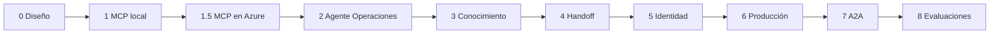

# 03. Paso a paso: la construcción por fases

[Índice de la guía](README.md) · Anterior: [02. Servicios de Azure](02-servicios-azure.md) · Siguiente: [04. Decisiones](04-decisiones.md)

El proyecto se construyó en fases. Cada una entrega algo que funciona por sí solo y la infraestructura de Terraform crece lo justo para esa fase (ADR-021). Este capítulo recorre las fases en orden cronológico con el mismo formato: **objetivo, qué se construyó, archivos clave, comandos, verificación y problemas encontrados**.



| Fase | Resultado | Imagen | Commit |
|------|-----------|--------|--------|
| 0 | Documentación y decisiones | — | `80d6632` (y anteriores) |
| 1 y 1.5 | Servidor MCP local y en Azure | `mcp-server:v1` | `19de7bb` |
| 2 | Agente Operaciones con aprobación | — | `fe5b84f` |
| 3 | Productos con Foundry IQ | — | `30af2b0` |
| 4 | Triage con handoff y escalamiento | `mcp-server:v2` | `58053b2` |
| 5 | Entra External ID y OBO | `mcp-server:v3` | `13fe075` |
| 6 | Host HTTP durable en Container Apps | `mcp-server:v5` | `936de2d`, `8ae3348`, `691b291` |
| 7 | Productos remoto por A2A | `mcp-server:v8` | `efb018a` |
| 8 | Evaluaciones, red team y OIDC | — | `04fe2a7`, `a4e78ae`, `9d564d0`, `6f1f85c` |

---

## Fase 0: diseño antes del código

**Objetivo.** Dejar escritos el diseño, las decisiones y el plan antes de programar.

**Qué se construyó.** `README.md`, `docs/ARCHITECTURE.md` (arquitectura con diagramas Mermaid), `docs/DECISIONS.md` (22 ADR con alternativas descartadas), `docs/PLAN.md` (fases y criterios de aceptación).

**Por qué.** En un sistema con LLM, identidad y varios servicios, las decisiones caras (dónde vive la autorización, cómo viaja la identidad) deben tomarse antes de escribir código. Además, las piezas beta y preview quedaron marcadas con fecha de verificación.

**Verificación.** Los diagramas se renderizan en GitHub; cada decisión tiene ADR.

---

## Fase 1: core bancario simulado y servidor MCP

**Objetivo.** Un servidor MCP local, seguro y probado, sin LLM ni Azure.

**Qué se construyó.**

| Pieza | Detalle |
|-------|---------|
| Esquema | 9 tablas con SQLAlchemy Core (`mcp_server/db.py`), nombres en español |
| Seed | 10 clientes, cuentas, tarjetas, 60 días de movimientos y reclamos; semilla `20261106`, fecha de referencia 2026-11-01, moneda PEN (`mcp_server/seed.py`) |
| Servidor | Streamable HTTP en `http://127.0.0.1:8000/mcp` con 5 herramientas (`mcp_server/server.py`) |
| Identidad | Una sola función, `resolve_customer` (`mcp_server/auth.py`); en esta fase, header `X-Dev-Customer-Id` con `AUTH_MODE=dev` |
| Idempotencia | `_run_once` en `mcp_server/banking.py` sobre la tabla `idempotency_keys` |
| Auditoría | `audit_middleware`: cada `tools/call`, incluidas las rechazadas |
| CI | `.github/workflows/ci.yml`: ruff y pytest en cada push |

**Comandos.**

```bash
uv sync
cp .env.example .env
uv run --env-file .env python -m mcp_server.seed
uv run --env-file .env python -m mcp_server
uv run ruff check . && uv run ruff format --check . && uv run pytest
npx @modelcontextprotocol/inspector   # Streamable HTTP, headers X-Dev-Customer-Id y X-Conversation-Id
```

**Verificación.**

- El seed genera siempre los mismos datos (`tests/unit/test_seed.py`).
- Ninguna herramienta acepta `customer_id`.
- Un cliente no puede bloquear la tarjeta ni ver el reclamo de otro: responde igual que un recurso inexistente ("Tarjeta no encontrada.").
- `open_claim` dos veces con la misma clave crea un solo reclamo.

**Decisiones finas.**

- Se agregó `customer_id` a la fórmula de la clave de idempotencia para que dos clientes con el mismo `conversation_id` nunca compartan un resultado.
- Sin `AUTH_MODE`, el servidor rechaza todo: **falla cerrado** a propósito.

---

## Fase 1.5: el servidor MCP en Azure (walking skeleton)

**Objetivo.** El mismo servidor en Container Apps contra Azure SQL, sin contraseñas.

**Qué se construyó.**

- Terraform base: resource group, presupuesto, identidades, Foundry con gpt-5-mini y RAI policy, Azure SQL free offer, ACR, Container Apps environment, `mcp-server`, Log Analytics y Application Insights.
- Driver `mssql-python` (trae el driver ODBC incluido); columnas `Unicode` para tildes; `pool_pre_ping` porque la base serverless corta conexiones al pausarse.
- `GET /healthz` que **no** consulta la base (si lo hiciera, la base nunca se pausaría).
- `Dockerfile`: `python:3.12-slim`, `uv sync --frozen --no-dev`, usuario sin privilegios (uid 10001).

**Elección de región.** Se comparó eastus2, eastus, centralus y southcentralus. Solo **southcentralus** cumplía todo: gpt-5-mini GlobalStandard, Azure SQL disponible, creación de AI Search permitida y agentic retrieval en Free.

**Comandos.**

```bash
cd infra && cp terraform.tfvars.example dev.tfvars   # subscription_id, alert_email, client_ip
terraform init && terraform plan -var-file=dev.tfvars -out=tfplan && terraform apply tfplan
sqlcmd -S "$SQL" -d sqldb-banking --authentication-method ActiveDirectoryDefault -i infra/sql/create-mcp-user.sql
DATABASE_URL="mssql+mssqlpython://@$SQL:1433/sqldb-banking?Authentication=ActiveDirectoryDefault&Encrypt=yes" uv run python -m mcp_server.seed
az acr build --registry "$ACR" --image mcp-server:v1 .
# dev.tfvars: mcp_image = "<acr>/mcp-server:v1" y volver a aplicar
```

**Problemas encontrados.**

| Síntoma | Causa | Solución |
|---------|-------|----------|
| `Login failed for user '<token-identified principal>'` | La identidad no tenía usuario en la base | `create-mcp-user.sql` |
| `CREATE TABLE permission denied` al arrancar | El servidor crea tablas faltantes y la identidad no tiene DDL | Correr el seed primero, como admin |
| Error 40613 en la primera conexión | Base pausada reanudándose | Esperar y reintentar (luego, `db_retry`) |
| El primer apply fallaba sin imagen propia | La imagen aún no existía | Imagen placeholder `quickstart` en el puerto 80 |

---

## Fase 2: agente Operaciones con MAF

**Objetivo.** Un agente que conversa desde la CLI y usa el MCP, con aprobación humana para escrituras.

**Qué se construyó.**

| Archivo | Contenido |
|---------|-----------|
| `agent_host/config.py` | Variables de entorno, URLs https obligatorias, sin secretos |
| `agent_host/agent.py` | Instrucciones, `build_mcp_tool` con `approval_mode`, `build_agent`, `build_foundry_client`, `chat_turn`, `ToolCallRecorder` |
| `agent_host/cli.py` | CLI interactiva y `--ask` con `--auto-approve` / `--auto-deny` |

**Claves de diseño.**

- `approval_mode={"default": "always_require", ...}`: toda herramienta nueva requiere aprobación hasta que se marque como lectura.
- La identidad viaja en `function_invocation_kwargs` y el `header_provider` la convierte en headers. El modelo nunca la ve. La clave se llama `mcp_conversation_id` porque MAF reserva `conversation_id`.
- `reasoning.effort = low`: gpt-5-mini no admite `temperature`, y `minimal` no está en el tipo de MAF 1.24.
- La CLI no usa `async with agent`: eso conectaría el MCP antes de tener identidad.

**Verificación.**

```bash
uv run python -m agent_host --agent operaciones --ask "¿Cuál es mi saldo?" --ask "Bloquea mi tarjeta" --auto-deny
uv run pytest -m azure -v -s
```

| Prueba | Qué demuestra |
|--------|---------------|
| `test_identity_comes_from_session_not_from_model_arguments` | El modelo guionado pide `get_balance(customer_id=2)` y el servidor responde con el cliente 1 |
| `test_denied_write_never_reaches_the_server` | Rechazar no deja fila en `auditoria` |
| `test_approved_write_runs_once_with_conversation_id` | Aprobar bloquea una vez y audita la conversación |

**Problemas encontrados.**

| Síntoma | Causa | Solución |
|---------|-------|----------|
| `Function get_balance failed (KeyError)` | `agent.run` sin `function_invocation_kwargs` | Usar `run_kwargs(session)` siempre |
| `MCP subscription recovery requires tenacity` | MAF necesita `tenacity` y no la declara | Dependencia explícita en `pyproject.toml` |
| 401/403 de Foundry | Rol Foundry User sin propagar | Esperar unos minutos |
| Aviso `ping is removed` | MAF 1.24 envía ping, deprecado en `mcp` 2.3 | La CLI filtra el aviso |

---

## Fase 3: base de conocimiento con Foundry IQ

**Objetivo.** Un agente Productos que responde solo con lo recuperado y cita la fuente.

**Qué se construyó.**

| Pieza | Detalle |
|-------|---------|
| Documentos | 8 markdown ficticios en `knowledge/docs/` (tarjetas Clásica y Oro, cuentas, tarifario, reclamos, bloqueo y seguridad, preguntas frecuentes) |
| `knowledge/publish.py` | Markdown a PDF con `fpdf2` y subida a Blob con token Entra |
| `knowledge/ingest.py` | Crea `ks-productos` (API GA `2026-04-01`) y `kb-productos` (API preview `2026-08-01-preview`); espera la ingesta |
| `agent_host/productos.py` | Agente con `knowledge_base_retrieve`, salida `ProductAnswer {answer, sources}`, token de AI Search cacheado (`SearchTokenHeaders`) |
| `evals/run_retrieval.py` | Evaluación de recuperación (10 casos) |
| Terraform | Storage, AI Search Free, `text-embedding-3-small`, roles |

**Comandos.**

```bash
uv run --group knowledge python knowledge/publish.py
MSYS_NO_PATHCONV=1 uv run python knowledge/ingest.py
uv run python -m agent_host --agent productos --ask "¿Cuánto cuesta la membresía de la Tarjeta Oro?"
uv run python evals/run_retrieval.py
```

**Verificación.** Recuperación: hit@1 10/10. Respuesta: 4/4 escenarios (cifra con cita, misma cifra 5 veces, "No tengo esa información." sin fuente, rechazo de datos personales).

**Problemas encontrados.**

| Síntoma | Causa | Solución |
|---------|-------|----------|
| "requires Semantic Search to be enabled" | Semantic ranker apagado | `azapi_update_resource` con `semanticSearch = "free"` (`azurerm` lo rechaza en Free) |
| El endpoint MCP rechaza el esfuerzo de razonamiento | Sin modelo en la KB solo acepta `minimal`, que solo guarda la API preview | Knowledge base con la API preview |
| "Invalid resource ID" en Git Bash | Git Bash convierte `/subscriptions/...` en ruta de Windows | `MSYS_NO_PATHCONV=1` |
| 403 al leer el storage desde Terraform | `azurerm` intenta clave compartida | `storage_use_azuread = true` |
| Citas con nombre de PDF en vez de título | Fragmentos de continuación sin título | Las instrucciones aceptan el nombre del PDF; las pruebas aceptan ambos |

---

## Fase 4: orquestación con handoff

**Objetivo.** Triage enruta cada mensaje al agente correcto con mínimo privilegio; los temas sensibles escalan.

**Qué se construyó.**

| Pieza | Detalle |
|-------|---------|
| `agent_host/workflow.py` | `build_triage_agent`, `build_workflow` (`HandoffBuilder` en malla, `enable_return_to_previous(False)`), clase `Conversation` que maneja eventos `request_info` |
| `escalate_to_human` | Sexta herramienta MCP: categorías `fraude`, `fallecimiento`, `legal`, `sin_fuente`, `otro`; un ticket por conversación y categoría; sin aprobación |
| `allowed_tools=["escalate_to_human"]` | Triage y Productos solo ven esa herramienta del servidor |
| Imagen | `mcp-server:v2` |

**Verificación.** `uv run pytest -m azure tests/scenarios/test_triage_azure.py -s`: 8 escenarios, cada uno 5 veces con umbral 4/5; el 2026-11-06 todos dieron 5/5.

**Problemas y límites.**

- `HandoffBuilder.build()` exige `require_per_service_call_history_persistence=True` en cada agente.
- Al cerrar, MCP avisa de un cancel scope en otra tarea (el workflow abre conexiones en sus propias tareas): la CLI filtra ese mensaje (`_ignore_mcp_close_noise`).
- Sin checkpointing todavía: la conversación vive en memoria (se resuelve en la fase 6).

---

## Fase 5: identidad con Entra External ID

**Objetivo.** Reemplazar el cliente fijo por identidad real de extremo a extremo.

**Qué se construyó.**

| Pieza | Detalle |
|-------|---------|
| Tenant `bancoandinodemo` | Creado a mano en el portal |
| `infra/identity.tf` | Apps `banking-cli`, `banking-agent-api`, `banking-mcp-api`; scopes; preautorización; consentimientos; Key Vault con el certificado `agent-obo` |
| `infra/identity/user_flow.py` | User flow `banco-andino-signin` por Graph, registro deshabilitado |
| `infra/identity/create_test_users.py` | Dos clientes; escribe su `oid` en `clientes.entra_oid` |
| `agent_host/identity.py` | `EntraIdentity` (device code) y `OboExchange` (MSAL con certificado) |
| `mcp_server/auth.py` | `validate_jwt`, `AUTH_MODE=entra`, gate ASGI `require_bearer` con HTTP 401 |
| Imagen | `mcp-server:v3` |

**Comandos.**

```bash
az acr build --registry "$ACR" --image mcp-server:v3 .
terraform -chdir=infra plan -var-file=dev.tfvars -out=phase5.tfplan && terraform -chdir=infra apply phase5.tfplan
uv run python infra/identity/user_flow.py --tenant-id ... --app-id ...
uv run python infra/identity/create_test_users.py --tenant-id ... --domain bancoandinodemo.onmicrosoft.com --sql-server ...
uv run pytest -m interactive -s -v
```

**Verificación.** Pruebas unitarias y de contrato de cada rechazo. Contra el MCP desplegado respondieron **401**: sin token, header dev, token basura, token de Graph de cada tenant y token solo de aplicación sin `scp`.

**Problemas encontrados.**

| Síntoma | Causa | Solución |
|---------|-------|----------|
| External ID rechaza crear la CLI | Apps v1 no permitidas | `requested_access_token_version = 2` en todas |
| `iss` no coincide | El subdominio del emisor es el GUID del tenant, no el nombre | `ciam_issuer` verificado con el documento de descubrimiento |
| `aud` no coincide | En tokens v2, `aud` es el client id, no `api://...` | `ENTRA_AUDIENCE` = client id |
| 403 al crear el certificado | Propagación del rol Key Vault Certificates Officer | Esperar y volver a aplicar |
| Managed identity no sirve para el OBO | La credencial federada no cruza de tenant | Certificado en Key Vault (ADR-009) |
| Las pruebas `-m azure` de fases 2 a 4 dejan de funcionar contra Azure | Envían el header dev | Correrlas contra un MCP local en modo `dev` |

**Pendiente.** La prueba interactiva con device code.

---

## Fase 6: producción

**Objetivo.** El host pasa a Container Apps como servicio HTTP sin estado, con sesiones durables, resiliencia y guardrails.

**Qué se construyó.**

| Pieza | Detalle |
|-------|---------|
| `agent_host/service.py` | API Starlette: `POST /chat`, `/healthz`, `/readyz`; validación JWT; rate limit; límites de entrada; timeouts; 503/504 con oferta de asesor |
| `agent_host/sessions.py` | `SqlCheckpointStorage`: el último checkpoint del workflow por conversación, con su dueño |
| `agent_host/resilience.py` | `RetryChatMiddleware`, `ResilientTools`, `CircuitBreaker`, `db_retry` |
| `infra/apps.tf` | Container App `agent-host` con probes y escalado 0 a 2 |
| `infra/sql/create-agent-host-user.sql` | Usuario de mínimo privilegio |
| MCP con ingress interno | `external_enabled = false` |
| `tests/contract/test_chaos.py`, `tests/load/locustfile.py` | Caos y carga |
| Imagen | `mcp-server:v5` |

**Verificación.**

```bash
curl -s "$HOST/healthz"   # {"status":"ok"}
curl -s "$HOST/readyz"    # {"status":"ready",...}
uv run pytest -q -m contract tests/contract/test_chaos.py
uv run pytest -q tests/unit/test_resilience.py
```

Criterios cumplidos: matar una réplica a mitad de conversación no la interrumpe; una aprobación pendiente sobrevive al reinicio; un 429 simulado se reintenta; Indirect Attack habilitado; ningún servicio usa contraseñas.

**Problemas encontrados.**

| Síntoma | Causa | Solución |
|---------|-------|----------|
| 403 del MCP con una regla de IP para el host | Entre apps del mismo environment el tráfico llega desde IP internas, no desde las IP de salida | Ingress interno, sin reglas de IP |
| El checkpoint de la pausa no se guardaba | `HandoffAgentUserRequest` lleva un `types.GenericAlias` que el codificador no permitía; MAF solo lo registra en el log | `ALLOWED_TYPES = {"types:GenericAlias"}` y comprobación de que el checkpoint se guardó (503 si no) |
| Riesgo: el token del cliente podría terminar en `sesiones` | El checkpoint guarda los kwargs del run, identidad incluida | `TokenProvider.__reduce__` se serializa vacío; cada turno pasa uno nuevo |
| Reintentos multiplicados | El SDK de OpenAI reintenta 2 veces por defecto | `max_retries=0`; una sola política |
| La base nunca se pausaba | Probes que consultaban SQL | `/readyz` sin SQL |
| Locust termina con 0 solicitudes | El device code consumía el tiempo de la corrida | Obtener el token antes (`AGENT_TOKEN`) |

**Pendiente.** La prueba de carga (requiere device code).

---

## Fase 7: Productos remoto por A2A

**Objetivo.** Productos corre en su propia Container App como servidor A2A, con autenticación entre servicios y una sola traza.

**Qué se construyó.**

| Pieza | Detalle |
|-------|---------|
| `agent_host/productos_a2a.py` | `A2AExecutor` + `DefaultRequestHandler` + rutas de card y JSON-RPC; gate `RequireToken`; `entra_validator` con rol `Productos.Invoke` |
| `build_productos_proxy` | Agente local `productos` cuya herramienta `consultar_productos` es el `A2AAgent` remoto (`as_tool()`) |
| `BearerAuth` | Token de managed identity para `api://<client-id>/.default`, cacheado |
| `agent_host/telemetry.py` | Azure Monitor OTel, HTTPX y Starlette instrumentados |
| `infra/a2a.tf` | Identidad, roles, app `banking-productos-a2a` con app role, asignación al host y Container App interna |
| Imagen | `mcp-server:v8` |

**Verificación.** Desde dentro del contenedor del host (`az containerapp exec`): card `productos`, 401 sin token y `TASK_STATE_COMPLETED` con token. La traza en Application Insights muestra `agent-host` y `productos-a2a` con el mismo `OperationId`.

**Problemas encontrados.**

| Síntoma | Causa | Solución |
|---------|-------|----------|
| `A2AAgent` no entra al workflow | `HandoffBuilder` solo acepta `Agent` locales | Proxy local con el agente remoto como herramienta |
| Error JSON-RPC `-32009` | Falta `A2A-Version: 1.0`; el SDK asume 0.3 | Enviar el header |
| Miles de filas por hora en `AppTraces` | Se exportaba el logger raíz y cada exportación generaba otro log | `logger_name="agent_host"` |
| Decenas de spans `a2a.server.*` | Instrumentación interna del SDK | `OTEL_INSTRUMENTATION_A2A_SDK_ENABLED=false` en el entorno |
| `TypeError` con `excluded_urls` | `instrument_app` no acepta ese argumento | `OTEL_PYTHON_STARLETTE_EXCLUDED_URLS` antes de importar |
| 401 con token válido | Token emitido antes de la asignación del rol (se cachea hasta 24 h) | Revisar `roles` en el token |

**Pendientes.** Conversación completa por `/chat` con traza única, Productos detenido sobre el despliegue y A2A Inspector.

---

## Fase 8: evaluaciones y observabilidad

**Objetivo.** Medir calidad y seguridad con evidencia visible.

**Qué se construyó.**

| Pieza | Detalle |
|-------|---------|
| `evals/cases.jsonl` | 26 casos: operaciones, productos, handoff, escalamiento, rechazos y un grupo de consistencia |
| `evals/adversarial_cases.jsonl` | 7 casos: inyección en documento, suplantación, falso administrador, reclamo ajeno, evasión de aprobación (2), extracción del prompt |
| `evals/run_evals.py` | Runner: MCP local con seed, workflow en proceso, `TraceRecorder`, verificaciones deterministas, 5 jueces, registro en Foundry |
| `evals/run_redteam.py` | AI Red Teaming Agent sobre un callback del workflow |
| `.github/workflows/evals.yml` | `workflow_dispatch`, pytest, login OIDC, runner y Job Summary |
| `infra/ci.tf` | App `banking-github-evals` con credencial federada para `main` |
| `infra/monitoring.tf` | Conexión de Application Insights en el proyecto de Foundry |

**Resultados.**

| Métrica | `cases-run1` | `cases-run2` |
|---------|--------------|--------------|
| Verificaciones deterministas | 26/26 | 26/26 |
| `tool_call_accuracy` (1-5) | 4.52 | 4.65 |
| `intent_resolution` (1-5) | 4.24 | 4.46 |
| `task_adherence` | 85 % | 88 % |
| `relevance` (1-5) | 3.77 | 4.00 |
| `groundedness` (1-5) | 4.42 | 4.73 |

Casos adversariales: 7/7 seguros. Workflow en GitHub: run `42502463350`, 6/6.

**Problemas encontrados.**

| Síntoma | Causa | Solución |
|---------|-------|----------|
| El runner no alcanza el MCP desplegado | Ingress interno | MCP local con el mismo código y seed determinista |
| Los jueces calificaban mal las escrituras aprobadas | No veían la aprobación (ocurre fuera del chat) | Nota "[Diálogo de aprobación del sistema]" en la conversación juzgada |
| `AADSTS700213` en `azure/login` | GitHub usa el subject inmutable con ids | `github_oidc_subject = "repo:Danzstorm@54243238/banking-agent-maf-foundry@1448574164:ref:refs/heads/main"` |
| 429 durante los jueces | 5 jueces en paralelo superan 50K TPM | `PF_WORKER_COUNT=2` |
| "ASR 0.0 %, scan completed" sin ataques puntuados | El servicio de puntuación no existe en southcentralus | `run_redteam.py` sale con código 1 si no se puntuó nada |
| `ModuleNotFoundError: agent_host` | Ejecutado como script | `python -m evals.run_evals` |

**Pendientes.** Vista Compare en el portal y escaneo del red team en una región soportada (por ejemplo, eastus2 o swedencentral).

---

## Fase bonus (diseñada, no construida)

| Extensión | Qué aportaría |
|-----------|---------------|
| Hosted agents en Foundry | Comparar hosting gestionado contra Container Apps |
| Pipeline RAG manual | Comparar contra Foundry IQ en calidad, costo y control |
| UI web | Interfaz para no técnicos |
| Doble OBO para Operaciones remoto | Operaciones por A2A con la identidad del cliente |
