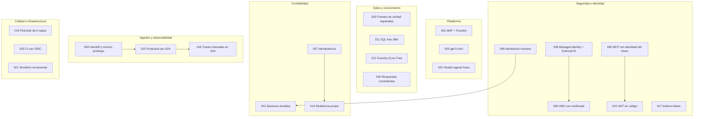

# 04. Decisiones explicadas

[Índice de la guía](README.md) · Anterior: [03. Paso a paso](03-paso-a-paso.md) · Siguiente: [05. Flujos](05-flujos.md)

Este capítulo explica en lenguaje simple las 22 decisiones de arquitectura (ADR) de [docs/DECISIONS.md](../DECISIONS.md) y las decisiones que surgieron durante la implementación. Para cada una: **contexto** (el problema), **decisión**, **alternativas**, **costo de la decisión** y **consecuencia visible en el repositorio**.

> Cómo leer un ADR: no dice "esto es lo mejor", dice "con lo que sabíamos y lo que queríamos lograr, elegimos esto y aceptamos estos costos". Un buen ADR permite revisar la decisión cuando cambia el contexto.

## Mapa de decisiones

Las flechas indican dependencia: por ejemplo, reintentar escrituras (014) solo es seguro porque existe la idempotencia (007).

---

## Parte 1: los 22 ADR

### ADR-001: MAF ejecuta el agente; Foundry es la plataforma

| | |
|---|---|
| Contexto | Foundry ofrece agentes server-side (Agent Service) y también acceso directo al modelo. Un banco necesita control fino sobre herramientas, aprobaciones, sesiones y reintentos. |
| Decisión | El bucle corre en nuestro código con MAF y `FoundryChatClient` (Responses API). Foundry pone modelo, conocimiento, tracing y evaluaciones. |
| Alternativa | Agentes de Foundry Agent Service: menos control y más difíciles de probar en local. |
| Costo | Somos dueños de la resiliencia y del estado. |
| En el repo | `build_foundry_client` en `agent.py`; no hay ningún agente creado en Foundry. |

### ADR-002: gpt-5-mini en GlobalStandard

| | |
|---|---|
| Contexto | Buen uso de herramientas a bajo costo; costo cero sin tráfico. |
| Decisión | gpt-5-mini, pago por token. Como es de razonamiento, no admite `temperature`: se fija `reasoning_effort`. |
| Alternativas | Provisioned throughput (costo fijo); modelos más grandes (más caros sin ganancia demostrada). |
| Costo | Global puede procesar fuera de la región: aceptable con datos sintéticos, a revisar con datos reales. |
| En el repo | `azurerm_cognitive_deployment.gpt5mini`; `default_options={"reasoning": {"effort": "low"}}`. |

### ADR-003: fuentes de verdad separadas

| | |
|---|---|
| Contexto | Un RAG puede devolver cifras plausibles pero equivocadas; una base transaccional no es lugar para reglas de producto. |
| Decisión | Saldos y movimientos **solo** de SQL vía MCP; tarifas y reglas **solo** de Foundry IQ. |
| Alternativa | Indexar datos de clientes en el buscador: fuga de datos personales y desactualización. |
| Costo | Las preguntas mixtas requieren dos agentes. |
| En el repo | Productos no tiene herramientas bancarias; Operaciones no tiene la knowledge base. El escenario "mixta" pasa por los dos. |

### ADR-004: handoff y mínimo privilegio

| | |
|---|---|
| Contexto | Un agente con todas las herramientas amplía la superficie de ataque: una inyección en un documento podría disparar una escritura. |
| Decisión | `HandoffBuilder` con Triage (solo enruta), Productos (solo conocimiento) y Operaciones (solo MCP). Todos pueden escalar. |
| Alternativas | Agente único (viola mínimo privilegio); planner o group chat (impredecible y difícil de evaluar). |
| Costo | Más llamadas al modelo por conversación. |
| En el repo | `allowed_tools=["escalate_to_human"]` para Triage y Productos; prueba de contrato que comprueba que Triage no alcanza `get_balance`. |

### ADR-005: servidor MCP propio con identidad del token

| | |
|---|---|
| Contexto | Si el modelo eligiera el cliente, una inyección bastaría para ver datos ajenos. |
| Decisión | Ninguna herramienta recibe `customer_id`; el servidor lo obtiene del token. Cada id recibido valida pertenencia. |
| Alternativas | `customer_id` como argumento (confía en el modelo); herramientas locales en el host (mezcla autorización y orquestación). |
| Costo | Un servidor más que mantener. |
| En el repo | `resolve_customer` en `auth.py`; consultas con `cliente_id == customer_id` en `banking.py`. El caso adversarial "reclamo ajeno" lo demostró: el modelo **sí** llamó `get_claim_status(2)` y el servidor lo rechazó. |

### ADR-006: aprobación humana para escrituras

| | |
|---|---|
| Contexto | Bloquear una tarjeta o abrir un reclamo tiene efectos reales. |
| Decisión | `approval_mode` con `always_require` por defecto; solo las lecturas se marcan `never_require`. |
| Alternativa | Que el modelo pida confirmación en texto: no es un control, puede omitirla. |
| Costo | Un paso extra; la aprobación debe sobrevivir a reinicios (ADR-013). |
| En el repo | `build_mcp_tool`; las instrucciones le piden al modelo **no** confirmar por texto. |

### ADR-007: idempotencia con `idempotency_key`

| | |
|---|---|
| Contexto | Un reintento por timeout podría crear dos reclamos. |
| Decisión | `sha256(conversation_id + customer_id + tool + args normalizados)` en una tabla con clave primaria. Una clave repetida devuelve el resultado guardado. |
| Alternativas | Deduplicación en memoria (no funciona con réplicas); clave generada por el modelo (no determinista). |
| Costo | Dos reclamos legítimos idénticos en la misma conversación cuentan como uno. |
| En el repo | `_run_once` en `banking.py`: la clave y la escritura comparten transacción, así que una escritura fallida no guarda nada. |

### ADR-008: managed identity entre servicios y External ID para clientes

| | |
|---|---|
| Contexto | Los secretos de conexión son la causa más común de filtraciones; los clientes no son empleados. |
| Decisión | Managed identity servicio a servicio; tenant External ID para clientes, creado a mano (la API ARM está en preview); apps con `azuread`; device code en la CLI. |
| Alternativas | Azure AD B2C (reemplazado); usuarios en el tenant workforce (mezcla); contraseñas (secreto innecesario). |
| Costo | Un paso manual fuera de Terraform. |
| En el repo | Tres `azurerm_user_assigned_identity`; `identity.tf` con `provider = azuread.external`. |

### ADR-009: OBO con certificado en Key Vault

| | |
|---|---|
| Contexto | El MCP necesita la identidad del cliente; una credencial federada de managed identity no cruza al tenant externo. |
| Decisión | El host hace OBO autenticándose con un certificado guardado en Key Vault, leído con managed identity. |
| Alternativas | Client secret (más fácil de filtrar); reenviar el token del cliente (audiencia incorrecta). |
| Costo | Rotar el certificado (12 meses de validez). |
| En el repo | `azurerm_key_vault_certificate.obo`, `OboExchange` en `identity.py`. |

### ADR-010: validación JWT en el código del MCP

| | |
|---|---|
| Contexto | Easy Auth de Container Apps podría interferir con el descubrimiento del protocolo MCP. |
| Decisión | El servidor valida firma, emisor, audiencia, vigencia, tenant y scope en su propio código. |
| Alternativa | Easy Auth: menos visible en pruebas y riesgo de romper MCP. |
| Costo | Código de seguridad propio con pruebas dedicadas. |
| En el repo | `validate_jwt` y `require_bearer`; `tests/unit/test_auth_entra.py` con cada rechazo. |

### ADR-011: Azure SQL free offer

| | |
|---|---|
| Contexto | Base relacional compartida entre réplicas, sin secretos y gratis en reposo. |
| Decisión | Free offer serverless con AutoPause, habilitada con `azapi`; solo Entra. Pruebas con SQLite. |
| Alternativas | SQLite en el contenedor (efímero, no compartido); Cosmos DB (sin ventaja con `UNIQUE` relacional). |
| Costo | Primera consulta lenta tras la pausa; diferencias de dialecto. |
| En el repo | `azapi_resource.sql_db` con `useFreeLimit`; `db_retry`. |

### ADR-012: Foundry IQ sobre AI Search Free

| | |
|---|---|
| Contexto | El conocimiento necesita ingesta, chunking, embeddings, búsqueda híbrida y fuentes. |
| Decisión | Foundry IQ (recuperación extractiva, GA) sobre AI Search Free; knowledge source y base creadas por script; síntesis en nuestro agente. |
| Alternativas | Pipeline propio desde el inicio (código sin valor diferencial); objetos de plano de datos en Terraform (soporte inmaduro). |
| Costo | Menos control del chunking; agentic retrieval en Free solo en algunas regiones. |
| En el repo | `knowledge/ingest.py`; `build_kb_tool`. |

### ADR-013: sesiones durables en Azure SQL

| | |
|---|---|
| Contexto | Con varias réplicas y scale to zero, la conversación no puede vivir en memoria. |
| Decisión | El estado de la conversación, aprobaciones incluidas, se persiste en `sesiones`. |
| Alternativas | Sticky sessions (fallan al reiniciar); Redis (un servicio más con costo). |
| Costo | No había sample oficial de reanudación: se demostró con una prueba de caos. |
| En el repo | `SqlCheckpointStorage` guarda el **checkpoint del workflow** (la evolución de la idea original de `session.to_dict()`, porque el handoff es un workflow). |

### ADR-014: capa de resiliencia propia

| | |
|---|---|
| Contexto | MAF no trae retry ni circuit breaker; el SDK de OpenAI solo hace 2 reintentos. |
| Decisión | Retry con backoff y jitter para modelo, MCP y A2A; timeouts por llamada; circuit breaker; probes. |
| Alternativas | Confiar en el SDK (incompleto); service mesh (desproporcionado). |
| Costo | Código propio que mantener. |
| En el repo | `resilience.py`; `max_retries=0` en el cliente de OpenAI. |

### ADR-015: Productos remoto por A2A

| | |
|---|---|
| Contexto | Demostrar interoperabilidad entre agentes sin complicar la identidad. |
| Decisión | Productos como servidor A2A 1.0 en su Container App, con token de managed identity. Se elige Productos porque no necesita la identidad del cliente. |
| Alternativas | Operaciones remoto (requiere doble OBO); todo local (no demuestra A2A). |
| Costo | Dependencia beta (`agent-framework-a2a`) y un salto de red más. |
| En el repo | `productos_a2a.py`, `a2a.tf`. |

### ADR-016: propagación manual de trazas en A2A

| | |
|---|---|
| Contexto | MAF solo inyecta `traceparent` en MCP; la traza se partiría en dos. |
| Decisión | Instrumentar HTTPX (cliente) y Starlette (servidor). |
| Alternativa | Correlacionar por ids en logs: sin vista de árbol ni latencias por tramo. |
| Costo | Configuración a revalidar con cada actualización. |
| En el repo | `telemetry.py`. |

### ADR-017: guardrails con Indirect Attack habilitado

| | |
|---|---|
| Contexto | DefaultV2 y jailbreak vienen activos, Indirect Attack no. Spotlighting solo aplica a Chat Completions y aquí se usa Responses. |
| Decisión | RAI policy con Indirect Attack en bloqueo; instrucciones, red team, límite de entrada y rate limit cubren el resto. |
| Alternativas | Solo valores por defecto; cambiar a Chat Completions (perder la Responses API). |
| Costo | Posibles falsos positivos. |
| En el repo | `azurerm_cognitive_account_rai_policy.main`; `MAX_MESSAGE_CHARS`, `TokenBucket`. |

### ADR-018: respuestas consistentes y fundamentadas

| | |
|---|---|
| Contexto | La misma pregunta debe dar la misma cifra y fuente. Idempotencia y consistencia son problemas distintos. |
| Decisión | Solo fuentes recuperadas con citas; "No tengo esa información" sin fuente; `reasoning_effort` fijo; salida estructurada; evaluación con 5 repeticiones; caché solo de recuperación. |
| Alternativas | Bajar `temperature` (no aplica); cachear respuestas completas (riesgo de fuga). |
| Costo | Más respuestas "no tengo esa información" con una base incompleta: es lo deseado. |
| En el repo | `ProductAnswer`; grupo de consistencia en `cases.jsonl`. La caché de recuperación con TTL no está implementada en el código actual (solo se cachean tokens); ninguna respuesta se cachea. |

### ADR-019: pirámide de pruebas de 6 capas

| | |
|---|---|
| Contexto | Un agente mezcla lógica determinista y un modelo no determinista. |
| Decisión | Unitarias, contrato MCP, escenarios con umbral, evaluaciones, red team y trazas. |
| Alternativas | Solo evaluaciones con LLM (caras, no prueban autorización); asserts exactos sobre texto (frágiles). |
| Costo | Las capas 3 a 5 consumen tokens e infraestructura. |
| En el repo | Marcadores `contract`, `azure`, `interactive` en `pyproject.toml`. |

### ADR-020: CI con OIDC y evaluaciones bajo demanda

| | |
|---|---|
| Contexto | Un workflow programado contra infraestructura destruida falla todos los días. |
| Decisión | `ci.yml` en cada push sin Azure; evaluaciones con `workflow_dispatch`; login solo por OIDC. |
| Alternativas | Cron (falla con infraestructura destruida); service principal con secreto. |
| Costo | Las regresiones del modelo no se detectan solas. |
| En el repo | `.github/workflows/`, `infra/ci.tf`. |

### ADR-021: Terraform incremental con control de costos

| | |
|---|---|
| Contexto | Desplegar todo desde el inicio sube costo y dificulta depurar. |
| Decisión | `azurerm` para el núcleo, `azapi` donde no llega, `azuread` para identidades; crece por fase; presupuesto USD 20; `destroy` al terminar cada sesión. |
| Alternativas | Bicep (no gestiona el tenant externo en el mismo flujo); infraestructura permanente. |
| Costo | Recrear toma tiempo. |
| En el repo | `infra/*.tf` agrupados por fase. |

### ADR-022: hosted agents fuera del núcleo

| | |
|---|---|
| Contexto | El hosting de agentes en Foundry está en beta. |
| Decisión | El núcleo corre en Container Apps; hosted agents quedan para la fase bonus. |
| Costo | No se demuestra el hosting gestionado todavía. |

---

## Parte 2: decisiones tomadas durante la implementación

Estas no tienen ADR propio, pero cambiaron el diseño de forma visible.

| Decisión | Contexto | Alternativa descartada | Consecuencia |
|----------|----------|------------------------|--------------|
| **Región southcentralus** | Era la única de cuatro candidatas con gpt-5-mini GlobalStandard, Azure SQL disponible, creación de AI Search permitida y agentic retrieval en Free | eastus2 (AI Search no admitía nuevos servicios), centralus (sin agentic retrieval en Free) | El red team no puede puntuar en esta región |
| **Ingress interno para el MCP** | Una lista de IP permitidas no sirve entre apps del mismo environment (llegan desde IP internas) y las IP de salida del plan de consumo son compartidas | Reglas `ip_security_restriction` | El MCP desplegado no es alcanzable desde tu máquina; las pruebas locales usan un MCP local |
| **Productos como herramienta de un proxy, no como participante del handoff** | `HandoffBuilder` solo acepta `Agent` locales | Reescribir la orquestación | `build_productos_proxy` con `consultar_productos`; el handoff sigue igual |
| **MCP local para las evaluaciones** | El MCP desplegado es interno; un job en Azure requeriría otra imagen con PyRIT y `transformers` | `az containerapp exec`, Container Apps job, reabrir el ingress | Se evalúa el comportamiento del agente con el seed determinista, no Azure SQL |
| **Una sola imagen para tres apps** | Menos builds, misma base de código | Una imagen por servicio | `command` distinto por app en Terraform |
| **Checkpoint del workflow en lugar de `session.to_dict()`** | El handoff es un workflow; su estado incluye las solicitudes pendientes | Guardar sesiones por agente | `SqlCheckpointStorage` con `ALLOWED_TYPES` |
| **El token nunca se persiste** | El checkpoint guarda los kwargs | Excluir la identidad a mano | `TokenProvider` se serializa vacío |
| **Probes sin SQL** | Una probe cada pocos segundos impediría que la base se pause | Readiness con `SELECT 1` | `/readyz` solo indica si el host está construido |
| **Una sola política de reintentos** | El SDK de OpenAI reintentaba por su cuenta | Reintentos anidados | `max_retries=0` |
| **Card A2A pública, `SendMessage` protegido** | La card es el documento de descubrimiento | Proteger todo | `OPEN_PATHS` en `RequireToken` |
| **Validador A2A acepta tokens v1 y v2** | Un cambio de manifiesto no debe dejar fuera al host | Solo v2 | Dos emisores y dos audiencias aceptados |
| **Token A2A del tenant workforce** | Productos no necesita la identidad del cliente | Token del tenant externo | Sin segunda cadena OBO |
| **Escalamiento sin aprobación** | Es un pedido de ayuda, no una operación sobre productos | Aprobación como en las escrituras | `never_require_approval` incluye `escalate_to_human` |
| **Categoría como prefijo del motivo** | Evitar migrar el esquema | Columna nueva | `[fraude] ...` en `tickets_escalamiento.motivo` |
| **Recurso ajeno = inexistente** | No revelar que existe | Mensaje "no autorizado" específico | "Tarjeta no encontrada." para ambos casos |
| **Mensaje de error único "No autorizado."** | No revelar qué control falló | Mensajes detallados | `AuthError` siempre con el mismo texto |
| **Rate limit y breaker en memoria** | Dos réplicas como máximo | Redis o SQL compartido | Límite real = límite por réplica por número de réplicas (marcado con `ponytail:` en el código) |
| **Nota de aprobación para los jueces** | Los jueces no veían el diálogo de aprobación | Ignorar esos puntajes | `tool_call_accuracy` de escrituras mejoró entre `cases-run1` y `cases-run2` |
| **Subject OIDC inmutable** | GitHub presenta `repo:<owner>@<id>/<repo>@<id>:ref:...` | Subject clásico `repo:owner/repo:ref:...` | Variable `github_oidc_subject` |

> **Patrón que se repite.** Cada vez que una pieza gestionada no encajaba (Easy Auth, IP allowlist, A2A en el handoff), se resolvió con la opción más simple que mantenía la regla de seguridad, y se dejó escrito el porqué en el código o en la guía de la fase.
