# 05. Flujos de punta a punta

[Índice de la guía](README.md) · Anterior: [04. Decisiones](04-decisiones.md) · Siguiente: [06. Seguridad](06-seguridad.md)

Cada sección sigue una petición real por el sistema, con un diagrama de secuencia y la tabla "dónde está en el código". Los nombres de funciones y archivos son los del repositorio.

Contenido:

1. [Inicio de sesión y OBO](#1-inicio-de-sesión-y-obo)
2. [Turno de chat con herramienta y aprobación humana](#2-turno-de-chat-con-herramienta-y-aprobación-humana)
3. [Ciclo de vida de una aprobación](#3-ciclo-de-vida-de-una-aprobación)
4. [Sesión durable: una réplica muere](#4-sesión-durable-una-réplica-muere)
5. [Handoff: Triage, Operaciones y Productos](#5-handoff-triage-operaciones-y-productos)
6. [Llamada A2A con token de managed identity y traza](#6-llamada-a2a-con-token-de-managed-identity-y-traza)
7. [Escalamiento y circuit breaker](#7-escalamiento-y-circuit-breaker)
8. [Recuperación de conocimiento con citas](#8-recuperación-de-conocimiento-con-citas)
9. [Idempotencia de una escritura](#9-idempotencia-de-una-escritura)
10. [Ejecución de evaluaciones y CI con OIDC](#10-ejecución-de-evaluaciones-y-ci-con-oidc)
11. [Modelo de datos](#modelo-de-datos)

---

## 1. Inicio de sesión y OBO

El cliente inicia sesión una vez en la CLI. Después, en cada turno, el host valida su token y lo cambia por uno para el MCP.

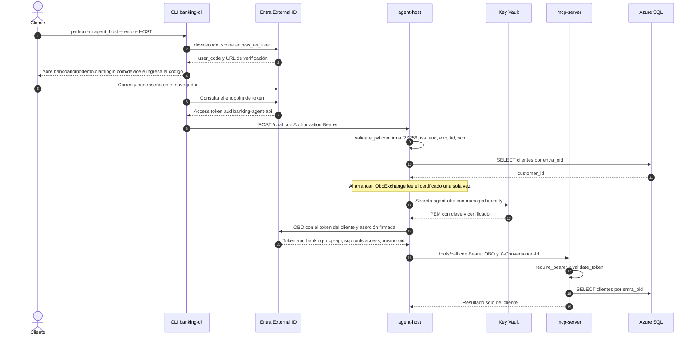

| Paso | Dónde está |
|------|------------|
| Device code | `EntraIdentity.sign_in` (`agent_host/identity.py`), llamado por `remote_auth` en `cli.py` |
| Token silencioso en cada turno | `EntraIdentity.user_token` |
| Validación en el host | `entra_authenticator` en `service.py`, con `validate_jwt` de `mcp_server/auth.py` |
| `oid` a cliente en el host | `customer_by_oid` en `sessions.py` (usa el permiso `SELECT` sobre `clientes`) |
| OBO | `OboExchange.mcp_token`; `TokenProvider(lambda: obo.mcp_token(user_token))` |
| Lectura del certificado | `load_certificate_pem` con `SecretClient`; se carga perezosamente la primera vez que se necesita el OBO |
| Header hacia el MCP | `mcp_headers` en `agent.py` |
| Validación en el MCP | `require_bearer` (HTTP 401 antes de abrir la sesión MCP) y `resolve_customer` |

> **Detalle.** MSAL cachea el token OBO de cada cliente y lo renueva cerca del vencimiento. La llamada es síncrona: está marcada con `ponytail:` en `identity.py` como un límite conocido si el host atendiera muchos usuarios.

---

## 2. Turno de chat con herramienta y aprobación humana

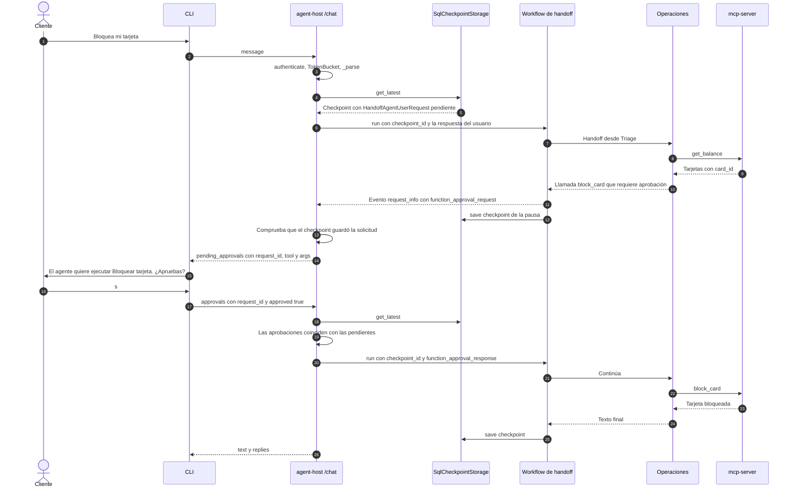

Reglas que aplica el host (`advance` y `chat` en `service.py`):

| Situación | Respuesta |
|-----------|-----------|
| Se envían `message` y `approvals` a la vez, o ninguno | 400 |
| Hay aprobaciones pendientes y llega un mensaje | 409 "Primero responde las aprobaciones pendientes." |
| Las aprobaciones no coinciden con las pendientes | 409 |
| `conversation_id` de otro cliente | 404 "Conversación no encontrada." (no revela de quién es) |
| El checkpoint de una aprobación abierta no se guardó | 503: nunca devuelve una aprobación que no podría retomarse |
| El turno supera 120 s | 504 con oferta de asesor |
| El modelo o el MCP fallan tras los reintentos | 503 con oferta de asesor |

Si el cliente **rechaza**, MAF devuelve a la herramienta el resultado "rejected by user" sin llamar al MCP, y las instrucciones de Operaciones dicen que responda que no se hizo.

---

## 3. Ciclo de vida de una aprobación

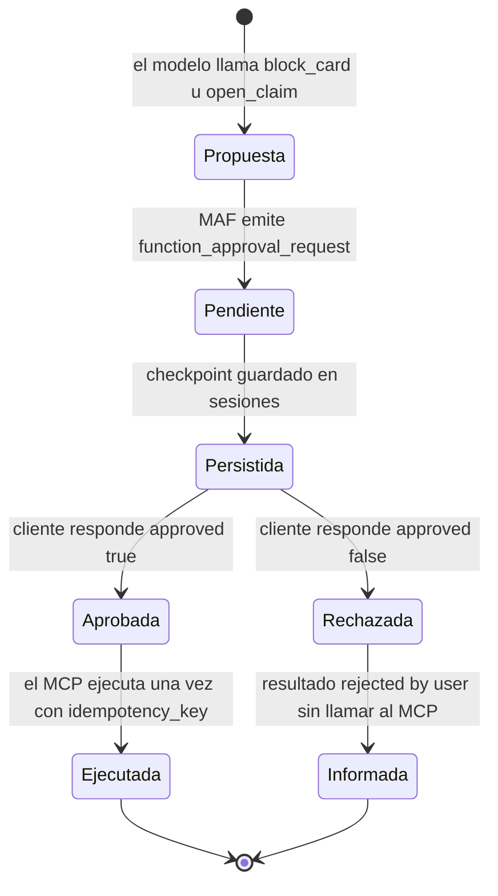

La aprobación pendiente sobrevive en el estado `Persistida`: cualquier réplica puede recibir la respuesta del cliente.

---

## 4. Sesión durable: una réplica muere

`tests/contract/test_chaos.py` lo prueba con dos procesos host reales que comparten la base, matando uno con `kill()` (sin hooks de cierre).

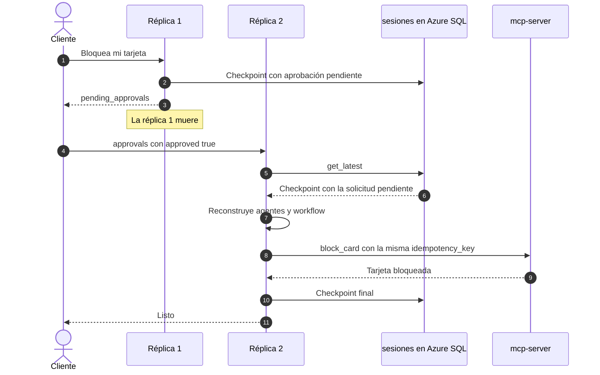

Segundo caso de la prueba: la réplica muere **durante** una escritura aprobada. El checkpoint guardado no tiene solicitudes pendientes pero la conversación no terminó, así que `advance` detecta `latest is not None and not waiting` y vuelve a ejecutar el superstep desde el checkpoint. La escritura se completa **una sola vez** gracias a la idempotencia del MCP.

| Pieza | Dónde |
|-------|-------|
| Un checkpoint por conversación, con su dueño | `SqlCheckpointStorage` (`sessions.py`) |
| Reconstrucción por request | `h.build_participants()` y `build_workflow` en `chat` |
| Reanudar un turno a medias | Primera rama de `advance` |
| Reintentos SQL ante 40613 | `db_retry` |

---

## 5. Handoff: Triage, Operaciones y Productos

Ejemplo: "¿Cuál es mi saldo y cuánto cuesta la Tarjeta Oro?" (escenario "mixta").

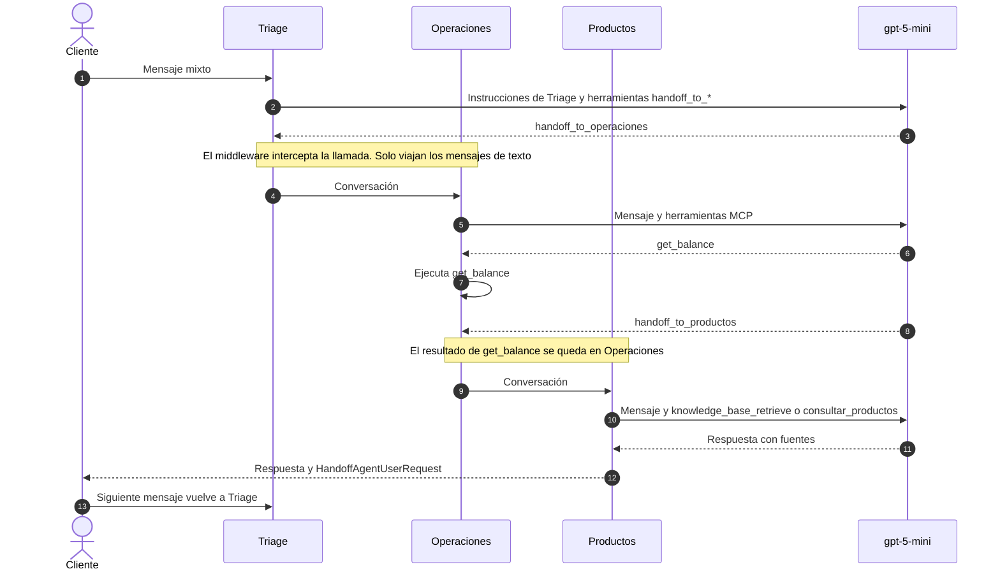

| Regla | Implementación |
|-------|----------------|
| Triage solo enruta | `TRIAGE_INSTRUCTIONS`; su única herramienta es `escalate_to_human` |
| Cualquiera transfiere a cualquiera | Sin `add_handoff` (malla) |
| Cada mensaje nuevo pasa por Triage | `enable_return_to_previous(False)` |
| Las respuestas de aprobación vuelven al agente que preguntó | Comportamiento del workflow |
| La identidad llega a todos los agentes | `function_invocation_kwargs` del workflow |

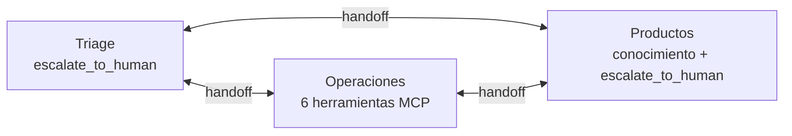

---

## 6. Llamada A2A con token de managed identity y traza

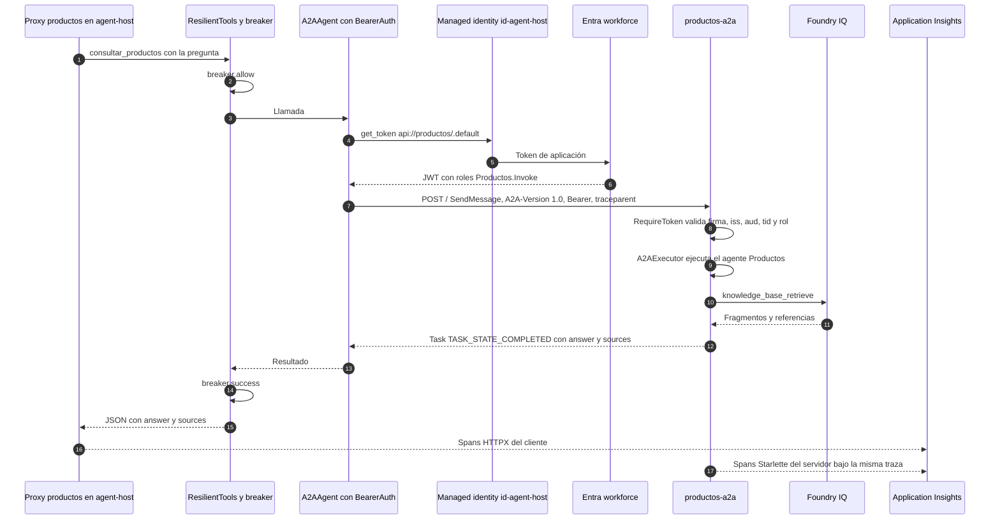

| Aspecto | Valor |
|---------|-------|
| URL interna | `https://productos-a2a.internal.happymoss-084472df.southcentralus.azurecontainerapps.io/` |
| Card | `GET /.well-known/agent-card.json`, sin token |
| Scope pedido | `api://<client id de banking-productos-a2a>/.default` (`PRODUCTOS_A2A_SCOPE`) |
| Emisores aceptados | `https://login.microsoftonline.com/<tid>/v2.0` y `https://sts.windows.net/<tid>/` |
| Audiencias aceptadas | `<client id>` y `api://<client id>` |
| Timeouts del cliente | 15 s de conexión, 60 s de respuesta |
| Cache del token | Hasta 5 minutos antes de vencer |

**Consulta KQL para ver la traza:**

```kusto
union AppRequests, AppDependencies
| where OperationId == "<trace id>"
| project TimeGenerated, Type, AppRoleName, Name, ResultCode, DurationMs
| order by TimeGenerated asc
```

---

## 7. Escalamiento y circuit breaker

Dos caminos llevan a una persona: el **escalamiento por tema** (decidido por el modelo según las instrucciones) y el **escalamiento por falla** (cuando el breaker abre).

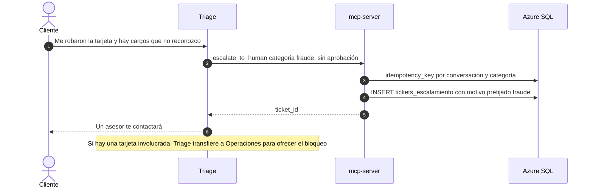

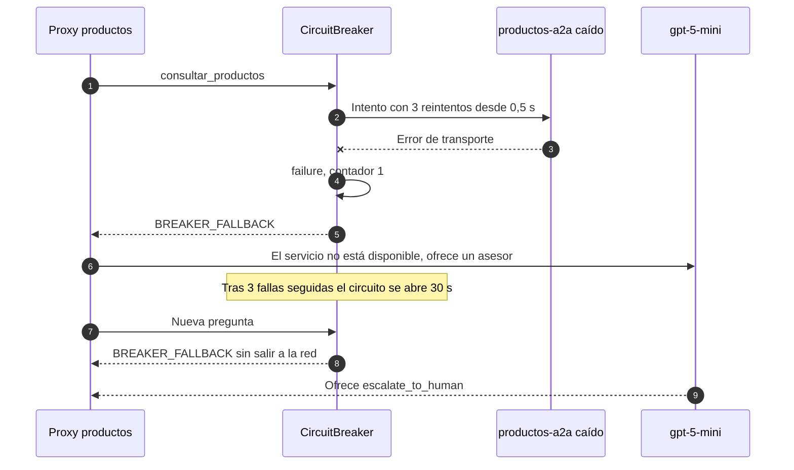

| Parámetro | Valor | Dónde |
|-----------|-------|-------|
| Umbral | 3 fallas seguidas | `CircuitBreaker(threshold=3)` |
| Tiempo abierto | 30 s, luego semiabierto | `reset_after_s=30` |
| Reintentos de herramienta | 3, desde 0,5 s, máximo 4 s, jitter 1 s | `ResilientTools` |
| Reintentos del modelo | 4, desde 1 s, máximo 8 s | `RetryChatMiddleware` |
| Mensaje al modelo | `BREAKER_FALLBACK` | `resilience.py` |
| Qué protege en el host | `consultar_productos` (A2A) o `knowledge_base_retrieve` (modo local) | `production_host` |
| Qué protege en `productos-a2a` | `knowledge_base_retrieve` | `productos_a2a.main` |
| Estado visible | `knowledge_breaker` en `/readyz` | `service.py` |

Una tarea A2A que termina en `TASK_STATE_FAILED` **no** cuenta como falla del breaker: llega como texto al proxy.

---

## 8. Recuperación de conocimiento con citas

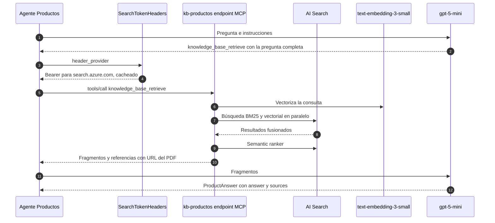

La ingesta, que ocurre una vez:

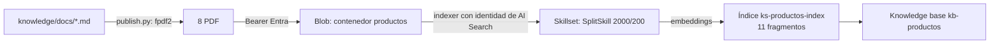

---

## 9. Idempotencia de una escritura

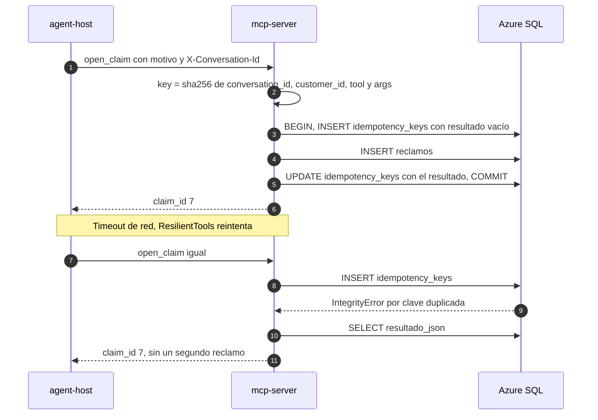

Si la escritura falla, la transacción hace rollback y no queda clave guardada: un reintento vuelve a intentarlo (`test_failed_write_is_not_cached`).

---

## 10. Ejecución de evaluaciones y CI con OIDC

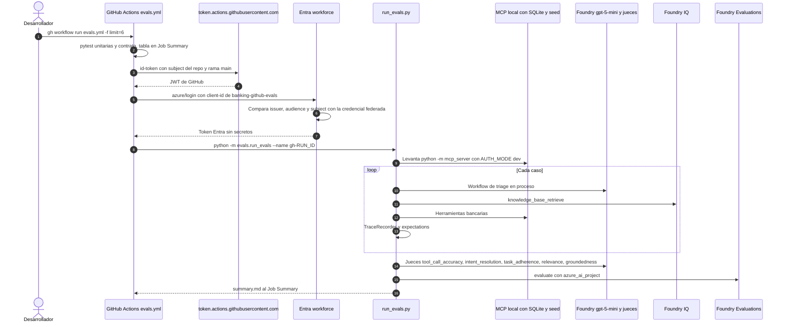

| Pieza | Dónde |
|-------|-------|
| Permiso `id-token: write` | `.github/workflows/evals.yml` |
| Credencial federada | `azuread_application_federated_identity_credential.github_main` en `infra/ci.tf` |
| MCP local | `local_mcp()` en `run_evals.py` |
| Registro de herramientas | `TraceRecorder` |
| Jueces | `evaluate()` en `run_evals.py`, `is_reasoning_model=True`, `PF_WORKER_COUNT=2` |
| Resultados locales | `evals/results/<nombre>/rows.jsonl`, `evaluation.json`, `summary.md` |

---

## Modelo de datos

Esquema real de `mcp_server/db.py` (SQLAlchemy Core; igual en SQLite y Azure SQL).

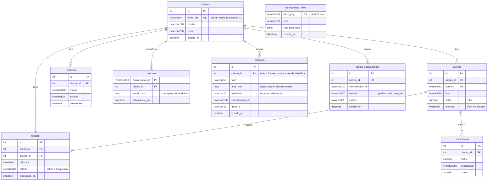

| Tabla | Quién escribe | Quién lee |
|-------|---------------|-----------|
| `clientes` | Seed; `create_test_users.py` actualiza `entra_oid` | MCP (`resolve_customer`), host (`customer_by_oid`) |
| `cuentas`, `tarjetas`, `movimientos`, `reclamos` | Seed; MCP (`block_card`, `open_claim`) | MCP |
| `idempotency_keys` | MCP (`_run_once`) | MCP |
| `sesiones` | Host (`SqlCheckpointStorage`) | Host |
| `auditoria` | MCP (`audit_middleware`) | Operadores |
| `tickets_escalamiento` | MCP (`escalate_to_human`) | Asesores (fuera de alcance) |

La columna `trace_id` de `auditoria` existe en el esquema, pero el middleware actual no la completa.
