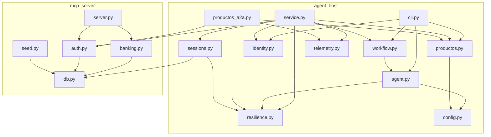
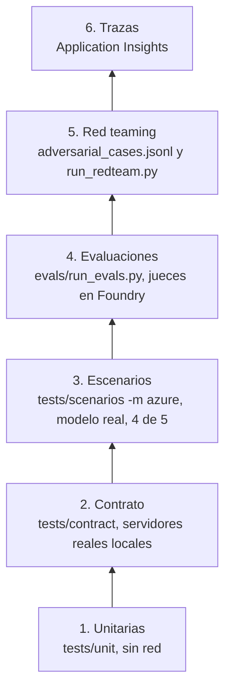

# 07. Recorrido por el código

[Índice de la guía](README.md) · Anterior: [06. Seguridad](06-seguridad.md) · Siguiente: [08. Operación](08-operacion.md)

Un mapa del repositorio para leer el código con contexto: qué hace cada módulo, sus funciones clave, cómo se conectan y cómo se prueban.

## 1. Estructura

```text
banking-agent-maf-foundry/
  mcp_server/        servidor MCP: esquema, identidad, lógica bancaria, seed
  agent_host/        agentes MAF, workflow, servicio HTTP, A2A, identidad, resiliencia, sesiones, CLI
  knowledge/         documentos de productos, render a PDF e ingesta en Foundry IQ
  evals/             datasets, runner de evaluaciones, red team, evaluación de recuperación
  infra/             Terraform, scripts SQL y scripts de identidad (Graph)
  tests/             unit, contract, scenarios, load
  docs/              documentación (esta guía incluida)
  .github/workflows/ ci.yml y evals.yml
  Dockerfile         una imagen para las tres apps
  pyproject.toml     dependencias (uv), ruff y pytest
```

Nota: el README menciona un paquete `productos_a2a/` en la estructura planificada; en la implementación final el servidor A2A vive en `agent_host/productos_a2a.py`.

## 2. Cómo se conectan los módulos



Dos detalles importantes:

- `validate_jwt` vive en `mcp_server/auth.py` y lo reutilizan el MCP, el host y Productos: **una sola implementación** de la validación de tokens.
- El esquema de `mcp_server/db.py` lo usa también el host (`sesiones`, `clientes`).

## 3. Paquete `mcp_server`

| Archivo | Responsabilidad | Piezas clave |
|---------|-----------------|--------------|
| `db.py` | Esquema SQLAlchemy Core y engine | 9 tablas; `make_engine` (crea la carpeta SQLite, activa claves foráneas, `pool_pre_ping` en Azure SQL, `create_all`) |
| `auth.py` | El único lugar donde una petición se convierte en cliente | `AuthError`; `validate_jwt` (RS256, `iss`, `aud`, `exp`, `nbf`, `tid`, `oid`, `scp` o `roles`); `validate_token` (lee `ENTRA_*`); `resolve_customer` (`dev` o `entra`); `require_bearer` (gate ASGI 401); `_jwks_client` con `lru_cache` |
| `banking.py` | Lógica bancaria, sin dependencia de MCP | `get_balance`, `list_transactions` (máximo 90 días), `get_claim_status`, `block_card`, `open_claim`, `escalate_to_human`; `idempotency_key`; `_run_once`; `BankError` |
| `server.py` | Servidor MCP | `build_server`: registra 6 herramientas con descripciones y anotaciones; `audit_middleware`; `_sanitize`; ruta `/healthz` |
| `__main__.py` | Arranque | `uvicorn.run(require_bearer(app))` en `MCP_HOST:MCP_PORT` |
| `seed.py` | Datos sintéticos | Semilla `20261106`, 10 clientes, 60 días de movimientos, moneda PEN; `drop_all` y `create_all` |

**Patrón de una herramienta** (`server.py`):

```python
@server.tool(description="...", annotations=write)
def block_card(card_id: Annotated[int, Field(gt=0)], ctx: Context) -> dict:
    return bank_call(banking.block_card, customer_id(ctx), conversation_id(ctx), card_id)
```

`customer_id(ctx)` llama a `resolve_customer` con los headers del request; `conversation_id(ctx)` exige `X-Conversation-Id`; `bank_call` convierte `BankError` en `ToolError` (mensaje seguro para el modelo).

## 4. Paquete `agent_host`

| Archivo | Responsabilidad | Piezas clave |
|---------|-----------------|--------------|
| `config.py` | Configuración desde variables de entorno | `Settings`, `EntraSettings` (deriva `tenant_id`, `issuer`, `jwks_uri` del authority), `ProductosSettings` (`kb_mcp_url`), `load_settings`, `load_productos_settings`, `_https_url` |
| `agent.py` | Agente Operaciones y piezas comunes | `INSTRUCTIONS`, `mcp_headers`, `build_mcp_tool` (approval_mode, `allowed_tools`, timeout 30 s), `build_agent`, `build_foundry_client` (retry, timeout 60 s, `max_retries=0`), `TokenProvider`, `new_session`, `run_kwargs`, `chat_turn`, `ToolCallRecorder` |
| `workflow.py` | Orquestación | `TRIAGE_INSTRUCTIONS`, `escalate_only_tool`, `build_triage_agent`, `build_workflow`, `Turn`, `Conversation` (eventos `request_info`, aprobaciones, `HandoffAgentUserRequest`) |
| `productos.py` | Agente Productos (local y proxy) | `ProductAnswer`, `SearchTokenHeaders`, `build_kb_tool`, `build_productos_agent`, `BearerAuth`, `build_remote_productos`, `build_productos_proxy`, `ask` |
| `productos_a2a.py` | Servidor A2A | `agent_card`, `RequireToken`, `entra_validator`, `create_app`, `main` |
| `identity.py` | Identidad del cliente | `EntraIdentity` (device code, `user_token`, `mcp_token`), `OboExchange`, `load_certificate_pem`, `certificate_credential`, `IdentityError` |
| `sessions.py` | Sesiones durables | `SqlCheckpointStorage` (save, get_latest, load, list), `owner`, `customer_by_oid`, `pending`, `sessions_engine`, `ALLOWED_TYPES` |
| `resilience.py` | Resiliencia | `is_transient`, `RetryChatMiddleware`, `ResilientTools`, `CircuitBreaker`, `BREAKER_FALLBACK`, `db_retry`, `SQL_TRANSIENT_CODES` |
| `service.py` | API HTTP | `Host`, `Caller`, `TokenBucket`, `dev_authenticator`, `entra_authenticator`, `advance`, `_parse`, `_render`, `create_app`, `production_host`, `_a2a_scope` |
| `telemetry.py` | OpenTelemetry | `configure_telemetry` (no-op sin cadena de conexión) |
| `cli.py` | CLI | `run_triage`, `run_productos`, `run`, `run_remote`, `remote_auth`, `customer_identity`, aprobaciones interactivas o fijas |

### Cómo se arma el host en producción

`production_host()` en `service.py` construye una vez por réplica:

1. `load_settings()` y, si no hay `PRODUCTOS_A2A_URL`, `load_productos_settings()`.
2. Engine de sesiones (`sessions_engine`), sin crear tablas en Azure SQL.
3. El autenticador: `dev_authenticator` o `entra_authenticator` con un `OboExchange` compartido.
4. Un `CircuitBreaker` compartido por todas las solicitudes de la réplica.
5. Si hay A2A, el cliente remoto (`build_remote_productos`) y su pool HTTP.
6. El `FoundryChatClient`.
7. La función `participants()`, que **en cada request** crea Triage, Productos (local o proxy) y Operaciones nuevos, con `ResilientTools`.

Cada `/chat` reconstruye agentes y workflow y restaura el checkpoint: así ninguna réplica guarda estado propio.

### Modos de ejecución

| Comando | Qué corre | Identidad |
|---------|-----------|-----------|
| `python -m agent_host` | Workflow de triage en tu proceso | `DEV_CUSTOMER_ID` o device code |
| `python -m agent_host --agent operaciones` | Solo Operaciones (`chat_turn`) | Igual |
| `python -m agent_host --agent productos` | Solo Productos | Tu `az login` hacia AI Search |
| `python -m agent_host --remote URL` | Cliente delgado del host HTTP | Device code (`AUTH_MODE=entra`) |
| `python -m agent_host.service` | Host HTTP | `AUTH_MODE` |
| `python -m agent_host.productos_a2a` | Servidor A2A | Tokens de aplicación |

## 5. `knowledge`, `evals` e `infra/identity`

| Archivo | Qué hace |
|---------|----------|
| `knowledge/docs/*.md` | 8 documentos ficticios; el H1 es el título que se cita |
| `knowledge/publish.py` | Markdown a PDF (`fpdf2`) y subida a Blob con token Entra |
| `knowledge/ingest.py` | Crea o reutiliza `ks-productos` y `kb-productos`; `--reindex` |
| `evals/run_retrieval.py` | hit@1 y hit@k contra `retrieval_cases.jsonl` |
| `evals/run_evals.py` | `TraceRecorder`, `local_mcp`, `Agents.converse`, `to_row`, `check`, `consistency`, `evaluate`, `summary` |
| `evals/run_redteam.py` | `RedTeam().scan()` con un callback del workflow; sale con 1 si no se puntuó nada |
| `infra/identity/graph.py` | Token y llamadas a Microsoft Graph |
| `infra/identity/user_flow.py` | User flow `banco-andino-signin` y asociación de `banking-cli` |
| `infra/identity/create_test_users.py` | Usuarios de prueba y `entra_oid` en SQL |

## 6. Estrategia de pruebas

Seis capas (ADR-019). Las dos primeras corren en cada push sin Azure.



### Marcadores de pytest

| Marcador | Qué indica | Por defecto |
|----------|------------|-------------|
| (ninguno) | Unitarias | Se ejecutan |
| `contract` | Levanta servidores reales en `127.0.0.1` (MCP, host, A2A) con modelos guionados | Se ejecutan |
| `azure` | Modelo real y servicios de Azure | Excluidos (`addopts = "-m 'not azure and not interactive'"`) |
| `interactive` | Necesita un humano para el device code | Excluidos |

### Archivos de prueba

| Capa | Archivo | Qué verifica |
|------|---------|--------------|
| Unit | `test_banking.py` | Pertenencia, rangos, idempotencia, tickets, escritura fallida no cacheada |
| Unit | `test_auth.py`, `test_auth_entra.py` | Modo dev, cada rechazo del JWT, gate 401 |
| Unit | `test_seed.py` | Reproducibilidad del seed |
| Unit | `test_db_mssql.py` | El esquema compila para SQL Server con tipos Unicode; la URL con managed identity se convierte en cadena ODBC |
| Unit | `test_agent_host.py` | Config, headers, política de aprobación, textos, error seguro del OBO |
| Unit | `test_productos.py` | Config, URL MCP, cacheo del token, herramienta de solo lectura |
| Unit | `test_productos_a2a.py` | Validación del token de MI (v1, v2, rechazos), card pública, breaker con Productos caído |
| Unit | `test_resilience.py` | 429 reintentado con backoff y jitter; breaker abierto, fallback y semiabierto |
| Unit | `test_service.py` | API HTTP: probes, conversación que sobrevive a un reinicio, otro cliente no la retoma, entrada inválida rechazada antes del modelo, rate limit, modo `entra` que nunca guarda el token, checkpoint acotado a su dueño |
| Unit | `test_evals.py` | Expectativas, consistencia, handoffs fuera de los jueces, endpoint derivado |
| Contract | `test_mcp_contract.py` | Seis herramientas, esquemas, `enum` de categoría, cliente MCP oficial |
| Contract | `test_agent_loop.py` | Bucle MAF real con modelo guionado: identidad desde la sesión, rechazo y aprobación |
| Contract | `test_workflow.py` | Workflow real: privilegios por agente, aprobación en el workflow, Triage sin `get_balance` |
| Contract | `test_entra_contract.py` | MCP en modo `entra` con JWKS local: aislamiento entre clientes |
| Contract | `test_a2a_interop.py` | Servidor A2A con JSON-RPC crudo en `httpx`, sin MAF ni `a2a-sdk` cliente |
| Contract | `test_chaos.py` | Dos hosts, `kill()` de uno: aprobación pendiente y escritura a medias sobreviven |
| Scenario | `test_operaciones_azure.py`, `test_productos_azure.py`, `test_triage_azure.py` | Modelo real; trayectoria vía `ToolCallRecorder`; umbral 4 de 5 en triage |
| Scenario | `test_identity_interactive.py` | Device code de punta a punta |
| Load | `tests/load/locustfile.py` | Preguntas de solo lectura contra el host desplegado |

### Piezas de apoyo

- `tests/conftest.py`: base temporal con dos clientes (A=1, B=2), cada uno con una cuenta, una tarjeta, un reclamo y tres movimientos; helper `_free_port`.
- `tests/contract/scripted_host.py`: host con modelos guionados para la prueba de caos.
- **Modelo guionado:** un cliente de chat falso que devuelve llamadas a herramientas predefinidas. Permite probar el bucle real de MAF, las aprobaciones y la autorización sin Azure ni tokens.

> **Por qué así.** La seguridad crítica (aislamiento entre clientes, aprobaciones, idempotencia) se prueba **sin depender del modelo**. Las capas con modelo real miden comportamiento, no seguridad.

## 7. Convenciones del código

| Convención | Ejemplo |
|------------|---------|
| Tablas y columnas en español; identificadores en inglés | `customers = Table("clientes", ...)` |
| Mensajes al usuario en español neutro | "No tengo esa información." |
| Comentarios `ponytail:` marcan simplificaciones deliberadas con su límite | Rate limit en memoria, SQL síncrono en el event loop, tareas A2A en memoria |
| Comentarios con el ADR que justifica la línea | `# ADR-006: anything not explicitly listed as a read requires approval.` |
| ruff con reglas `E, F, W, I, B, UP, S, SIM` y línea de 100 | `pyproject.toml` |
| Dependencias opcionales por grupo | `evals`, `knowledge`, `load`, `dev` |
