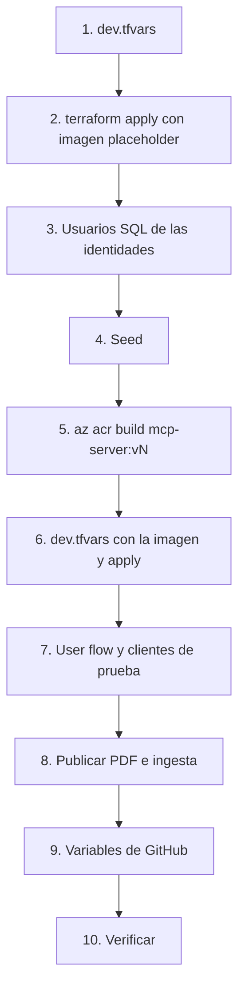

# 08. Operación

[Índice de la guía](README.md) · Anterior: [07. Código](07-codigo.md) · Siguiente: [09. Glosario](09-glosario.md)

Cómo ejecutar en local, desplegar, verificar, observar, evaluar y depurar el sistema, y cómo destruirlo y recrearlo. Todos los comandos se ejecutan desde la raíz del repositorio en Git Bash, con `az login` en la suscripción correcta.

## Requisitos

| Herramienta | Para qué |
|-------------|----------|
| [uv](https://docs.astral.sh/uv/) | Python 3.12 y dependencias (`uv sync`) |
| Terraform >= 1.9 | Infraestructura |
| Azure CLI | `az login`, `az acr build`, `az containerapp` |
| `sqlcmd` (opcional) | Scripts SQL; alternativa: editor de consultas del portal |
| `gh` (opcional) | Lanzar el workflow de evaluaciones |
| Node.js (opcional) | MCP Inspector (`npx @modelcontextprotocol/inspector`) |

> En Git Bash para Windows, exporta `MSYS_NO_PATHCONV=1` cuando un valor empiece con `/subscriptions/...`; si no, Git Bash lo convierte en una ruta de Windows.

## 1. Ejecutar en local

### Sin Azure: MCP y pruebas

```bash
uv sync
cp .env.example .env
uv run --env-file .env python -m mcp_server.seed   # data/banco.db con datos sintéticos
uv run --env-file .env python -m mcp_server        # http://127.0.0.1:8000/mcp, AUTH_MODE=dev
uv run ruff check . && uv run ruff format --check . && uv run pytest
uv run pytest -m contract                          # solo contrato
```

### Con Foundry: agentes en tu proceso

Desde la fase 6 el MCP desplegado es interno, así que en local se usa un MCP local en modo `dev` y los servicios reales de Foundry.

```bash
export FOUNDRY_PROJECT_ENDPOINT=$(terraform -chdir=infra output -raw foundry_project_endpoint)
export SEARCH_ENDPOINT=$(terraform -chdir=infra output -raw search_endpoint)
export MCP_URL=http://127.0.0.1:8000/mcp
export DEV_CUSTOMER_ID=1

uv run python -m agent_host                                       # triage interactivo
uv run python -m agent_host --ask "¿Cuál es mi saldo?" --auto-deny
uv run python -m agent_host --agent productos --ask "¿Cuánto cuesta la Tarjeta Oro?"
uv run pytest -m azure -v -s                                      # escenarios con modelo real
```

Tu usuario necesita **Foundry User** y lectura en AI Search (Terraform te los asigna).

### Host HTTP en local

```bash
uv run python -m agent_host.service                  # 127.0.0.1:8080, DATABASE_URL por defecto SQLite
uv run python -m agent_host --remote http://127.0.0.1:8080
```

### Servidor A2A en local

```bash
export A2A_PUBLIC_URL=http://127.0.0.1:8090/
export A2A_TENANT_ID=$(az account show --query tenantId -o tsv)
export A2A_AUDIENCE=$(terraform -chdir=infra output -raw productos_a2a_client_id)
uv run python -m agent_host.productos_a2a
```

### Contra Azure con identidad real

```bash
export AUTH_MODE=entra
export ENTRA_AUTHORITY=$(terraform -chdir=infra output -raw entra_authority)
export ENTRA_CLI_CLIENT_ID=$(terraform -chdir=infra output -raw cli_client_id)
export ENTRA_AGENT_API_CLIENT_ID=$(terraform -chdir=infra output -raw agent_api_client_id)
HOST=$(terraform -chdir=infra output -raw agent_host_url)
uv run python -m agent_host --remote "$HOST"          # device code
```

## 2. Variables de entorno

| Variable | Quién la usa | Valor o default |
|----------|--------------|-----------------|
| `AUTH_MODE` | MCP, host, CLI | `dev` o `entra` (MCP sin valor: rechaza todo) |
| `DEV_CUSTOMER_ID` | Host y CLI en modo dev | Entero positivo |
| `FOUNDRY_PROJECT_ENDPOINT` | Host, Productos, evals | Salida de Terraform |
| `FOUNDRY_MODEL_DEPLOYMENT` | Host, Productos | `gpt-5-mini` |
| `MCP_URL` | Host | https (http solo para localhost) |
| `SEARCH_ENDPOINT`, `KNOWLEDGE_BASE` | Productos | Salida de Terraform; `kb-productos` |
| `ENTRA_AUTHORITY`, `ENTRA_CLI_CLIENT_ID`, `ENTRA_AGENT_API_CLIENT_ID`, `ENTRA_MCP_API_CLIENT_ID`, `KEY_VAULT_URI`, `OBO_CERT_NAME` | Host y CLI en modo entra | Salidas de Terraform; `agent-obo` |
| `ENTRA_TENANT_ID`, `ENTRA_ISSUER`, `ENTRA_AUDIENCE`, `ENTRA_JWKS_URI` | MCP en modo entra | Definidas en Terraform |
| `DATABASE_URL` | MCP, host | `sqlite:///./data/banco.db` |
| `MCP_HOST`, `MCP_PORT` | MCP | `127.0.0.1`, `8000` |
| `AGENT_BIND`, `AGENT_PORT` | Host | `127.0.0.1`, `8080` |
| `RATE_LIMIT_PER_MINUTE`, `RATE_LIMIT_BURST`, `MAX_MESSAGE_CHARS` | Host | `20`, `10`, `2000` |
| `PRODUCTOS_A2A_URL`, `PRODUCTOS_A2A_SCOPE` | Host | Vacía: Productos en proceso |
| `A2A_PUBLIC_URL`, `A2A_TENANT_ID`, `A2A_AUDIENCE`, `A2A_BIND`, `A2A_PORT` | Productos A2A | `127.0.0.1`, `8090` |
| `APPLICATIONINSIGHTS_CONNECTION_STRING` | Host, Productos, MCP | Sin ella, no hay telemetría |
| `OTEL_INSTRUMENTATION_A2A_SDK_ENABLED` | Host, Productos | `false` en Azure |
| `AZURE_CLIENT_ID` | Contenedores | Client id de la managed identity |
| `AGENT_TOKEN` | Locust | Token de usuario obtenido antes |

## 3. Desplegar desde cero

El orden importa: cada paso depende del anterior.



```bash
# 1. Configuración (dev.tfvars está en .gitignore)
cp infra/terraform.tfvars.example infra/dev.tfvars
# subscription_id, alert_email, client_ip (curl -s https://api.ipify.org),
# external_tenant_id, external_tenant_subdomain

# Sesión en los dos tenants; luego vuelve a la suscripción por defecto
az login
az login --tenant <external-tenant-id> --allow-no-subscriptions
az account set --subscription <subscription-id>

# 2. Infraestructura
terraform -chdir=infra init
terraform -chdir=infra plan -var-file=dev.tfvars -out=tfplan
terraform -chdir=infra apply tfplan

# 3. Usuarios SQL (como admin Entra)
SQL=$(terraform -chdir=infra output -raw sql_server_fqdn)
sqlcmd -S "$SQL" -d sqldb-banking --authentication-method ActiveDirectoryDefault -i infra/sql/create-mcp-user.sql
sqlcmd -S "$SQL" -d sqldb-banking --authentication-method ActiveDirectoryDefault -i infra/sql/create-agent-host-user.sql

# 4. Seed
DATABASE_URL="mssql+mssqlpython://@$SQL:1433/sqldb-banking?Authentication=ActiveDirectoryDefault&Encrypt=yes" \
  uv run python -m mcp_server.seed

# 5. Imagen
ACR=$(terraform -chdir=infra output -raw acr_name)
az acr build --registry "$ACR" --image mcp-server:v8 .

# 6. dev.tfvars: mcp_image y agent_image = "<acr_login_server>/mcp-server:v8"
terraform -chdir=infra plan -var-file=dev.tfvars -out=tfplan && terraform -chdir=infra apply tfplan

# 7. Identidad de clientes
uv run python infra/identity/user_flow.py \
  --tenant-id "$(terraform -chdir=infra output -raw entra_tenant_id)" \
  --app-id "$(terraform -chdir=infra output -raw cli_client_id)"
uv run python infra/identity/create_test_users.py \
  --tenant-id "$(terraform -chdir=infra output -raw entra_tenant_id)" \
  --domain bancoandinodemo.onmicrosoft.com --sql-server "$SQL"
# Anota las contraseñas: se muestran una sola vez

# 8. Conocimiento
export STORAGE_ACCOUNT_NAME=$(terraform -chdir=infra output -raw storage_account_name)
export STORAGE_ACCOUNT_ID=$(terraform -chdir=infra output -raw storage_account_id)
export SEARCH_ENDPOINT=$(terraform -chdir=infra output -raw search_endpoint)
export FOUNDRY_OPENAI_ENDPOINT=$(terraform -chdir=infra output -raw foundry_openai_endpoint)
uv run --group knowledge python knowledge/publish.py
MSYS_NO_PATHCONV=1 uv run python knowledge/ingest.py

# 9. Variables del repositorio para evals.yml (ids, no secretos)
gh variable set AZURE_CLIENT_ID --body "$(terraform -chdir=infra output -raw github_evals_client_id)"
gh variable set FOUNDRY_PROJECT_ENDPOINT --body "$(terraform -chdir=infra output -raw foundry_project_endpoint)"
gh variable set SEARCH_ENDPOINT --body "$SEARCH_ENDPOINT"
# AZURE_TENANT_ID y AZURE_SUBSCRIPTION_ID: tenant workforce y suscripción
```

El seed vuelve a generar `entra_oid`: si lo corres otra vez, repite `create_test_users.py`.

### Desplegar un cambio de código

```bash
az acr build --registry "$ACR" --image mcp-server:v9 .
# dev.tfvars: mcp_image y agent_image a v9
terraform -chdir=infra plan -var-file=dev.tfvars -out=tfplan && terraform -chdir=infra apply tfplan
```

Las tres apps comparten imagen, así que un cambio en `agent_host/` o `mcp_server/` redeploya las tres.

## 4. Verificar

| Qué | Comando | Esperado |
|-----|---------|----------|
| Host vivo | `curl -s "$HOST/healthz"` | `{"status":"ok"}` |
| Host listo y modo | `curl -s "$HOST/readyz"` | `{"status":"ready","productos":"a2a","knowledge_breaker":"closed"}` |
| Sin token | `curl -s -X POST "$HOST/chat" -d '{"message":"hola"}'` | 401 |
| Sin cambios pendientes | `terraform -chdir=infra plan -var-file=dev.tfvars` | Sin cambios |
| Recursos | `az resource list -g rg-banking-agent-dev -o table` | 19 recursos en estado `Succeeded` |
| MCP y Productos | No alcanzables desde tu máquina (ingress interno) | Usar `az containerapp exec` |

Verificar Productos desde dentro del environment (la imagen no trae `curl`; se usa Python codificado en base64 para evitar problemas de comillas): ver el paso 3 de [la guía de la fase 7](../guides/fase-7-a2a.md).

## Observar

### Logs de los contenedores

```bash
RG=$(terraform -chdir=infra output -raw resource_group)
az containerapp logs show -g "$RG" -n agent-host --follow
az containerapp logs show -g "$RG" -n mcp-server --follow
az containerapp logs show -g "$RG" -n productos-a2a --follow
```

### Application Insights

| Vista | Qué muestra |
|-------|-------------|
| Transaction search | Una petición con todos sus spans |
| Agents (preview) | Ejecuciones por agente (`triage`, `productos`, `operaciones`), latencia, tokens y errores por herramienta; **View traces** abre la traza |
| Logs (KQL) | Consultas libres sobre `AppRequests`, `AppDependencies`, `AppTraces` |

Traza distribuida de una conversación:

```kusto
union AppRequests, AppDependencies
| where OperationId == "<trace id>"
| project TimeGenerated, Type, AppRoleName, Name, ResultCode, DurationMs
| order by TimeGenerated asc
```

Spans GenAI de MAF:

```kusto
AppDependencies
| where TimeGenerated > ago(7d)
| extend op = tostring(Properties["gen_ai.operation.name"])
| where isnotempty(op)
| summarize n = count() by op, AppRoleName
```

### Foundry

| Vista | Qué muestra |
|-------|-------------|
| **Tracing** (o Agents > Monitoring) | Trazas del Application Insights conectado (`appi-banking-agent`) |
| **Evaluations** | Ejecuciones (`cases-run1`, `cases-run2`, `gh-<run id>`, `adversarial-run1`) con detalle por fila y razonamiento de cada juez; **Compare** entre dos |

Verificación por API:

```bash
EP=$(terraform -chdir=infra output -raw foundry_project_endpoint)
T=$(az account get-access-token --resource https://ai.azure.com --query accessToken -o tsv)
curl -s -H "Authorization: Bearer $T" "$EP/evaluations/runs?api-version=2025-05-15-preview"
```

### Auditoría en SQL

```sql
SELECT TOP 20 * FROM dbo.auditoria ORDER BY id DESC;
SELECT * FROM dbo.tickets_escalamiento ORDER BY id DESC;
```

## 5. Evaluaciones, carga y caos

```bash
uv sync --group evals
uv run --group evals python -m evals.run_evals --name baseline               # 26 casos con jueces
uv run --group evals python -m evals.run_evals --dataset evals/adversarial_cases.jsonl
uv run --group evals python -m evals.run_evals --limit 5 --no-judges         # solo checks
uv run --group evals python -m evals.run_redteam
uv run python evals/run_retrieval.py                                         # recuperación
gh workflow run evals.yml -f limit=6 && gh run watch                         # en GitHub, con OIDC
```

| Opción del runner | Efecto |
|-------------------|--------|
| `--name` | Nombre en Foundry y carpeta `evals/results/<nombre>/` |
| `--limit N` | Primeros N casos |
| `--no-judges` | Sin jueces ni registro en Foundry |
| `--no-upload` | Jueces sin registro en Foundry |
| `--parallel N` | Conversaciones simultáneas (4) |

**Caos y resiliencia (local):**

```bash
uv run pytest -q -m contract tests/contract/test_chaos.py
uv run pytest -q tests/unit/test_resilience.py
```

**Carga (contra Azure):** obtén el token **antes** de lanzar locust.

```bash
export AGENT_TOKEN=$(uv run python -c "
import contextlib, sys
from agent_host.cli import remote_auth
with contextlib.redirect_stdout(sys.stderr):
    identity, _ = remote_auth()
print(identity.user_token())
")
uv run --group load locust -f tests/load/locustfile.py --headless -u 5 -r 1 -t 3m \
  --host "$HOST" --csv docs/load/phase6 --only-summary
unset AGENT_TOKEN
```

**Productos detenido (pendiente de repetir en Azure):**

```bash
az containerapp ingress disable -g "$RG" -n productos-a2a
# una pregunta de productos por /chat: el agente debe ofrecer un asesor
az containerapp ingress enable -g "$RG" -n productos-a2a --type internal --target-port 8090 --transport auto
```

## 6. Solución de problemas

| Síntoma | Causa probable | Acción |
|---------|----------------|--------|
| Error 40613 "database is not currently available" | Azure SQL pausada reanudándose | Esperar un minuto; `db_retry` ya reintenta |
| `Login failed for user '<token-identified principal>'` | Falta el usuario SQL de la identidad | Correr el script de `infra/sql/` correspondiente |
| `CREATE TABLE permission denied` | El esquema no existe y la identidad no tiene DDL | Correr el seed como admin |
| `/readyz` responde 503 `starting` | El host aún se construye o falta configuración | Revisar logs (variable faltante, certificado OBO) |
| `/chat` 401 | Token vencido o de otra app | Volver a iniciar sesión |
| `/chat` 404 | `conversation_id` de otro cliente o inexistente | Empezar una conversación nueva |
| `/chat` 409 | Aprobaciones pendientes o que no coinciden | Responder exactamente las `pending_approvals` |
| `/chat` 429 | Rate limit (20/min, ráfaga 10) | Esperar `Retry-After` |
| `/chat` 503 | Modelo o MCP caídos tras reintentos, o checkpoint no guardado | Revisar `turn failed: conversation ...` en los logs |
| `/chat` 504 | Turno de más de 120 s (frecuente con la base pausada) | Reintentar |
| 401/403 de Foundry en local | Rol Foundry User sin propagar o otra cuenta en `az login` | Esperar; revisar `az account show` |
| 401 de Productos con token válido | El token no trae `Productos.Invoke` (se cachea hasta 24 h) | Decodificar el token y revisar `roles` |
| Error JSON-RPC `-32009` | Falta `A2A-Version: 1.0` | Agregar el header |
| `TASK_STATE_FAILED` | Falló el modelo o la knowledge base en Productos | Logs de `productos-a2a` |
| "requires Semantic Search" | Semantic ranker apagado | Revisar `azapi_update_resource.search_semantic` |
| "Invalid resource ID" en `ingest.py` | Conversión de rutas de Git Bash | `MSYS_NO_PATHCONV=1` |
| `AADSTS700213` en GitHub | Subject federado distinto | Copiar el subject del log a `github_oidc_subject` |
| 429 en los jueces | Supera 50K TPM | No correr dos evaluaciones a la vez; `PF_WORKER_COUNT=2` |
| Red team "ASR 0.0 %" | Ningún ataque puntuado en la región | Proyecto en una región soportada |
| `ModuleNotFoundError: agent_host` | Runner ejecutado como script | `python -m evals.run_evals` |
| Miles de filas en `AppTraces` | Se exporta el logger raíz | `logger_name="agent_host"` |
| Avisos de cancel scope al cerrar | Conexiones MCP abiertas en otras tareas | Inofensivo; se filtra |
| 403 al crear el certificado | Propagación del rol de Key Vault | Volver a aplicar |
| Locust con 0 solicitudes | Device code dentro de la corrida | Usar `AGENT_TOKEN` |

## 7. Costos

| Recurso | Costo en reposo | Por uso |
|---------|-----------------|---------|
| Container Registry Basic | ~USD 5 al mes (~0,17 al día) | — |
| Container Apps | 0 con 0 réplicas | Grant gratuito de 180 000 vCPU-s al mes |
| Azure SQL free offer | 0 | 100 000 vCore-s al mes; AutoPause al agotar |
| AI Search Free | 0 | Cuota mensual de recuperación agéntica |
| gpt-5-mini | 0 | Aprox. USD 0,25 / 2,00 por millón de tokens (entrada / salida) |
| text-embedding-3-small | 0 | La ingesta de 8 documentos cuesta menos de un centavo |
| Log Analytics | 0 | Por GB, tope de 1 GB al día |
| Storage, Key Vault | Centavos | — |

Referencia real: todas las ejecuciones de evaluación de un día (1,50 M tokens de entrada y 0,26 M de salida) costaron unos USD 0,90; una ejecución completa de 26 casos con jueces ronda USD 0,30. El presupuesto de USD 20 avisa al 50 % y al 100 %.

## 8. Destruir y recrear

```bash
terraform -chdir=infra destroy -var-file=dev.tfvars
```

Qué pasa y qué tener en cuenta:

| Tema | Detalle |
|------|---------|
| Tenant External ID | **No** se destruye (no lo gestiona Terraform). Sí se borran las apps de su interior; el user flow y los usuarios quedan |
| Sufijo de nombres | `random_string.suffix` se destruye: la recreación genera nombres nuevos (ACR, Foundry, SQL, Key Vault, AI Search, Storage) |
| Imagen | El ACR nuevo está vacío: repite `az acr build` y actualiza `mcp_image` y `agent_image` con el nuevo login server |
| Foundry | `purge_soft_delete_on_destroy = true` purga la cuenta para poder recrearla |
| Key Vault | `purge_protection_enabled = false` y 7 días de soft delete |
| Base de datos | Se pierde: repite usuarios SQL, seed y `create_test_users.py` |
| User flow | Las apps nuevas tienen otro client id: vuelve a correr `user_flow.py` para asociar la nueva `banking-cli` |
| Conocimiento | Repite `publish.py` e `ingest.py` |
| GitHub | `github_evals_client_id` cambia: actualiza la variable `AZURE_CLIENT_ID` y los endpoints |
| Free offer de SQL | Fija su región con la primera base gratuita de la suscripción |

Al terminar cada sesión de trabajo, `terraform destroy` (ADR-021).
