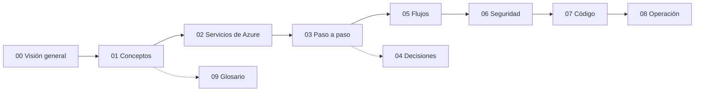

# Guía de aprendizaje: agente bancario con MAF, Foundry, MCP y A2A

Esta guía explica **todo lo que se construyó** en este repositorio, desde los conceptos hasta la operación diaria. Está pensada para quien ya tiene el sistema funcionando (fases 0 a 8) y ahora quiere entender cada pieza: qué problema resuelve, cómo está implementada aquí y cómo se verifica.

> Todos los datos y nombres son ficticios. **Banco Andino Demo** no existe. Los valores concretos (nombres de recursos, versiones, resultados) salen del repositorio y de la infraestructura desplegada, verificados el 2026-11-08.

## Cómo usar esta guía

1. Lee primero la [visión general](00-vision-general.md): te da el mapa completo en 15 minutos.
2. Si algún término no te resulta familiar, ve a [conceptos](01-conceptos.md) o al [glosario](09-glosario.md).
3. Después elige según tu objetivo:

| Si quieres... | Lee |
|---------------|-----|
| Entender cada servicio de Azure y por qué existe | [02. Servicios de Azure](02-servicios-azure.md) |
| Revivir la construcción paso a paso, con los problemas encontrados | [03. Paso a paso por fase](03-paso-a-paso.md) |
| Entender por qué se eligió cada cosa y qué se descartó | [04. Decisiones](04-decisiones.md) |
| Seguir una petición de punta a punta | [05. Flujos](05-flujos.md) |
| Revisar identidades, tokens, red y amenazas | [06. Seguridad](06-seguridad.md) |
| Leer el código con un mapa en la mano | [07. Recorrido por el código](07-codigo.md) |
| Ejecutar, desplegar, observar o depurar | [08. Operación](08-operacion.md) |

Cada capítulo sigue el mismo orden: **concepto** (qué problema resuelve), **implementación** (archivos, recursos de Terraform, variables de entorno) y **verificación** (cómo comprobar que funciona).

## Mapa de capítulos

| N.º | Capítulo | Contenido |
|-----|----------|-----------|
| 00 | [Visión general](00-vision-general.md) | Qué hace el sistema, historias de usuario, arquitectura completa, tabla de componentes y una conversación recorrida de punta a punta |
| 01 | [Conceptos](01-conceptos.md) | Agentes LLM y tool calling, MAF, Foundry, MCP, A2A, OAuth2/OIDC, Entra, device code, OBO, managed identity, Container Apps, RAG |
| 02 | [Servicios de Azure](02-servicios-azure.md) | Cada recurso desplegado: qué es, SKU, costo, configuración, quién lo usa y con qué rol |
| 03 | [Paso a paso](03-paso-a-paso.md) | Fases 0 a 8: objetivo, qué se construyó, comandos, verificación y problemas resueltos |
| 04 | [Decisiones](04-decisiones.md) | Los 22 ADR en lenguaje simple y las decisiones tomadas durante la implementación |
| 05 | [Flujos](05-flujos.md) | Diagramas de secuencia: login y OBO, aprobación, sesión durable, handoff, A2A, circuit breaker, RAG, evaluaciones |
| 06 | [Seguridad](06-seguridad.md) | Identidades, audiencias, roles, usuarios SQL, red, guardrails, aislamiento de datos y amenazas |
| 07 | [Código](07-codigo.md) | Módulo por módulo, cómo se conectan y la estrategia de pruebas |
| 08 | [Operación](08-operacion.md) | Ejecutar en local, desplegar, verificar, observar, evaluar, solucionar problemas, costos y recreación |
| 09 | [Glosario](09-glosario.md) | Todos los términos, en orden alfabético |

## Orden de lectura recomendado

Las flechas punteadas indican capítulos de consulta: no hace falta leerlos de corrido.

## Diagramas

Además de los diagramas Mermaid de cada capítulo, hay un archivo draw.io con siete páginas (arquitectura, identidad, red, conversación, A2A, datos y CI/CD) que usa los iconos oficiales de Azure: [docs/diagramas](../diagramas/README.md).

## Otras fuentes del repositorio

Esta guía no reemplaza la documentación original; la explica y la conecta.

| Documento | Para qué sirve |
|-----------|----------------|
| [README.md](../../README.md) | Resumen del proyecto y comandos rápidos |
| [docs/PLAN.md](../PLAN.md) | Fases, entregables y criterios de aceptación |
| [docs/ARCHITECTURE.md](../ARCHITECTURE.md) | Arquitectura de referencia |
| [docs/DECISIONS.md](../DECISIONS.md) | Registro formal de decisiones (ADR) |
| [docs/guides/](../guides/fase-1-mcp.md) | Guías detalladas por fase, con transcripciones reales |
| [infra/README.md](../../infra/README.md) | Notas de Terraform y región |
