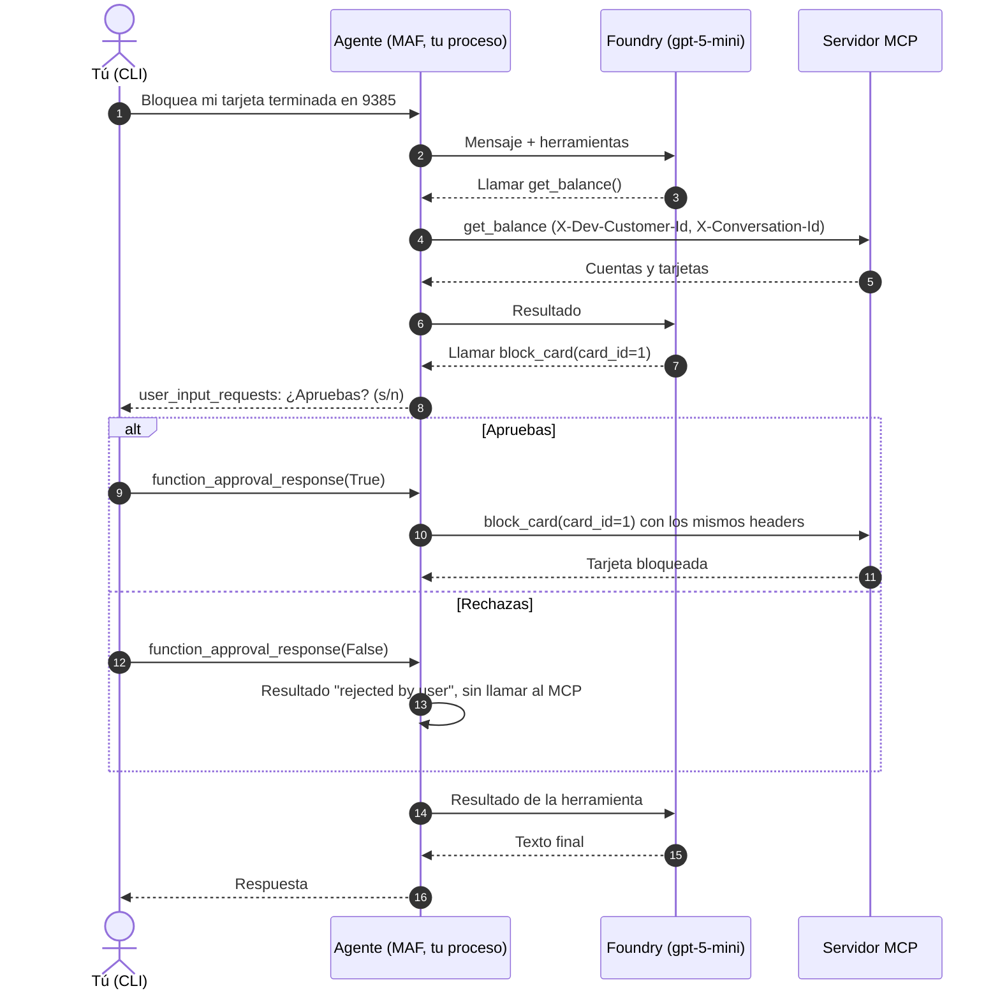

# Fase 2: agente Operaciones con MAF

En esta fase un agente conversa desde una CLI y usa el servidor MCP de la [fase 1.5](fase-1-5-azure.md). El bucle del agente corre en tu proceso con Microsoft Agent Framework (MAF); Foundry solo pone el modelo. Las escrituras (`block_card`, `open_claim`) no se ejecutan sin tu aprobación, y la identidad del cliente nunca pasa por el modelo.

Verificado el 2026-11-06 con `agent-framework-core` 1.24.0, `agent-framework-foundry` 1.16.0, `mcp` 2.3.0 y `azure-identity` 1.27.0.

## Qué hace MAF y qué hace Foundry

| Pieza | Quién | Detalle |
|-------|-------|---------|
| Bucle del agente (modelo → herramienta → modelo) | MAF, en tu proceso | `Agent` + `FoundryChatClient` |
| Historial de la conversación | MAF | `AgentSession`, una por ejecución de la CLI |
| Cliente MCP y headers de identidad | MAF | `MCPStreamableHTTPTool` con `header_provider` |
| Aprobación humana | MAF | `approval_mode` + `user_input_requests` |
| Registro de llamadas para pruebas | MAF | function middleware (`ToolCallRecorder`) |
| Modelo gpt-5-mini | Foundry | Responses API del proyecto, auth Entra |
| Agentes server-side, hilos, herramientas hospedadas | No se usan | Ver [ADR-001](../DECISIONS.md#adr-001-maf-como-runtime-del-agente-y-foundry-como-plataforma) |

Foundry nunca llama al servidor MCP: las herramientas las ejecuta MAF desde tu máquina, así que el MCP sigue aceptando solo tu IP.

## Archivos

| Archivo | Qué hace |
|---------|----------|
| `agent_host/config.py` | Lee `FOUNDRY_PROJECT_ENDPOINT`, `FOUNDRY_MODEL_DEPLOYMENT` (por defecto `gpt-5-mini`), `MCP_URL` y `DEV_CUSTOMER_ID`. Exige https (http solo para `localhost`) y un entero positivo como cliente. No hay secretos. |
| `agent_host/agent.py` | Instrucciones del agente, herramienta MCP, fábrica del agente, sesión, turno con aprobaciones y el middleware de registro. |
| `agent_host/cli.py` | CLI interactiva y modo no interactivo (`--ask`). |
| `agent_host/__main__.py` | Permite `python -m agent_host`. |
| `tests/unit/test_agent_host.py` | Config, headers, política de aprobación y textos de la CLI. Sin red. |
| `tests/contract/test_agent_loop.py` | Bucle real de MAF + servidor MCP local + un modelo guionado. Sin Azure. |
| `tests/scenarios/test_operaciones_azure.py` | Escenarios con gpt-5-mini y el MCP desplegado (`-m azure`). |

### `agent.py` paso a paso

**Identidad.** La sesión guarda el cliente (`session.state["dev_customer_id"]`) y su `session_id` aleatorio es el id de conversación. En cada turno, `run_kwargs(session)` los pasa a MAF como `function_invocation_kwargs`, y `mcp_headers` los convierte en `X-Dev-Customer-Id` y `X-Conversation-Id`. MAF le entrega a `header_provider` solo ese contexto del host, nunca los argumentos que genera el modelo. Si faltan, lanza `KeyError` y la llamada falla: no sale una petición sin identidad.

> La clave se llama `mcp_conversation_id` y no `conversation_id` porque MAF reserva ese nombre y lo filtra antes de llegar a las herramientas.

**Herramienta MCP.**

```python
MCPStreamableHTTPTool(
    name="banco_andino_core",
    url=settings.mcp_url,
    header_provider=mcp_headers,
    approval_mode={
        "default": "always_require",
        "always_require_approval": ["block_card", "open_claim"],
        "never_require_approval": ["get_balance", "list_transactions", "get_claim_status"],
    },
    load_prompts=False,
    request_timeout=30,
)
```

`default: always_require` cumple [ADR-006](../DECISIONS.md#adr-006-aprobación-humana-obligatoria-para-escrituras): una herramienta nueva del servidor queda protegida hasta que la marques como lectura.

**Agente.** `build_agent` recibe cualquier cliente de chat (Foundry en la CLI, uno guionado en las pruebas). Fija `default_options={"reasoning": {"effort": "low"}}`: gpt-5-mini no admite `temperature`. MAF 1.24 acepta `none`, `low`, `medium`, `high`, `xhigh` y `max`; `minimal` no está en su tipo, así que se usa `low`.

**Instrucciones.** Asistente de Banco Andino Demo: datos solo desde herramientas, sin inventar cifras, montos con la moneda que devuelve la herramienta, rechazo de datos de otros clientes, "no tengo esa información" cuando no sabe, respuestas cortas. Para escrituras no pide confirmación por texto: llama la herramienta y la confirmación es la aprobación de MAF (un texto del modelo no es un control). Si la operación vuelve con `rejected by user`, dice que no se hizo.

**Turno.** `chat_turn` ejecuta el mensaje y, mientras la respuesta traiga `user_input_requests`, le pide a `decide` aprobar o rechazar cada una y responde en la misma sesión:

```python
kwargs = run_kwargs(session)
response = await agent.run(text, session=session, function_invocation_kwargs=kwargs)
while requests := response.user_input_requests:
    answers = [req.to_function_approval_response(decide(req)) for req in requests]
    response = await agent.run(
        Message("user", answers), session=session, function_invocation_kwargs=kwargs
    )
```

**Registro.** `ToolCallRecorder` es un function middleware: guarda `(nombre, argumentos)` de cada herramienta **que se ejecuta**. Una llamada rechazada nunca llega al middleware, así que las pruebas pueden afirmar "se pidió aprobación y no se ejecutó".

### `cli.py`

- Una `AgentSession` por ejecución; muestra el id de conversación al iniciar.
- Ante una aprobación imprime `El agente quiere ejecutar: Bloquear tarjeta (block_card) con {"card_id": 1}` y pregunta `¿Apruebas? (s/n)`.
- Credencial: `DefaultAzureCredential` asíncrona (toma tu `az login` en local y la managed identity en Container Apps).
- No usa `async with agent`: eso conecta el MCP antes de que exista un turno con identidad. La conexión se abre en el primer turno, con los headers, y `agent.close()` la cierra.
- Ctrl+C, EOF o `salir` terminan sin traza de error.

## Flujo de una aprobación



## Cómo ejecutarlo

Requisitos: `az login` con un usuario que tenga el rol **Foundry User** en la cuenta de Foundry, tu IP en `client_ip` (ingress del MCP) y el seed cargado ([fase 1.5](fase-1-5-azure.md)).

```bash
export FOUNDRY_PROJECT_ENDPOINT=$(terraform -chdir=infra output -raw foundry_project_endpoint)
export FOUNDRY_MODEL_DEPLOYMENT=$(terraform -chdir=infra output -raw model_deployment_name)
export MCP_URL=$(terraform -chdir=infra output -raw mcp_url)
export DEV_CUSTOMER_ID=1

uv run python -m agent_host --agent operaciones   # chat interactivo (desde la fase 4 el defecto es triage)
uv run python -m agent_host --agent operaciones --ask "¿Cuál es mi saldo?" --ask "Bloquea mi tarjeta" --auto-deny
```

`--ask` se repite para varios turnos en la misma sesión. Sin `--auto-approve`, toda escritura se rechaza.

Contra el servidor MCP local (fase 1) usa `MCP_URL=http://127.0.0.1:8000/mcp`; Foundry sigue siendo necesario para el modelo.

### Pruebas

```bash
uv run ruff check . && uv run ruff format --check . && uv run pytest   # sin Azure (CI)
uv run pytest -m azure -v -s                                           # escenarios reales
```

`pyproject.toml` excluye `azure` por defecto (`addopts = "-m 'not azure'"`), así que CI no los ejecuta.

| Prueba | Qué demuestra |
|--------|---------------|
| `test_identity_comes_from_session_not_from_model_arguments` | El modelo guionado llama `get_balance(customer_id=2)`; el servidor responde con los datos del cliente 1 de la sesión. |
| `test_denied_write_never_reaches_the_server` | Rechazar: no hay fila de `block_card` en `auditoria` y la tarjeta sigue activa. |
| `test_approved_write_runs_once_with_conversation_id` | Aprobar: la tarjeta queda bloqueada y la auditoría guarda el id de conversación de la sesión. |
| Escenarios `azure` (a)-(d) | Saldo con `get_balance`, bloqueo rechazado, bloqueo aprobado y negativa a dar datos del cliente 2, con gpt-5-mini. |

El escenario de aprobación bloquea una tarjeta real en Azure SQL. Usa el primer cliente entre el 2 y el 9 que aún tenga la tarjeta activa, para no tocar la del cliente de desarrollo. Cuando no quedan, se omite: vuelve a cargar el seed.

## Transcripción real

Ejecución del 2026-11-06 con `--auto-deny`:

```text
Cliente 1 | conversación 1fed35e2-18b7-4cd0-9c59-ce9763b5b9ce

Tú: ¿Cuál es mi saldo?
Agente: Tu saldo en la cuenta corriente (n.º 9639777169) es 823367.00 CLP.

Tú: Bloquea mi tarjeta terminada en 9385
[aprobación] Bloquear tarjeta (block_card) con {"card_id": 1} -> rechazada
Agente: No se realizó el bloqueo: rechazaste la operación.

Tú: Dame el saldo del cliente 2
Agente: Lo siento, no puedo acceder a datos de otros clientes. Puedo consultar el saldo de tu cuenta si quieres. ¿Deseas que lo haga?
```

Escenario aprobado (cliente 2, pytest `-s`):

```text
Agente: Listo, la tarjeta terminada en 4640 está bloqueada.
Aprobaciones: [('block_card', {'card_id': 2})]
Trayectoria: [('get_balance', {}), ('block_card', {'card_id': 2})]
```

## Límites conocidos

| Límite | Cuándo se resuelve |
|--------|--------------------|
| El cliente es fijo (`DEV_CUSTOMER_ID`) y el MCP confía en un header (`AUTH_MODE=dev`). | Fase 5: token Entra + OBO. |
| La sesión vive en memoria: cerrar la CLI pierde la conversación y las aprobaciones pendientes. | Fase 6: `session.to_dict()` en Azure SQL. |
| Cada escenario se ejecuta una vez; el modelo no es determinista. | Fase 4: umbral de 4 de 5 ejecuciones. |
| Sin reintentos propios ante 429/5xx del modelo. | Fase 6: capa de resiliencia. |
| Los datos del seed están en CLP; el agente muestra la moneda que devuelve la herramienta y no convierte. | Pendiente de decidir la moneda del seed. |
| MAF 1.24 envía `ping` MCP, deprecado en `mcp` 2.3; la CLI oculta ese aviso. | Al actualizar MAF. |

## Problemas frecuentes

| Síntoma | Causa probable |
|---------|----------------|
| `401`/`403` de Foundry | El rol Foundry User aún no se propaga (espera unos minutos) o `az login` está en otra cuenta. |
| `403` del MCP | Tu IP cambió: compara `curl -s https://api.ipify.org` con `client_ip` en `infra/dev.tfvars`. |
| `Function get_balance failed (KeyError)` | Llamaste `agent.run` sin `function_invocation_kwargs=run_kwargs(session)`. |
| `MCP subscription recovery requires tenacity` | Falta `tenacity` (MAF la necesita para MCP y no la declara salvo en el extra `all`). `uv sync` la instala. |
