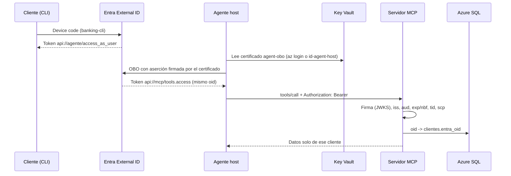

# Fase 5: identidad Entra

El cliente fijo de desarrollo (`X-Dev-Customer-Id`) se reemplaza por identidad real de extremo a extremo: el cliente inicia sesión en Entra External ID desde la CLI, el agente host cambia su token por uno para el servidor MCP (on-behalf-of) y el MCP valida ese token y lo mapea a un cliente del banco. Decisiones: [ADR-008](../DECISIONS.md#adr-008-managed-identity-entre-servicios-y-entra-external-id-para-clientes), [ADR-009](../DECISIONS.md#adr-009-obo-con-certificado-en-key-vault) y la validación JWT en código del MCP.

> **Estado: en curso.** Infraestructura, código, pruebas y rechazos en Azure están verificados. Falta que corras la prueba interactiva de extremo a extremo ([paso 4](#4-prueba-interactiva-de-extremo-a-extremo)): requiere un inicio de sesión humano por device code.

## Conceptos

### Dos tenants

| Tenant | Para quién | Qué vive ahí |
|--------|-----------|--------------|
| Workforce (`f3743cf0-…`) | Tú y los servicios | Suscripción, Key Vault, Foundry, SQL, Container Apps, managed identities |
| External ID (`bancoandinodemo`, `3c195357-…`) | Los clientes del banco | Usuarios clientes, app registrations, user flow |

External ID es el producto de Entra para identidad de clientes (reemplaza a Azure AD B2C). Sus apps son de un solo tenant, solo pueden pedir `openid`, `offline_access`, `User.Read` y APIs propias, y no admiten ROPC (usuario y contraseña enviados por la app). Sí admiten device code, cliente público y OBO.

### App registrations y scopes

Las tres apps se crean con el provider `azuread` (alias `azuread.external`) en `infra/identity.tf`:

| App | Tipo | Expone | Pide |
|-----|------|--------|------|
| `banking-cli` | Cliente público (device code) | — | `access_as_user` del agente |
| `banking-agent-api` | API y cliente confidencial con certificado | `api://<id>/access_as_user` | `tools.access` del MCP (OBO) |
| `banking-mcp-api` | API | `api://<id>/tools.access` | — |

- Todas emiten tokens v2 (`requested_access_token_version = 2`). External ID rechaza crear una app con v1, incluida la CLI.
- `banking-cli` está preautorizada en `banking-agent-api` y hay consentimiento de administrador (`oauth2PermissionGrant` para todos los usuarios) de CLI a agente, de agente a MCP y de ambos a `openid` y `offline_access`. El cliente nunca ve una pantalla de consentimiento.

### User flow

External ID solo deja iniciar sesión en apps asociadas a un user flow. El provider `azuread` no tiene ese recurso, así que `infra/identity/user_flow.py` lo crea por Graph (`banco-andino-signin`, correo y contraseña, **registro deshabilitado**: el banco crea a sus clientes) y le asocia `banking-cli`. Es idempotente.

### Device code

La CLI no tiene navegador propio. Pide un código a `https://bancoandinodemo.ciamlogin.com/<tenant>/oauth2/v2.0/devicecode`, te muestra "abre https://bancoandinodemo.ciamlogin.com/device e ingresa el código XXXX", y consulta el endpoint de token hasta que inicias sesión. Resultado: un token para `api://<agente>/access_as_user` (y un refresh token que MSAL guarda en memoria).

### OBO y por qué certificado y no managed identity

El agente necesita llamar al MCP **como el cliente**, no como sí mismo: el MCP debe saber quién es. Con on-behalf-of, `banking-agent-api` presenta el token del cliente más su propia credencial y recibe un token para `api://<mcp>/tools.access` con el mismo `oid` del cliente.

La credencial del agente no puede ser una managed identity: la federated identity credential de una managed identity solo funciona dentro de su tenant (workforce), y `banking-agent-api` vive en el tenant externo. Tampoco usamos secreto de cliente. Queda un certificado:

1. Key Vault (`kv-banking-<sufijo>`, RBAC, en la suscripción) genera un certificado autofirmado `agent-obo`. La clave privada nunca sale de Key Vault hacia el repositorio.
2. Terraform sube solo la parte pública a `banking-agent-api` (`azuread_application_certificate`).
3. El host lee el secreto del certificado (PEM con clave y certificado) con `DefaultAzureCredential` del tenant workforce (`az login` en local, `id-agent-host` en Azure; ambos con `Key Vault Secrets User`) y se lo entrega a MSAL `ConfidentialClientApplication`, que firma la aserción del cliente.

Rotación: renueva el certificado en Key Vault (`az keyvault certificate create` con la misma política o `terraform apply -replace=azurerm_key_vault_certificate.obo`) y vuelve a aplicar para subir la nueva parte pública. El host lee la versión vigente al arrancar.

### Validación JWT en el MCP

`mcp_server/auth.py` con `AUTH_MODE=entra` (PyJWT con `cryptography`):

1. Exige `Authorization: Bearer <token>` (máximo 8 KB).
2. Busca la clave pública por `kid` en el JWKS del tenant (`ENTRA_JWKS_URI`). `PyJWKClient` cachea el conjunto de claves y, si llega un `kid` desconocido (rotación), vuelve a descargarlo una vez.
3. Verifica la firma solo con `RS256`: nunca acepta el `alg` que trae el token (ni `none` ni HMAC).
4. Verifica `iss`, `aud`, `exp` y `nbf` (60 s de tolerancia), y exige `tid`, `oid` y `scp`.
5. Comprueba `tid` contra el tenant y que `scp` contenga `tools.access`. Un token del agente (`access_as_user`) reenviado al MCP, o un token solo de aplicación (sin `scp`), se rechaza.
6. Mapea `oid` a `clientes.entra_oid`. Un usuario válido que no es cliente se rechaza.

Toda falla responde lo mismo, "No autorizado.", para no revelar qué control falló. El header de desarrollo se ignora. Además, un gate ASGI (`require_bearer`) responde **HTTP 401** con `WWW-Authenticate: Bearer` a cualquier request a `/mcp` sin token válido, antes de abrir una sesión MCP. `/healthz` sigue abierto para las probes.

Formatos verificados con el documento de descubrimiento del tenant y con un token real:

| Valor | Formato |
|-------|---------|
| Authority (MSAL) | `https://bancoandinodemo.ciamlogin.com/<tenant-id>` |
| Issuer de tokens v2 | `https://<tenant-id>.ciamlogin.com/<tenant-id>/v2.0` (el subdominio es el GUID, no el nombre) |
| `aud` de tokens v2 | Client id de `banking-mcp-api` (GUID), no `api://…` |
| JWKS | `https://bancoandinodemo.ciamlogin.com/<tenant-id>/discovery/v2.0/keys` |

### Mapeo `oid` -> cliente

`infra/identity/create_test_users.py` crea dos cuentas locales con identidad `emailAddress` (`cliente1@bancoandinodemo.onmicrosoft.com` y `cliente2@…`), contraseñas aleatorias que imprime **una sola vez** en consola y no guarda, y escribe el `oid` de cada una en `clientes.entra_oid` de los clientes 1 y 2 de Azure SQL (con tu sesión de administrador Entra). Volver a ejecutarlo reinicia las contraseñas. Si vuelves a correr el seed, `entra_oid` se regenera: ejecuta el script otra vez.

## Secuencia



## Pasos

Requisitos: `az login` en el tenant workforce (suscripción por defecto) y también en el externo (`az login --tenant 3c195357-af00-4fe8-a70b-cf88fcc9d0d1 --allow-no-subscriptions`), que te permite Terraform con `azuread.external` y Graph. Después de iniciar sesión en el externo, vuelve a dejar la suscripción por defecto: `az account set --subscription 2bf29b75-ddc1-40de-94c5-59f988784057`.

### 1. Infraestructura

En `infra/dev.tfvars`:

```hcl
external_tenant_id        = "3c195357-af00-4fe8-a70b-cf88fcc9d0d1"
external_tenant_subdomain = "bancoandinodemo"
mcp_image                 = "acrbankingagentke9ih.azurecr.io/mcp-server:v3"
```

```bash
ACR=$(terraform -chdir=infra output -raw acr_name)
az acr build --registry "$ACR" --image mcp-server:v3 .
terraform -chdir=infra plan -var-file=dev.tfvars -out=phase5.tfplan
terraform -chdir=infra apply phase5.tfplan
```

El plan agrega 21 recursos y actualiza `mcp-server` en el lugar (`AUTH_MODE=entra`, `ENTRA_TENANT_ID`, `ENTRA_ISSUER`, `ENTRA_AUDIENCE`, `ENTRA_JWKS_URI`). Si la creación del certificado falla con 403, es la propagación del rol `Key Vault Certificates Officer`: espera un minuto y vuelve a aplicar.

### 2. User flow y clientes de prueba

```bash
uv run python infra/identity/user_flow.py \
  --tenant-id "$(terraform -chdir=infra output -raw entra_tenant_id)" \
  --app-id "$(terraform -chdir=infra output -raw cli_client_id)"
uv run python infra/identity/create_test_users.py \
  --tenant-id "$(terraform -chdir=infra output -raw entra_tenant_id)" \
  --domain bancoandinodemo.onmicrosoft.com \
  --sql-server "$(terraform -chdir=infra output -raw sql_server_fqdn)"
```

Anota las contraseñas que imprime: no se vuelven a mostrar.

### 3. Variables del agente host

```bash
export AUTH_MODE=entra
export FOUNDRY_PROJECT_ENDPOINT=$(terraform -chdir=infra output -raw foundry_project_endpoint)
export SEARCH_ENDPOINT=$(terraform -chdir=infra output -raw search_endpoint)
export MCP_URL=$(terraform -chdir=infra output -raw mcp_url)
export ENTRA_AUTHORITY=$(terraform -chdir=infra output -raw entra_authority)
export ENTRA_CLI_CLIENT_ID=$(terraform -chdir=infra output -raw cli_client_id)
export ENTRA_AGENT_API_CLIENT_ID=$(terraform -chdir=infra output -raw agent_api_client_id)
export ENTRA_MCP_API_CLIENT_ID=$(terraform -chdir=infra output -raw mcp_api_client_id)
export KEY_VAULT_URI=$(terraform -chdir=infra output -raw key_vault_uri)
unset DEV_CUSTOMER_ID
```

`OBO_CERT_NAME` es opcional (por defecto `agent-obo`). Con `AUTH_MODE=dev` (o sin definirla) todo sigue como en las fases 2 a 4.

### 4. Prueba interactiva de extremo a extremo

```bash
uv run pytest -m interactive -s -v                    # inicia sesión como cliente1@bancoandinodemo.onmicrosoft.com
uv run python -m agent_host --agent operaciones       # chat: la CLI te pide el device code
```

La prueba (`tests/scenarios/test_identity_interactive.py`) inicia sesión una vez y comprueba:

- Con el token OBO, `get_balance` devuelve las tarjetas del cliente 1, y un header `X-Dev-Customer-Id: 2` no cambia nada.
- `block_card` sobre la primera tarjeta del cliente 2 falla.
- El agente Operaciones responde "¿Cuál es mi saldo?" llamando a `get_balance` a través de `header_provider` con el token OBO.

En el chat, prueba también "bloquea la tarjeta con card_id N" con una tarjeta que no es tuya: aunque el modelo lo intente, el MCP lo rechaza.

## Pruebas

| Prueba | Dónde | Azure |
|--------|-------|-------|
| `tests/unit/test_auth_entra.py` | Token válido; rechaza `aud`, `iss`, `tid` incorrectos, expirado, `nbf` futuro, sin `tools.access`, token del agente reenviado, firma de otra clave, payload alterado, `HS256` y `none`, `oid` desconocido; ignora el header dev; falla cerrado si falta configuración; gate HTTP 401 | No |
| `tests/contract/test_entra_contract.py` | Servidor real en modo `entra` con un JWKS local: 401 sin token, cada token ve solo sus datos, el token de A no lee ni bloquea nada de B | No |
| `tests/unit/test_agent_host.py` | Variables `ENTRA_*`, header `Authorization` desde el contexto del host, error seguro si falla el OBO | No |
| `tests/scenarios/test_identity_interactive.py` | Extremo a extremo con device code | Sí, interactiva |

Rechazos verificados contra el MCP desplegado (2026-11-06): sin token, header dev, token basura, token de Graph del tenant externo, token de Graph del tenant workforce y un token solo de aplicación con `iss` y `aud` correctos pero sin `scp` responden **401**. `/healthz` responde 200.

## Defensa en profundidad

- El ingress de `mcp-server` sigue restringido a tu IP (`client_ip`): el agente host todavía corre en tu máquina. Se quita cuando el host corra en Azure (fase 6) y se reemplace por red privada o por la restricción a la salida del host.
- Las pruebas de escenarios de las fases 2 a 4 (`-m azure`) envían el header dev, así que ya no funcionan contra el MCP desplegado en modo `entra`. Córrelas contra un MCP local en modo `dev` (`MCP_URL=http://127.0.0.1:8000/mcp`) o adáptalas a tokens en la fase 6.
